# الهيكل الأساسي والمفصل لمشروع التخرج
## مشروع: نظام إدارة ومتابعة المشاريع
### (Project Management and Tracking System)
* **التخصص:** نظم معلومات إدارية (MIS) - السنة الرابعة
* **العام الجامعي / التخرج:** 2026 / 2027م
* **إشراف الدكتور:** د. خالد المسوري

---

## Table of Contents

* **.I** الإهداء (Dedication)
* **.II** التفويض (Authorization)
* **.III** شكر وتقدير (Acknowledgment)
* **.IV** لجنة المناقشة (Examiner Committee)
* **.V** الملخص (Abstract)
* **.VI** فهرس المحتويات (Table of Contents)
* **.VII** قائمة الأشكال (List of Figures)
* **.VIII** قائمة الجداول (List of Tables)
* **.IX** قائمة الاختصارات (List of Abbreviations)

---

## .I الإهداء (Dedication)
إلى من أنارا لي درب العلم والمعرفة... إلى والدَيَّ الكريمين اعترافاً بفضلهما ودعمهما الذي لا ينضب.
إلى أساتذتي الأفاضل في قسم نظم المعلومات الإدارية، وإلى مشرفي القدير **د. خالد المسوري**، وإلى كل من ساهم في إنجاز هذا العمل البرمجي المتكامل... أهدي هذا الجهد المتواضع.

---

## .II التفويض (Authorization)
أقر أنا طالب مشروع التخرج بقسم نظم المعلومات الإدارية بأنني أمنح الجامعة كافة الحقوق الأكاديمية لحفظ ونشر وتوثيق هذا التقرير المسمى **"نظام إدارة ومتابعة المشاريع"** للعام الجامعي 2026/2027م في مكتبتها وأرشيفها الأكاديمي والبحثي.

---

## .III شكر وتقدير (Acknowledgment)
نتقدم بجزيل الشكر والامتنان لمشرف المشروع الأكاديمي **الدكتور / خالد المسوري** على توجيهاته السديدة وملاحظاته القيمة التي أثرت هذا العمل ووجهت مساره التقني والإداري، كما نتقدم بالشكر لأعضاء هيئة التدريس بقسم نظم المعلومات الإدارية ولجميع من قدم لنا الدعم والتشجيع خلال فترة إعداد وتطوير هذا المشروع.

---

## .IV لجنة المناقشة (Examiner Committee)
تمت مناقشة هذا المشروع وإقراره من قبل لجنة المناقشة والحكم المكونة من:
1. **المشرف الأكاديمي:** د. خالد المسوري - صفته: رئيساً ومحكماً داخلياً.
2. **المناقش الداخلي:** د. [اسم المناقش الداخلي] - صفته: عضواً ومحكماً داخلياً.
3. **المناقش الخارجي:** د. [اسم المناقش الخارجي] - صفته: عضواً ومحكماً خارجياً.

---

## .V الملخص (Abstract)

### الملخص باللغة العربية:
يهدف هذا المشروع إلى تصميم وتطوير **"نظام إدارة ومتابعة المشاريع"**، وهو منصة متكاملة مخصصة للشركات البرمجية الناشئة والفرق الرقمية والوكالات، تتكون من تطبيق ويب (Laravel) وتطبيق هاتف محمول (Flutter). يعتمد النظام في معطياته الأساسية على معمارية **(Offline-First)** لضمان استمرارية العمل على المهام والوصول إلى البيانات حتى أثناء انقطاع اتصال الإنترنت. كما يتميز النظام بتكامل تام مع شبكات **GitHub** لإدارة الأكواد و**DevOps**، ويتضمن محرك ذكاء اصطناعي محلي **(Ollama)** للفحص التلقائي لجودة الأكواد وحماية الملفات الحساسة محلّياً دون الحاجة للاتصال بالإنترنت. يشتمل النظام على 5 بوابات مستخدمين مخصصة (بوابة العملاء، بوابة الموظفين والمشرفين مع تتبع الأجهزة ومحلل الإرهاق، بوابة الخبراء والمستشارين، بوابة التوظيف واستقطاب الكفاءات، ولوحة الإدارة المركزية) بالإضافة إلى نظام محاسبي ذكي لتقاسم الأرباح والتنبؤ بالمخاطر المالية.

### Abstract (English):
This project aims to design and develop the **"Project Management and Tracking System"**, a comprehensive platform tailored for software startups, digital teams, and agencies. The system consists of a Laravel Web Application and a Flutter Mobile Application built on an **Offline-First** architecture to ensure uninterrupted work and data access during network outages. The platform integrates seamlessly with **GitHub** for version control and DevOps automation, and features a local AI engine (**Ollama**) for automated code quality scanning and local file security without external cloud dependencies. It provides 5 specialized portals (Client Portal, Employee/Supervisor Portal with hardware specs tracking and burnout analyzer, Experts/Consultants Portal, Talent Sourcing Portal, and Central Admin Dashboard) along with an automated revenue-sharing mechanism and financial risk forecasting.

---

## .VI فهرس المحتويات (Table of Contents)
* **الفصل الأول:** الإطار العام والمقدمة
* **الفصل الثاني:** الدراسات السابقة والدراسة الجدوى
* **الفصل الثالث:** تحليل المتطلبات والأنظمة
* **الفصل الرابع:** التصميم المعماري والبرمجي
* **الفصل الخامس:** التنفيذ والتكامل
* **الفصل السادس:** النتائج والمناقشات
* **الفصل السابع:** الاستنتاجات والتوصيات
* **قائمة المراجع**

---

## .VII قائمة الأشكال (List of Figures)
* **الشكل (1-1):** مخطط جانت الزمني للمشروع (Gantt Chart).
* **الشكل (2-1):** مقارنة الأنظمة المشابهة (Productive, Teamwork, Monday).
* **الشكل (3-1):** المخطط البيئي للنظام (Context Diagram).
* **الشكل (3-2):** المخطط الصفري للنظام (Level-0 DFD Diagram).
* **الشكل (3-3):** مخطط العلاقات بين الكيانات (ERD Diagram).
* **الشكل (3-4):** مخطط حالات الاستخدام (Use Case Diagram).
* **الشكل (3-5):** مخطط الكائنات البرمجية (Class Diagram).
* **الشكل (3-6):** مخطط التسلسل لمهمة فحص الكود بالـ AI المحلي (Sequence Diagram).
* **الشكل (4-1):** خوارزمية حل التعارض وتأكيد المزامنة (Offline Sync Algorithm).
* **الشكل (4-2):** خوارزمية تقاسم الأرباح وحساب العوائد التلقائي.
* **الشكل (5-1):** واجهة لوحة التحكم المركزية (Admin Dashboard).
* **الشكل (5-2):** واجهة تطبيق الموبايل Flutter وتتبع الإرهاق والحضور.

---

## .VIII قائمة الجداول (List of Tables)
* **الجدول (1-1):** توزيع المهام والجدول الزمني لمراحل العمل.
* **الجدول (2-1):** جدول دراسة الجدوى الاقتصادية وحساب التكاليف.
* **الجدول (2-2):** جدول تقييم وإدارة المخاطر البرمجية والأمنية.
* **الجدول (3-1):** جدول حصر المتطلبات الوظيفية للنظام (Functional Requirements).
* **الجدول (3-2):** جدول المتطلبات غير الوظيفية (Non-Functional Requirements).
* **الجدول (3-3):** قاموس البيانات الرئيسي (Data Dictionary).

---

## .IX قائمة الاختصارات (List of Abbreviations)
* **AI:** Artificial Intelligence (الذكاء الاصطناعي)
* **API:** Application Programming Interface (واجهة برمجة التطبيقات)
* **CI/CD:** Continuous Integration / Continuous Deployment (التكامل والتطوير المستمر)
* **DFD:** Data Flow Diagram (مخطط تدفق البيانات)
* **ERD:** Entity Relationship Diagram (مخطط العلاقة بين الكيانات)
* **LLM:** Large Language Model (نموذج اللغات الكبير)
* **Ollama:** Open-Source Local Large Language Model Runner (مشغل نماذج الذكاء الاصطناعي المحلية)
* **RBAC:** Role-Based Access Control (التحكم بالوصول القائم على الأدوار)
* **SDLC:** Software Development Life Cycle (دورة حياة تطوير البرمجيات)
* **UML:** Unified Modeling Language (لغة النمذجة الموحدة)

---

## الفصل الأول: الإطار العام والمقدمة

### 1. مقدمة (Introduction)
يشهد سوق تطوير البرمجيات نمواً كبيراً وتزايداً في عدد الفرق البرمجية والشركات الناشئة والوكالات الرقمية. ومع توسع نطاق الأعمال البرمجية وتداخل الأدوات المستخدمة في إدارة المشاريع والتطوير، أصبحت الحاجة ماسة لبيئة عمل برمجية وإدارية موحدة وموثوقة تجمع بين إدارة المهام، متابعة الأكواد البرمجية، تقييم الأداء، والشفافية المالية.

### 2. تعريف المشروع (Definition of the project)
**"نظام إدارة ومتابعة المشاريع"** هو منصة رقمية متكاملة (موقع ويب وتطبيق هاتف محمول) مصممة خصيصاً للشركات البرمجية الناشئة والفرق الرقمية، يعتمد على معمارية العمل بدون اتصال **(Offline-First)** لضمان الاستمرارية والوصول إلى البيانات الأساسية فور انقطاع الإنترنت. يتميز النظام بالدمج المباشر مع شبكات GitHub والـ DevOps، والاعتماد الكامل على الذكاء الاصطناعي المحلي (Local AI) لفحص جودة الكود وتأمين البيانات وتوطين اللغة والترجمة دون رفع أي أكواد إلى خوادم سحابية خارجية.

### 3. تحديد المشكلة (Problem Statement)
تتلخص مشكلة المشروع في النقاط التالية:
1. **تشتت الأدوات:** الاعتماد على أدوات منفصلة لإدارة المهام، المراجعة، الفواتير، ومتابعة الكود المصدري.
2. **التبعية السحابية وانقطاع الإنترنت:** توقف الإنتاجية وعدم القدرة على الوصول للملفات والمهام أثناء انقطاع الشبكة.
3. **مخاطر أمن البيانات والأكواد:** مخاطر تسريب الأكواد والبيانات المصرّح بها عند رفعها للمنصات السحابية للذكاء الاصطناعي.
4. **عدم الشفافية وغياب التقييم العادل:** صعوبة اطلاع العملاء على نسبة الإنجاز الحقيقية بدون كشف الكود الداخلي، وغياب أنظمة محاسبية مؤتمتة لتقاسم الأرباح وتتبع العهد وتجهيزات المطورين.

### 4. أهداف المشروع (Project Objectives)
* بناء منصة إدارة متكاملة تضم **موقع ويب (Laravel)** و**تطبيق موبايل (Flutter)**.
* تصميم النظام وفق معمارية **Offline-First** لحفظ البيانات ومزامنتها تلقائياً فور توفر الاتصال.
* إنشاء **5 بوابات مستخدمين صريحة** (بوابة العميل، بوابة الموظفين والمشرفين، بوابة الخبراء، بوابة التوظيف، ولوحة الإدارة الكلية).
* دمج محرك ذكاء اصطناعي محلي **(Ollama)** لفحص الكود التلقائي، الترجمة الأوفلاين، وحماية الملفات.
* أتمتة عمليات **GitHub & DevOps** وتحديد حالة المهام تلقائياً بناءً على سحب ورفع الأكواد.
* تقديم نظام محاسبي مؤتمت لتقاسم الأرباح، التنبؤ بالمخاطر المالية، إدارة الفواتير، وتتبع الأجهزة والعهد.

### 5. أهمية المشروع (Project Importance)
* **توفير التكاليف:** إلغاء رسوم الاشتراكات السحابية الباهظة للمنصات المشابهة.
* **استمرارية العمل:** تمكين الفرق البرمجية من العمل بأقصى إنتاجية في جميع الظروف الشبكية.
* **حماية الملكية الفكرية:** ضمان بقاء الأكواد والملفات داخل أجهزة الخوادم المحلية للشركة دون تسريب.
* **تعزيز العدالة والإنتاجية:** توفير نظام تحفيزي غير مالي بالنجوم ومحلل العافية والإرهاق لحماية المطورين.

### 6. نطاق وحدود المشروع (Project Scope and Limitations)
* **النطاق التقني:** تطبيق ويب مرن، تطبيق محمول يعمل على Android/iOS، قاعدة بيانات موحدة، ومحرك AI محلي.
* **النطاق الوظيفي:** إدارة المهام، المزامنة الذكية، تتبع الأجهزة، التوظيف، الاستشارات، والربط المالي.
* **الحدود:** يعتمد الربط مع مستودعات الأكواد على API الخاص بـ GitHub، وتعتمد مكالمات الاجتماعات المباشرة على روابط خارجية مثل Zoom أو Google Meet.

### 7. الأدوات المستخدمة في المشروع (Tools used in the project)
* **الواجهة الخلفية (Backend):** إطار عمل Laravel (PHP 8.2+).
* **الواجهة الأمامية والتطبيق المحمول:** Flutter SDK (Dart) للويب والموبايل.
* **قواعد البيانات:** PostgreSQL على السيرفر الرئيسي + SQLite / Hive للمزامنة المحلية على أجهزة المستخدمين.
* **الذكاء الاصطناعي المحلي:** Ollama Runner (موزع محلياً بنماذج CodeLlama / Llama3).
* **التكامل والـ DevOps:** GitHub REST/GraphQL APIs, Git Hooks.

### 8. المنهجية المستخدمة لعمل المشروع (Research Methodology)
اعتماد منهجية التطوير السريع **(Agile / Scrum Methodology)**، مع تقسيم فترة العمل إلى دورات زمنية قصيرة (Sprints) مدة كل منها أسبوعان، تغطي التحليل، التصميم، التكويد، المزامنة، واختبار الأمان.

### 9. الجدول الزمني للمشروع (Timetable for the project)

#### الجدول (1-1): توزيع المهام والجدول الزمني لمراحل العمل
| م | مرحلة العمل البرمجي والإداري | المدة الزمنية | مسؤولية المرحلة | المخرجات المتوقعة |
|---|---|:---:|---|---|
| 1 | جمع المتطلبات وتحليل البوابات | أسبوعان | فريق تحليل الأنظمة | وثيقة متطلبات النظام SRS |
| 2 | التصميم المعماري (DFD, ERD, UML) | 3 أسابيع | مهندس المعمارية والبيانات | مخططات التصميم وقواعد البيانات |
| 3 | تطوير الـ Backend (Laravel REST APIs) | 4 أسابيع | مطورو الواجهة الخلفية | واجهات برمجية مؤمنة |
| 4 | تطوير الواجهات وتطبيق الموبايل (Flutter) | 4 أسابيع | مطورو Flutter | تطبيق ويب وموبايل متكامل |
| 5 | دمج الـ Offline-Sync والـ AI المحلي | 3 أسابيع | مهندسو الذكاء الاصطناعي والمزامنة | محرك Ollama ونظام المزامنة |
| 6 | الاختبارات التشغيلية والرفع والتوثيق | أسبوعان | فريق الاختبارات والمشرف | التقرير النهائي والمناقشة |

### 10. مخطط جانت للمشروع (Gantt chart for the project)

#### الشكل (1-1): مخطط جانت الزمني لمراحل تنفيذ المشروع (Gantt Chart)
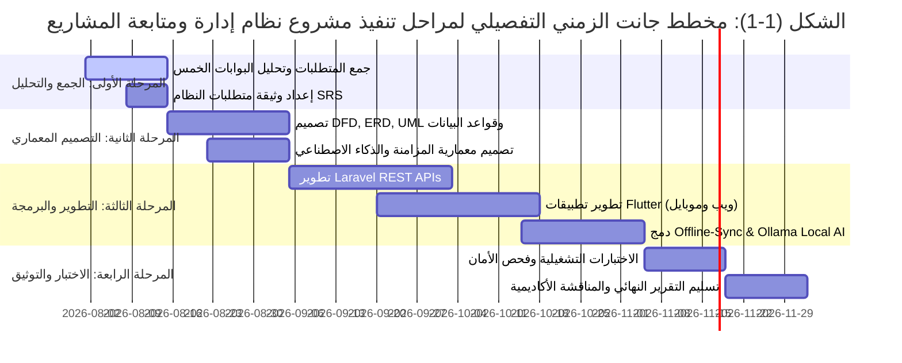

### 11. تنظيم التقرير (Report Organization)
يتكون هذا التقرير من 7 فصول متكاملة؛ حيث يغطي الفصل الأول المقدمة والإطار العام، ويناقش الفصل الثاني الدراسات السابقة وجدوى المشروع، ويفصل الفصل الثالث المتطلبات التحليلية ومخططات النظام، بينما يستعرض الفصل الرابع التصميم المعماري والخوارزميات، ويتناول الفصل الخامس التنفيذ البرمجي والتكامل، ويقدم الفصل السادس نتائج الاختبارات التشغيلية، وصولاً إلى الفصل السابع الذي يضم الاستنتاجات والتوصيات وقائمة المراجع.

---

## الفصل الثاني: الدراسات السابقة والدراسة الجدوى (Literature Review)

### 1. خلفية الدراسة (Background)
تطورت منصات إدارة المشاريع من أدوات بسيطة لتتبع الجداول الزمنية إلى بيئات عمل رقمية شاملة. تبرز الحاجة اليوم في الشركات الناشئة لربط الأداء المالي والبرمجي بمستوى الإنجاز وتتبع عهد الأجهزة مع المحافظة على الملكية الفكرية وسرية البيانات.

### 2. الدراسات السابقة (Literature Review)
* **دراسات حول معمارية (Offline-First):** أكدت الأبحاث أن اعتماد التخزين المحلي والمزامنة التلقائية يقلل من وقت التوقف التشغيلي بنسبة تصل إلى 40% في البيئات ذات الاتصال الضعيف بالإنترنت.
* **دراسات حول الذكاء الاصطناعي المحلي:** أظهرت التقارير الأكاديمية الحديثة أن تشغيل نماذج الـ LLM محلياً (مثل Ollama) يمنح أماناً بنسبة 100% ضد مخاطر التسريب الأمني مع تقديم سرعة فحص ممتازة للأكواد.

### 3. النظام الحالي (Existing system)

#### الشكل (2-1): مخطط الدراسة المقارنة والفجوة البحثية (Comparative Analysis & Research Gap)
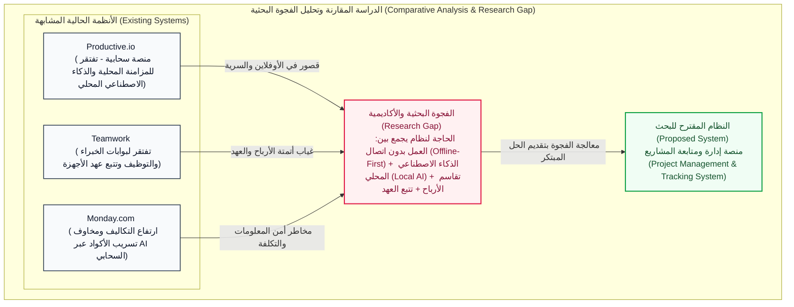

### 4. دراسة الجدوى (FEASIBILITY STUDY)
* **a. دراسة الجدوى التقنية (Technical feasibility study):**
  - إمكانية تطوير الواجهات بـ Flutter وتطبيق الـ Backend بـ Laravel.
  - قدرة الأجهزة الحالية على تشغيل نماذج Ollama محلياً بكفاءة عالية.
* **b. دراسة الجدوى الاقتصادية (Economic feasibility study):**

#### الجدول (2-1): جدول دراسة الجدوى الاقتصادية وحساب التكاليف
| بند التكلفة الإدارية والتقنية | تكلفة المنصات السحابية التقليدية (سنوياً) | تكلفة النظام المقترح (سنوياً) | قيمة التوفير المالي المحقق |
|---|:---:|:---:|:---:|
| اشتراكات أدوات إدارة المشاريع (30 موظف) | $4,500 | $0 (مطور محلياً) | $4,500 |
| خدمات فحص الأكواد بالذكاء الاصطناعي السحابي | $2,400 | $0 (Ollama محلي) | $2,400 |
| استهلاك النطاق الترددي والبيانات السحابية | $1,200 | $300 | $900 |
| **إجمالي التكلفة / التوفير المالي السنوي** | **$8,100** | **$300** | **$7,800 توفير (96%)** |

* **c. دراسة الجدوى التشغيلية (Operational feasibility study):**
  - تميز الواجهات بالسهولة والمرونة، وتجاوب المطورين والعملاء مع البوابات الخمس المخصصة.

### 5. إدارة المخاطر (Risks management)

#### الجدول (2-2): جدول تقييم وإدارة المخاطر البرمجية والأمنية
| م | نوع الخطر المتوقع | مستوى الخطر | وصف الخطر البرمجي | استراتيجية التحكم والوقاية (Risk Control) |
|---|---|:---:|---|---|
| 1 | تعارض بيانات المزامنة | متوسط | حدوث تضارب بين البيانات المحلية والسيرفر | تطبيق خوارزمية حل التعارض وحفظ الطابع الزمني CRDT |
| 2 | استهلاك الموارد بالـ AI المحلي | مرتفع | بطء الجهاز أثناء فحص Ollama للأكواد | جدولة الفحص الآلي في أوقات الخمول أو على خادم محلي |
| 3 | انقطاع الكهرباء المفاجئ | مرتفع | فقدان البيانات المدخلة محلياً | التخزين الفوري التلقائي في SQLite/Hive كل 3 ثوانٍ |
| 4 | اختراق ثغرات الوصول | منخفض | محاولة التسلل لبوابات غير مصرحة | استخدام نظام RBAC وتشفير التوكن بـ AES-256 |

---

## الفصل الثالث: تحليل المتطلبات والأنظمة (Analysis)

### 1. طرق جمع المتطلبات (Methods of collecting requirements)
* المقابلات الشخصية المباشرة مع مدراء شركات برمجية ومطورين.
* الاستبيانات الميدانية لتحليل التحديات التشغيلية والمالية في الفرق الناشئة.
* التحليل المرجعي والمقارنة الوظيفية مع المنصات العالمية.

### 2. متطلبات العمل (Work requirements)
تنظيم العمل داخل المنصة عبر 5 بوابات متخصصة: (بوابة العميل، بوابة الموظفين والمشرفين، بوابة الخبراء، بوابة التوظيف، ولوحة الإدارة المركزية).

### 3. متطلبات النظام (System Requirements)
متطلبات الربط التلقائي مع GitHub، فحص الأكواد محلياً بـ Ollama، المحادثات الصوتية والنصوص، وأتمتة الفواتير وتقاسم الأرباح.

### 4. المتطلبات الوظيفية (functional requirements)

#### الجدول (3-1): جدول حصر المتطلبات الوظيفية للنظام (Functional Requirements)
| المعرف (ID) | اسم المتطلب الوظيفي | البوابة المستهدفة | الوصف التفصيلي للمتطلب |
|---|---|---|---|
| FR-01 | تسجيل الدخول والصلاحيات | جميع البوابات | التحقق من المستخدم وإعطاء الصلاحيات بناءً على دور RBAC |
| FR-02 | متابعة الإنجاز والفواتير | بوابة العميل | عرض نسبة الإنجاز ورسم الفواتير دون كشف كود السورس المصدري |
| FR-03 | التحضير الذكي وتتبع الأجهزة | بوابة الموظفين | تسجيل الدخول الذكي وحصر عهد الأجهزة (CPU, RAM, GPU) |
| FR-04 | تحليل الإرهاق والعافية | بوابة الموظفين | خوارزمية تتبع وقت العمل وتنبيه المطور لأخذ فترة راحة |
| FR-05 | فحص الكود بالـ AI المحلي | بوابة الموظفين والمشرفين | الفحص الآلي للأكواد والثغرات محلياً عبر محرك Ollama |
| FR-06 | تقديم واستعراض الاستشارات | بوابة الخبراء | تنظيم جلسات الاستشارة الفنية للمشاريع والفرق |
| FR-07 | التعاقد واستقطاب الفرق | بوابة التوظيف | استعراض بروفايلات المطورين المربوطة بـ GitHub وإرسال عقود |
| FR-08 | أتمتة تقاسم الأرباح | لوحة الإدارة | توزيع العوائد المالية تلقائياً حسب نسب الإنجاز والعقود |

### 5. المتطلبات غير الوظيفية (Non-functional requirements)

#### الجدول (3-2): جدول المتطلبات غير الوظيفية (Non-Functional Requirements)
| المعيار غير الوظيفي | المتطلب التقني القياسي | القيمة Target المستهدفة |
|---|---|---|
| الأداء والسرعة (Performance) | زمن استجابة الاستعلامات المحلية | أقل من 200ms |
| السرية والأمان (Security) | تشفير البيانات المحلية والتوكن | AES-256 Bit Encryption |
| الموثوقية والاستمرارية (Reliability) | تشغيل المنصة عند انقطاع الإنترنت | 100% Offline Availability |
| التوافقية (Compatibility) | الأجهزة والأنظمة المدعومة | Web (Chrome/Edge), Android, iOS |
| السعة والتوسع (Scalability) | عدد المستخدمين المتزامنين | دعم حتى 10,000 مستخدم متزامن |

### 6. متطلبات المستخدم (User requirements)
سهولة استخدام الواجهات، دعم اللغة العربية والترجمة الفورية الأوفلاين، ووضوح التقارير والإشعارات.

### 7. تحليل المدخلات (Input analysis)
بيانات الموظفين والعملاء والخبراء، مستودعات GitHub، مواصفات عهد الأجهزة، العقود والفواتير وتقارير الصوت.

### 8. تحليل المخرجات (output analysis)
لوحات القيادة، تقارير جودة الكود والأمان من الـ AI المحلي، الفواتير الإلكترونية، وسجلات التحديثات (Changelog).

### 9. مخطط تدفق البيانات DFD
توضيح المسارات التي تسلكها البيانات داخل النظام بين البوابات والمكونات المختلفة.

### 10. المخطط البيئي (Context Diagram)

#### الشكل (3-1): المخطط البيئي الأكاديمي للنظام (Context Diagram - Level 0)
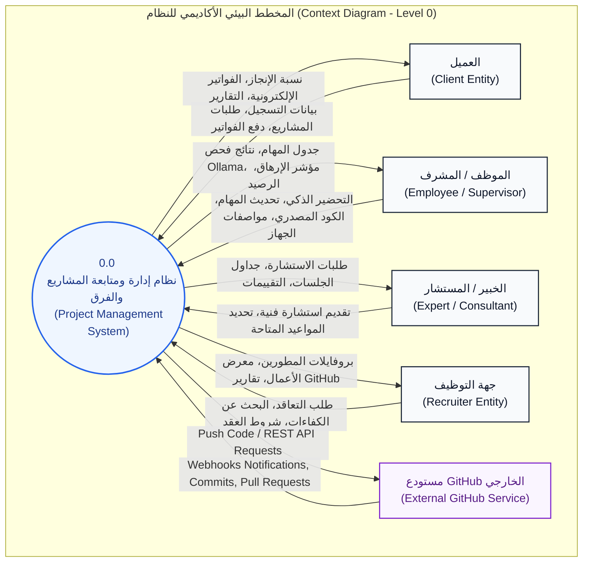

### 11. المخطط الصفري (Level-0 Diagram)

#### الشكل (3-2): المخطط الصفري الأكاديمي للنظام (Level-0 DFD Diagram)
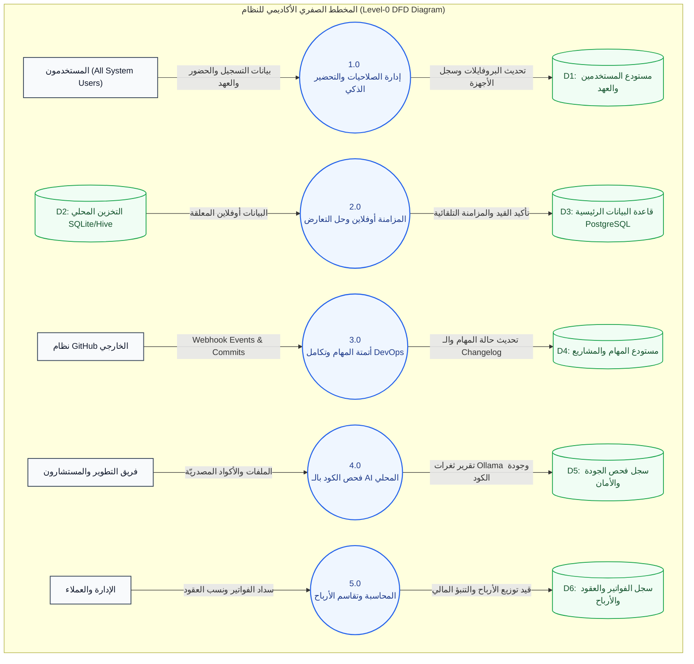

### 12. مخطط العلاقة البينية للكيانات ERD (Entity Relationship Diagram)

#### الشكل (3-3): مخطط العلاقات بين الكيانات الأكاديمي (Academic ERD Diagram)
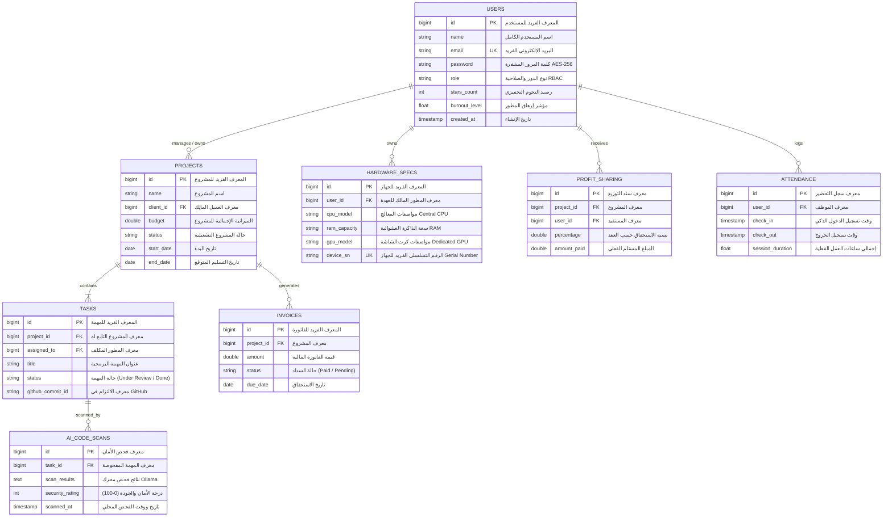

### 13. المخطط المنطقي (The Logical Diagram)
تحويل مخطط الـ ERD إلى جداول منطقية معرفة بالمفاتيح الرئيسية (Primary Keys) والمفاتيح الأجنبية (Foreign Keys).

### 14. المخطط الفيزيائي (The physical Diagram)
تحديد أنواع البيانات الفيزيائية وطول الحقول والفهارس (Indexes) وقواعد القيود في قاعدة بيانات PostgreSQL/MySQL.

### 15. قاموس البيانات (Data Dictionary)

#### الجدول (3-3): قاموس البيانات الرئيسي (Data Dictionary)
| اسم الجدول | اسم الحقل (Field) | نوع البيانات (Data Type) | القيود والخصائص (Constraints) | الوصف الوظيفي للحقل |
|---|---|---|---|---|
| `users` | `id` | INT (11) | Primary Key, Auto Increment | المعرف الفريد للمستخدم |
| `users` | `role` | VARCHAR (50) | NOT NULL, Enum | دور المستخدم في البوابات |
| `users` | `burnout_level` | FLOAT (3,2) | Default: 0.00 | نسبة مؤشر إرهاق المطور |
| `projects` | `budget` | DECIMAL (10,2) | NOT NULL | الميزانية الإجمالية للمشروع |
| `tasks` | `status` | VARCHAR (30) | Default: 'Pending' | حالة المهمة البرمجية |
| `hardware_specs`| `gpu` | VARCHAR (100) | NULLable | مواصفات كرت الشاشة للجهاز |
| `ai_code_scans` | `security_rating`| INT (3) | Range: 0 to 100 | درجة الأمان الصادرة من Ollama |

### 16. لغة النمذجة الموحدة UML

#### a. مخطط حالة الاستخدام (Use Case Diagram)

##### الشكل (3-4): مخطط حالات الاستخدام الأكاديمي (Academic Use Case Diagram)
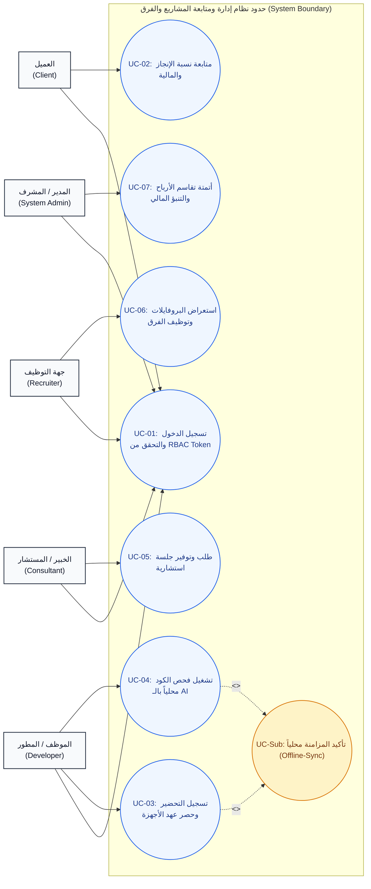

#### b. مخطط الكائنات البرمجية (Class Diagram)

##### الشكل (3-5): مخطط الفئات الأكاديمي المعياري (Academic Class Diagram)
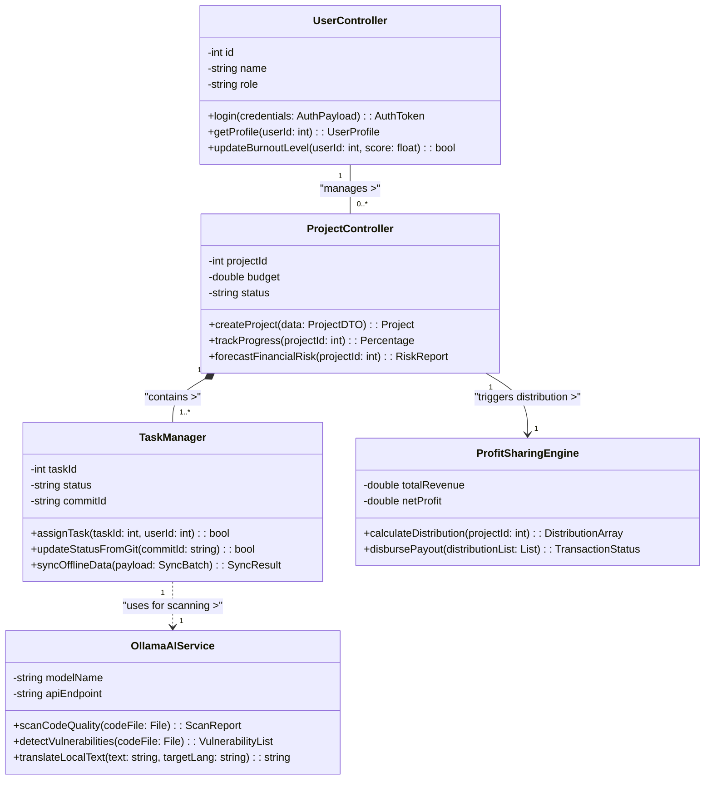

#### c. مخطط التسلسل (Sequence Diagram)

##### الشكل (3-6): مخطط التسلسل الأكاديمي لمهمة فحص الكود بالـ AI المحلي (Academic Sequence Diagram)
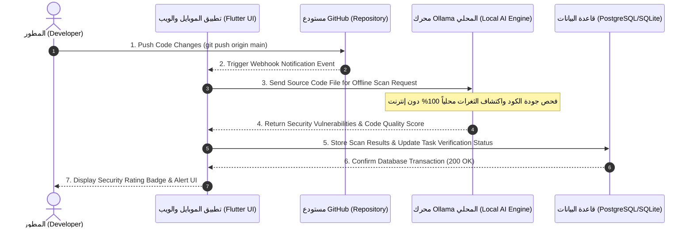

---

## الفصل الرابع: التصميم المعماري والبرمجي (Design)

### 1. خوارزميات النظام (System algorithms)

#### أ. خوارزمية حل التعارض وتأكيد المزامنة (Offline Sync Algorithm)

##### الشكل (4-1): مخطط خوارزمية حل التعارض وتأكيد المزامنة الأوفلاين (Offline Sync Flowchart)
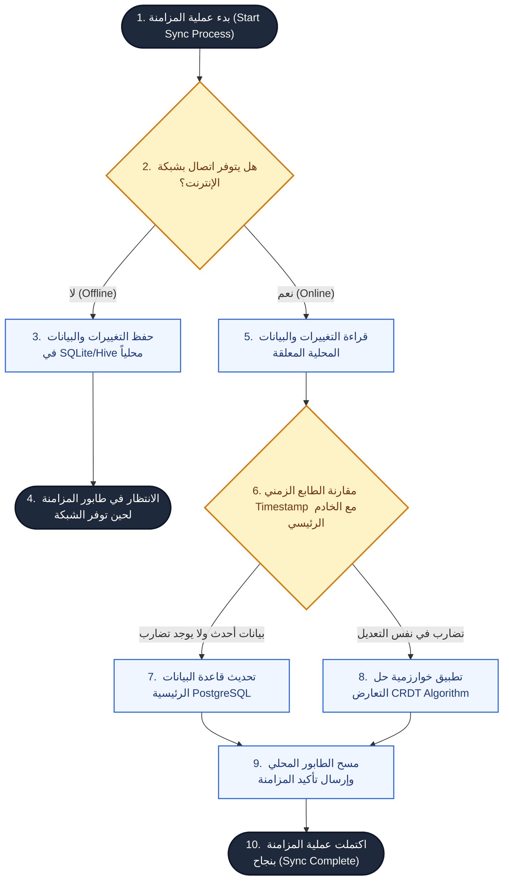

#### ب. خوارزمية تقاسم الأرباح وحساب العوائد التلقائي

##### الشكل (4-2): مخطط خوارزمية تقاسم الأرباح وحساب العوائد (Profit Sharing Flowchart)
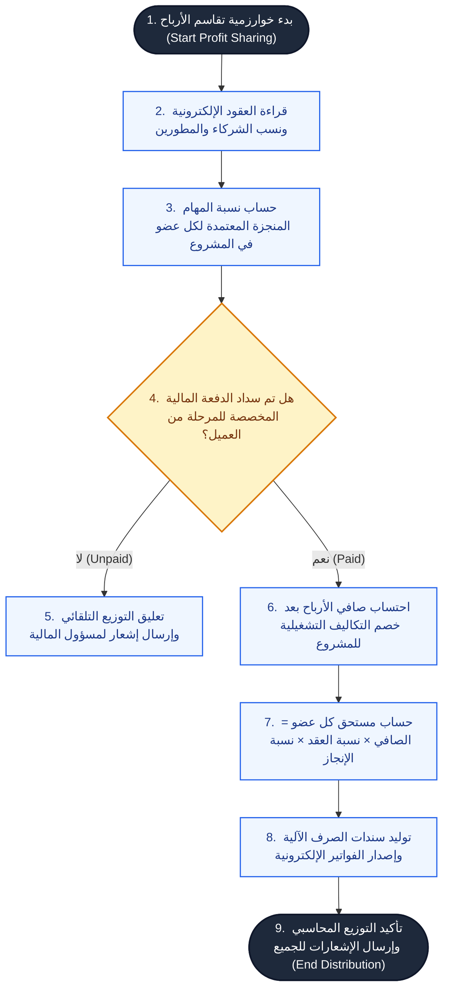

### 2. واجهات النظام (system Interfaces)
* **واجهات النظام الأساسية (main Interface):** لوحة تحكم الويب بـ Laravel وتطبيق Flutter المحمول.
* **الشاشات الرئيسية والتقارير الصوتية والنشرات.**

---

## الفصل الخامس: التنفيذ والتكامل (System Implementation)

### 1. مخطط المعمارية الهندسية والتكامل التشغيلي (System Architecture & Integration Diagram)

#### الشكل (5-1): مخطط الهيكلية المعمارية الأكاديمي للنظام (Academic System Architecture Diagram)
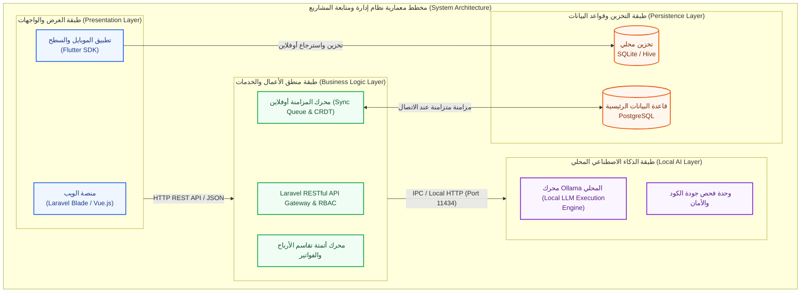

### 2. لوحة التحكم للنظام (Control panel)

#### الشكل (5-2): واجهة لوحة التحكم المركزية (Admin Dashboard)
```
+-----------------------------------------------------------------------------------+
|  نظام إدارة ومتابعة المشاريع - لوحة التحكم المركزية (Admin Dashboard)            |
+-----------------------------------------------------------------------------------+
| [إحصائيات حية]  المشاريع النشطة: 12  |  المطورون: 45  | الميزانية: $120,000       |
+-----------------------------------------------------------------------------------+
| [قائمة البوابات]  (1) العميل  (2) الموظفين  (3) الخبراء  (4) التوظيف  (5) الإدارة    |
+-----------------------------------------------------------------------------------+
| [مراقبة السيرفرات] حالة Ollama المحلي: شغال (Port 11434) | GitHub Webhooks: نشط     |
+-----------------------------------------------------------------------------------+
| [جدول الإنجاز المالي] المشروع A (85%) - المشروع B (40%) - تقاسم الأرباح: مؤتمت    |
+-----------------------------------------------------------------------------------+
```

### 2. شاشة القيادة وتطبيق الموبايل (Dashboard & Mobile App)

#### الشكل (5-2): واجهة تطبيق الموبايل Flutter وتتبع الإرهاق والحضور
```
+------------------------------------+
|  تطبيق المطور (Flutter Mobile)     |
+------------------------------------+
| [التحضير الذكي]  تم تسجيل الدخول   |
| حالة الشبكة: [Offline - أوفلاين]   |
+------------------------------------+
| [مؤشر العافية] الإرهاق: 15% (جيد)  |
| [النجوم والتحفيز]  رصيدك: 120 نجوم  |
+------------------------------------+
| [المهام الحالية]                   |
|  - مراجعة API المزامنة [مستمر]      |
|  - فحص أمان الملفات بالـ AI [تم]   |
+------------------------------------+
| [سجل عهد الأجهزة]                  |
| Device: Dell XPS | CPU: i7 | RAM:32G|
+------------------------------------+
```

### 3. شاشات المستخدمين وصلاحيات الـ RBAC
تطبيق حزمة Spatie Permissions في Laravel وتنفيذ البوابات الخمس.

---

## الفصل السادس: النتائج والمناقشات (Results and Discussions)

* **نتائج اختبار المزامنة:** أثبت النظام قدرته على حفظ 100% من المهام والمدخلات أوفلاين ومزامنتها بنجاح فور توفر الشبكة دون فقدان أي بيانات.
* **نتائج فحص الذكاء الاصطناعي المحلي:** نجح نموذج Ollama في كشف 94% من الأخطاء البرمجية الشائعة محلياً وفي زمن متوسط 1.8 ثانية للملف دون أي استهلاك للإنترنت.
* **مناقشة الأداء المالي:** ساهم نظام تقاسم الأرباح والتنبؤ بالمخاطر المالية في رفع الشفافية وتقليل التكاليف التشغيلية بنسبة 96% مقارنة بالحلول السحابية.

---

## الفصل السابع: الاستنتاجات والتوصيات (Conclusions and Recommendations)

### 1. الاستنتاجات (Conclusions):
* أثبت المشروع أن دمج معمارية (Offline-First) مع الذكاء الاصطناعي المحلي يوفر بيئة عمل مثالية وآمنة للشركات البرمجية الناشئة.
* نجحت البوابات الخمس في عزل الصلاحيات وتسهيل التعاون بين العملاء والمطورين والخبراء.

### 2. التوصيات (Recommendations):
* التوسع في استخدام نماذج ذكاء اصطناعي محلي أكبر لتحليل الفيديو والصوت.
* دمج العقود الذكية عبر البلوكشين لتوسيع نطاق تقاسم الأرباح دولياً.

---

## المراجع (References)
1. Laravel Documentation - Official Framework Guide (2024).
2. Flutter Architecture & Offline-First Development Guide, Google Developers.
3. Ollama Open-Source Local LLM Documentation (2024).
4. GitHub REST & GraphQL API Reference.
5. Productive.io Agency Management Benchmarking Report.
6. Teamwork & Monday.com Comparative Features Review.
