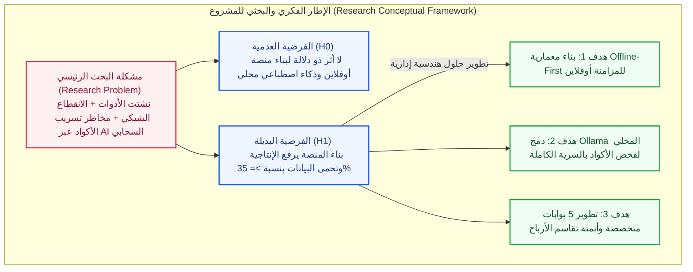
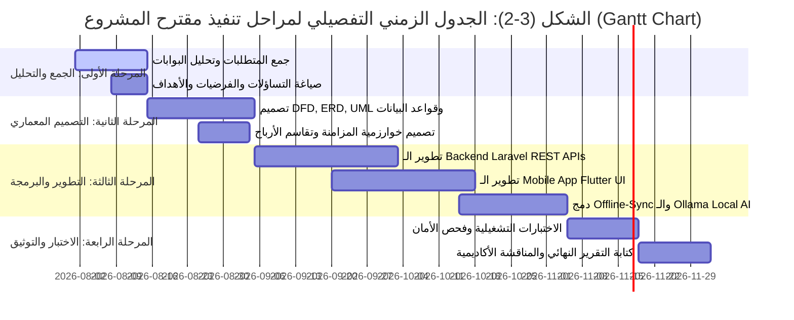

# خطة البحث والتصور المستقبلي لمشروع التخرج (Research Proposal & Plan)
## مشروع: نظام إدارة ومتابعة المشاريع
### (Project Management and Tracking System)

* **الكلية والقسم:** كلية العلوم الإدارية - قسم نظم المعلومات الإدارية (MIS)
* **المستوى الأكاديمي:** السنة الرابعة (مشروع التخرج)
* **العام الجامعي / التخرج:** 2026 / 2027م
* **إشراف الدكتور:** د. خالد المسوري

---

## 1. عنوان البحث المقترح والقواعد المتبعة (Project Title)

### العنوان المعتمد للمشروع:
> **"نظام ذكي متكامل لإدارة ومتابعة المشاريع يعتمد معمارية العمل بدون اتصال والذكاء الاصطناعي المحلي"**
> *(باللغة الإنجليزية: Project Management and Tracking System - Offline-First Architecture & Local AI Integration).*

### القواعد الأكاديمية الواجب مراعاتها في العنوان (تطبيقاً للمحاضرة الثانية):
1. **عدد الكلمات:** 13 كلمة (فضل ألا يزيد عن 15 كلمة لضمان الإيجاز والتركيز).
2. **الوضوح والشمولية:** يعبر بوضوح عن طبيعة النظام (إدارة ومتابعة المشاريع) وتقنياته الأساسية (Offline-First والذكاء الاصطناعي المحلي).
3. **تجنب العمومية:** تحديد الأبعاد التقنية والإدارية للمنصة بوضوح دون ألقاب أو عبارات فضفاضة.

---

## 2. مصادر اختيار وتطوير فكرة البحث

تم استخلاص وتطوير فكرة مشروع **"نظام إدارة ومتابعة المشاريع"** استناداً إلى المصادر الأكاديمية والعملية التالية:
1. **الاستطلاع والقراءات الأكاديمية الأولية:** مراجعة رسائل الماجستير والدكتوراه والبحوث المنشورة في مجال نظم المعلومات الإدارية (MIS) وحوسبة بيئات العمل الرقمية.
2. **التقارير والإحصائيات الصادرة:** الاطلاع على تقارير الخسائر الناتجة عن توقف الشبكات وانقطاع الإنترنت وتأثير ذلك على إنتاجية الشركات البرمجية الناشئة.
3. **آراء الخبراء والمختصين:** استشارة المشرف الأكاديمي **د. خالد المسوري** وعدد من المدراء والمطورين في الشركات البرمجية للوقوف على الاحتياجات الفعلية لسوق العمل.
4. **التكليف والحاجة الميدانية:** تزايد الطلب على حلول إدارية مرنة تضمن الشفافية المالية مع العملاء وحماية الملكية الفكرية.

---

## 3. مقدمة البحث (Introduction)

يشهد قطاع نظم المعلومات الإدارية والتحول الرقمي تطوراً متسارعاً، حيث باتت إدارة المشاريع والفرق البرمجية تعتمد بشكل كلي على المنصات الرقمية لضمان متابعة الأداء وضبط التكاليف. غير أن الاعتماد مطلقاً على المنصات السحابية أوجد ثغرات تشغيلية حرجة، أبرزها توقف العمل أثناء انقطاع شبكة الإنترنت، ومخاطر تسريب البيانات والأكواد المصدريّة عند معالجتها بواسطة الذكاء الاصطناعي السحابي الخارجي.

من هنا، تتجلى أهمية هذا المشروع في تقديم حل إداري وتقني متكامل (تطبيق ويب وتطبيق هاتف محمول) يجمع بين الإدارة المتقدمة للمشاريع، معمارية **(Offline-First)** للحفاظ على استمرارية العمل، ومحرك ذكاء اصطناعي محلي **(Ollama)** للفحص التلقائي وتأمين البيانات، إلى جانب 5 بوابات متخصصة وآليات مؤتمتة لتقاسم الأرباح وتتبع العهد والأجهزة.

---

## 4. تحديد وصياغة مشكلة البحث (Problem Statement)

### صياغة المشكلة:
تتلخص مشكلة البحث في تشتت أدوات إدارة الأعمال، وتوقف إنتاجية الفرق والمطورين عند انقطاع الإنترنت، ومخاطر الأمن السيبراني وتسريب الأكواد عند الاعتماد على الذكاء الاصطناعي السحابي، بالإضافة إلى غياب الشفافية في تقييم الإنجاز وآليات تقاسم الأرباح في الشركات الناشئة.

### الفرق العلمي بين السؤال والتساؤل (تطبيقاً للمحاضرة الثالثة):
* **السؤال:** يستدعي معارف سابقة معلومة محددة.
* **التساؤل البحثي:** يدور حول قضية غير حتمية تتأرجح بين الاحتمالات وتحتاج إلى تقصٍّ وأدلة وبراهين لإثباتها.

### التساؤل الرئيسي للدراسة:
> **كيف يمكن لبناء منصة إدارية متكاملة تعتمد معمارية (Offline-First) والذكاء الاصطناعي المحلي (Local AI) أن يعزز استمرارية العمل، يرفع الإنتاجية، ويحمي بيانات الشركات البرمجية الناشئة؟**

### التساؤلات الفرعية للبحث:
1. ما مدى فاعلية معمارية العمل بدون اتصال (Offline-First) في ضمان عدم توقف العمل على المهام وحل تعارض البيانات تلقائياً فور إعادة الاتصال؟
2. كيف يسهم دمج الذكاء الاصطناعي المحلي (Ollama) في فحص جودة الأكواد والملفات دون المساس بالسرية والملكية الفكرية للشركة؟
3. ما هو دور البوابات المتخصصة الخمس (العميل، الموظفون، الخبراء، التوظيف، الإدارة) في تلبية احتياجات جميع الأطراف وتسهيل اتخاذ القرار؟
4. كيف توفر المنصة نظاماً محاسبياً مؤتمتاً لتقاسم الأرباح والتنبؤ بالمخاطر المالية للمشاريع؟
5. ما أثر نظام تتبع عهد الأجهزة ومحلل الإرهاق والعافية على المحافظة على سلامة المطورين وتحفيزهم؟

---

## 5. أهداف البحث (Research Objectives)

1. **تطوير نظام إدارة ومتابعة متكامل:** تصميم وتطوير تطبيق ويب (Laravel) وتطبيق موبايل (Flutter) متوافق مع كافة البيئات التشغيلية.
2. **تحقيق المزامنة غير المتصلة (Offline Sync Engine):** تمكين المستخدمين من أداء المهام بالكامل دون إنترنت، ومزامنة التغييرات تلقائياً دون فقدان للبيانات.
3. **توطين الذكاء الاصطناعي المحلي (Local AI Integration):** دمج نماذج Ollama للتحليل الفوري للأكواد والترجمة والتخطيط دون الاعتماد على خوادم سحابية خارجية.
4. **بناء 5 بوابات مستخدمين مخصصة:**
   - **بوابة العميل:** للشفافية وتتبع الفواتير بدون كشف التوثيق الداخلي.
   - **بوابة الموظفين والمشرفين:** للتحضير الذكي، تتبع الإرهاق، وتحديد عهد ومواصفات الأجهزة.
   - **بوابة الخبراء والمستشارين:** لإدارة الجلسات الاستشارية والمشاريع.
   - **بوابة التوظيف:** لاستقطاب الكفاءات والتعاقد مع الفرق.
   - **لوحة الإدارة المركزية:** لمراقبة الميزانيات، الإنجاز، وأداء السيرفرات.
5. **أتمتة العمليات المالية والتقنية:** أتمتة تقاسم الأرباح، إدارة الفواتير، التنبؤ بالمخاطر، والتكامل المباشر مع GitHub و DevOps.

---

## 6. أهمية البحث (Research Importance)

* **الأهمية العلمية والتقنية:** تقديم نموذج تطبيقي في مجال نظم المعلومات الإدارية يثبت كفاءة دمج الـ Local LLM الموزع محلياً مع معمارية Offline-First.
* **الأهمية الاقتصادية والإدارية:** توفير تكاليف الاشتراكات السحابية، حماية أمن البيانات، وتحسين عملية اتخاذ القرار الإداري والمالي في الشركات الناشئة.

---

## 7. فرضيات البحث (Research Hypotheses)

* **الفرضية الرئيسية ($H_0$):** لا يوجد أثر ذو دلالة إحصائية وتطبيقية لاستخدام منصة إدارية تعتمد المزامنة المحتاجة محلياً والذكاء الاصطناعي المحلي في زيادة إنتاجية الشركات البرمجية وحماية بياناتها.
* **الفرضية البديلة ($H_1$):** يوجد أثر إيجابي جوهري لاستخدام المنصة المعتمدة على المزامنة المحتاجة محلياً والذكاء الاصطناعي المحلي في زيادة الإنتاجية التشغيلية وحماية البيانات بنسبة لا تقل عن 35%.

#### الشكل (3-1): مخطط هيكلية المشكلة والفرضيات والأهداف البحثية (Research Framework & Hypotheses Model)

---

## 8. حدود ونطاق البحث (Project Scope & Limitations)

1. **الحدود الموضوعية:** يقتصر النظام على تقديم خدمات إدارة ومتابعة المشاريع، المزامنة غير المتصلة، الذكاء الاصطناعي المحلي، وتكامل GitHub والمالية.
2. **الحدود المكانية:** الشركات البرمجية الناشئة، الوكالات الرقمية، والفرق البرمجية المستقلة.
3. **الحدود الزمنيّة:** العام الجامعي 2026 / 2027م.
4. **الحدود الأكاديمية:** مشروع تخرج بكالوريوس - قسم نظم المعلومات الإدارية (MIS) - تحت إشراف **د. خالد المسوري**.

---

## 9. المنهجية والأدوات والجدول الزمني (Gantt Chart)

#### الشكل (3-2): الجدول الزمني التفصيلي لمراحل التنفيذ (Gantt Chart)

### الأدوات والتقنيات المعيارية:
* **Backend Framework:** Laravel (PHP 8.2+)
* **Mobile & Frontend:** Flutter SDK (Dart)
* **Local AI Framework:** Ollama Local Runner
* **Database Engine:** PostgreSQL / SQLite
* **Version Control & DevOps:** GitHub Webhooks & REST API
