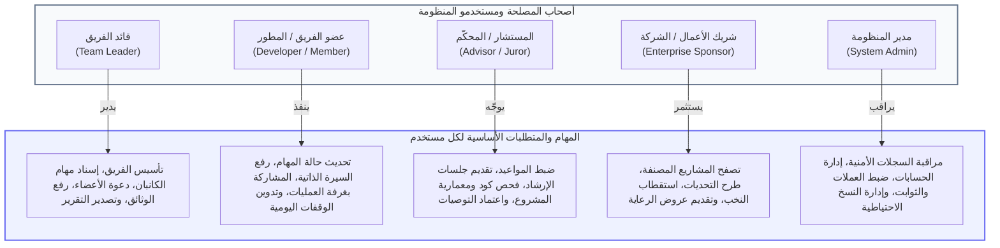
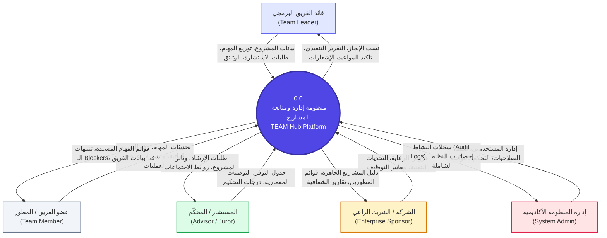
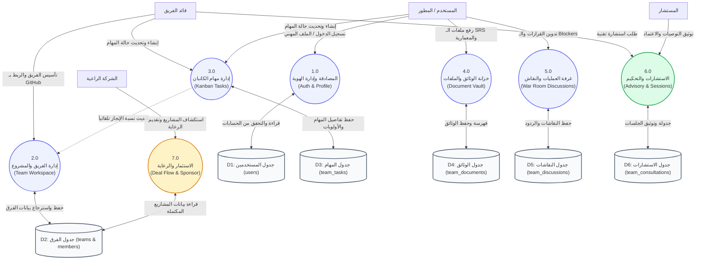
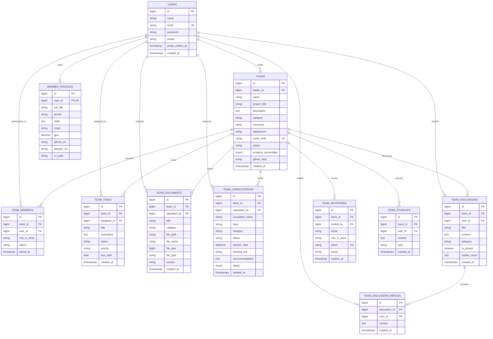
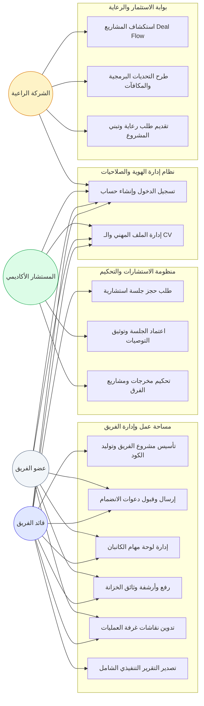
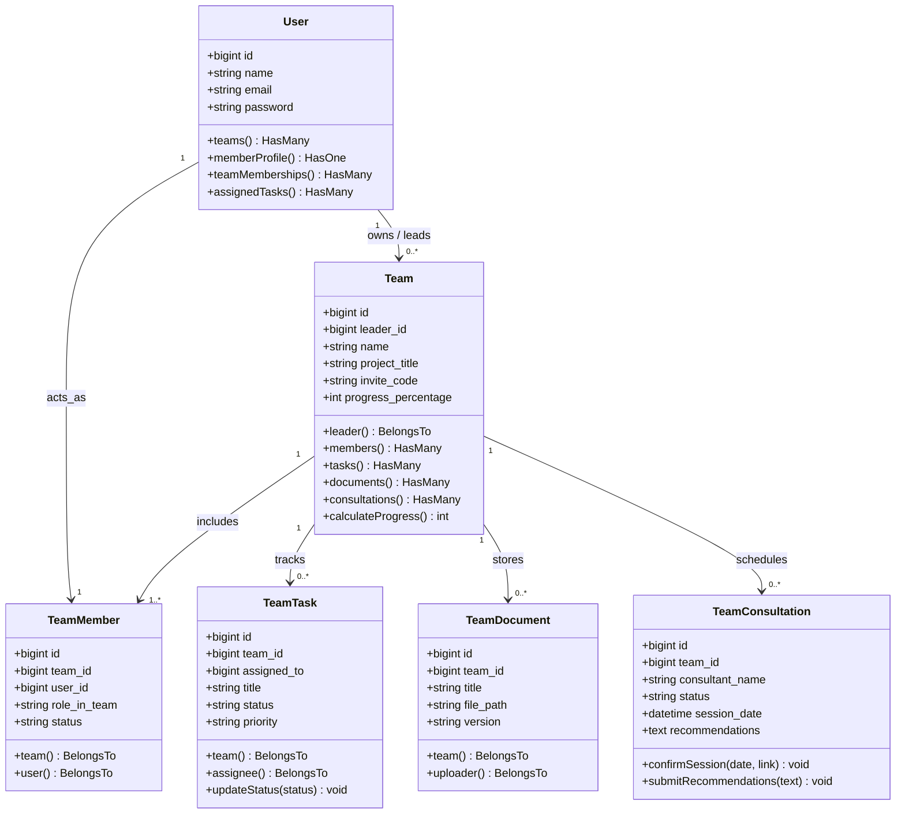
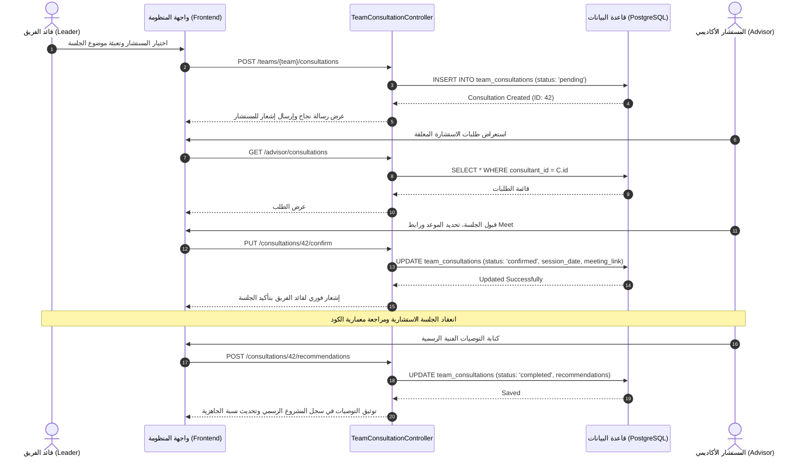
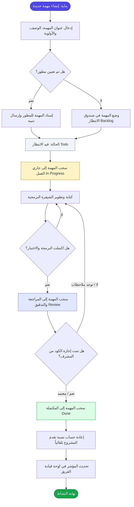
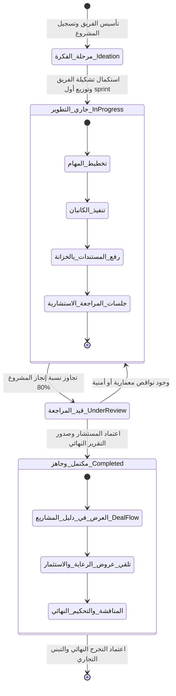

# الفصل الثالث: التحليل الهندسي ومتطلبات النظام (Analysis)

> **مشروع التخرج:** منصة ومسرعة المشاريع التقنية والريادية المتكاملة (**TEAM Hub / PMTS**)  
> **التخصص:** نظم معلومات إدارية (MIS) & هندسة البرمجيات  
> **العام الجامعي:** 2026 / 2027م  
> **إطار العمل والتقنيات:** Laravel 12 (PHP 8.2+) | TailwindCSS | Alpine.js | PostgreSQL / SQLite | Offline-First Sync

---

## 📑 فهرس محتويات الفصل الثالث

1. [1. طرق جمع المتطلبات (Methods of Collecting Requirements)](#1-طرق-جمع-المتطلبات-methods-of-collecting-requirements)
2. [2. متطلبات العمل وقواعد الحوكمة (Work Requirements / Business Rules)](#2-متطلبات-العمل-وقواعد-الحوكمة-work-requirements--business-rules)
3. [3. متطلبات النظام الفنية (System Requirements)](#3-متطلبات-النظام-الفنية-system-requirements)
   - [أولاً: متطلبات العتاد (Hardware Requirements)](#أولا-متطلبات-العتاد-hardware-requirements)
   - [ثانياً: متطلبات البرمجيات وبيئة التشغيل (Software Requirements)](#ثانيا-متطلبات-البرمجيات-وبيئة-التشغيل-software-requirements)
4. [4. المتطلبات الوظيفية (Functional Requirements)](#4-المتطلبات-الوظيفية-functional-requirements)
5. [5. المتطلبات غير الوظيفية (Non-Functional Requirements)](#5-المتطلبات-غير-الوظيفية-non-functional-requirements)
6. [6. متطلبات المستخدمين حسب الأدوار (User Requirements)](#6-متطلبات-المستخدمين-حسب-الأدوار-user-requirements)
7. [7. تحليل المدخلات (Input Analysis)](#7-تحليل-المدخلات-input-analysis)
8. [8. تحليل المخرجات (Output Analysis)](#8-تحليل-المخرجات-output-analysis)
9. [9. مخطط تدفق البيانات (Data Flow Diagrams - DFD)](#9-مخطط-تدفق-البيانات-data-flow-diagrams---dfd)
10. [10. المخطط البيئي العام (Context Diagram - Level 0 DFD)](#10-المخطط-البيئي-العام-context-diagram---level-0-dfd)
11. [11. المخطط الصفري التفصيلي (Level-0 Process Diagram)](#11-المخطط-الصفري-التفصيلي-level-0-process-diagram)
12. [12. مخطط العلاقة البينية للكينونات (ERD - Entity Relationship Diagram)](#12-مخطط-العلاقة-البينية-للكينونات-erd---entity-relationship-diagram)
13. [13. المخطط المنطقي لقاعدة البيانات (The Logical Schema & Normalization)](#13-المخطط-المنطقي-لقاعدة-البيانات-the-logical-schema--normalization)
14. [14. المخطط الفيزيائي لقاعدة البيانات (The Physical Database Schema)](#14-المخطط-الفيزيائي-لقاعدة-البيانات-the-physical-database-schema)
15. [15. قاموس البيانات الشامل (Data Dictionary)](#15-قاموس-البيانات-الشامل-data-dictionary)
16. [16. لغة النمذجة الموحدة (UML - Unified Modeling Language)](#16-لغة-النمذجة-الموحدة-uml---unified-modeling-language)
    - [a. مخطط حالات الاستخدام (Use Case Diagram)](#a-مخطط-حالات-الاستخدام-use-case-diagram)
    - [b. مخطط الفئات والكائنات (Class Diagram)](#b-مخطط-الفئات-والكائنات-class-diagram)
    - [c. مخطط التتابع والتفاعل الزمني (Sequence Diagram)](#c-مخطط-التتابع-والتفاعل-الزمني-sequence-diagram)
    - [d. مخطط النشاط وسير العمليات (Activity Diagram)](#d-مخطط-النشاط-وسير-العمليات-activity-diagram)
    - [e. مخطط الحالة ودورة حياة الكيانات (State Machine Diagram)](#e-مخطط-الحالة-ودورة-حياة-الكيانات-state-machine-diagram)

---

## 1. طرق جمع المتطلبات (Methods of Collecting Requirements)

اعتمد فريق العمل منهجية علمية وميدانية متعددة المصادر لاستخلاص وتوثيق الاحتياجات الوظيفية والتقنية لمنظومة **TEAM Hub** لضمان تطابق الحل البرمجي مع واقع العمل الفعلي لأصحاب المصلحة:

### 1.1 المقابلات الشخصية الميدانية والموجّهة (Interviews)

عُقدت سلسلة من المقابلات المعمقة (شبه الموجهة Semi-Structured Interviews) مع الفئات المستهدفة:

- **الأكاديميون ومستشارو المشاريع (12 أستاذاً ومحكّماً):** للتعرف على المشاكل التي تواجههم في تقييم مخرجات الطلاب ومتابعة الـ Commits وتحديد مواعيد الاستشارات.
- **قادة ومطورو الفرق التقنية (25 طالباً ومطوراً):** لمناقشة عوائق توزيع المهام، ومشاكل استكمال الأعضاء ذوي التخصصات النادرة، وصعوبة حفظ الإصدارات والوثائق.
- **ممثلو قطاع الأعمال ومسؤولو التوظيف بالشركات البرمجية (8 شركات):** لتحديد معايير استقطاب النخب الطلابية، وكيفية طرح التحديات التجارية والرعاية المالية.

### 1.2 الاستبيان الإلكتروني المسحي (Questionnaires)

تم تصميم وتوزيع استبيان إحصائي موجّه لمجتمع كليات الحاسوب والشركات الناشئة؛ حيث تم جمع وتحليل **184 استجابة مكتملة**. وقد أظهرت النتائج:

- **89.2%** يعانون من تشتت الأدوات (استخدام Trello لمهام العمل، WhatsApp للمحادثات، Google Drive للوثائق، وZoom للاجتماعات).
- **78.4%** أكدوا انقطاع وتأخر التواصل مع المستشارين المشرفين لعدم وجود جدول مواعيد رسمي موثق.
- **93.5%** من الشركات أبدت رغبة ملحة في وجود منصة موحدة تستعرض المشاريع الجاهزة والمصنفة حسب قطاع الأعمال (FinTech, AI, HealthTech).

### 1.3 الملاحظة المباشرة ودراسة بيئة العمل الواقعية (Observation)

قام فريق التحليل بمراقبة جلسات المناقشة والتحكيم السنوية للمشاريع الجامعية وحضور فعاليات هاكاثونات تقنية؛ وتم تدوين الملاحظات حول:

- غياب التوثيق الفوري لتوصيات اللجان؛ مما يؤدي لفقدان الملاحظات البرمجية.
- الصعوبة في استعراض السير الذاتية (CVs) للمشاركين أثناء تقييم مشاريعهم.

### 1.4 فحص وتدقيق الوثائق والنماذج القائمة (Document Review)

تم جمع وفحص النماذج المعتمدة في إدارة المشاريع:

- نماذج مواصفات متطلبات البرمجيات المعتمدة (IEEE 830 SRS Templates).
- استمارات تحكيم وتقييم مشاريع التخرج الأكاديمية.
- عقود واتفاقيات رعاية المشاريع والمسؤولية المجتمعية (CSR).

---

## 2. متطلبات العمل وقواعد الحوكمة (Work Requirements / Business Rules)

تحدد قواعد العمل المنطق المؤسسي والتنظيمي (**Business Logic Rules - BR**) الذي يحكم جميع العمليات التفاعلية داخل النظام:

- **[BR-01] حوكمة تسجيل الفرق وقادتها:** لا يحق للمستخدم إنشاء أكثر من فريق نشط واحد كـ "قائد فريق" (Team Leader)، بينما يمكنه الانضمام كعضو في فرق أخرى شريطة قبول الدعوة الرسمية.
- **[BR-02] كود الانضمام السري وتأمين التشكيلة:** لكل فريق برمجية رمز سري فريد (Invite Code) مكوّن من 12 خانة عشوائية، لا يمكن لأي عضو الانضمام إلا عبر إدخال هذا الرمز أو عبر رابط دعوة مشفر مؤقت الصلاحية (7 أيام).
- **[BR-03] آلية احتساب نسبة إنجاز المشروع التلقائية:** تحسب نسبة التقدم المئوية للمشروع تلقائياً استناداً إلى معادلة أوزان المهام المكتملة في لوحة الكانبان:
  $$\text{Progress \%} = \left( \frac{\sum \text{Completed Tasks}}{\text{Total Tasks}} \times 0.6 \right) + \left( \frac{\text{Approved Documents}}{5} \times 0.4 \right) \times 100$$
- **[BR-04] تصنيف مهام الكانبان ودورة حياتها:** تمر أي مهمة برمجية بإلزامية الترتيب التسلسلي عبر أربع حالات: `Todo` -> `In Progress` -> `Review` -> `Done`، ولا يمكن نقل المهمة لحالة المكتملة إلا بعد تسجيل تاريخ الإنجاز وتحديد المطور المسؤول.
- **[BR-05] قواعد خزانة وثائق المشروع (Vault):** تخضع الملفات المرفوعة إلى تصنيف إلزامي (`Technical`, `Architecture`, `Pitch Deck`, `Reports`, `Agreements`) مع إلزامية وضع رقم الإصدار (Version Tagging) وحد أقصى لحجم الملف (15MB).
- **[BR-06] حوكمة الجلسات الاستشارية:** لا تكتمل الجلسة الاستشارية في سجل المشروع إلا بعد قيام الخبير بكتابة **التوصيات الفنية الرسمية**، وإدخال الفريق لتقييم الجلسة بالنجوم (1 إلى 5 نجوم).
- **[BR-07] قواعد الرعاية وحوكمة الشركات (Deal Flow):** لا يمكن للشركات الاطلاع على الشيفرة المصدرية المباشرة (Private Repositories) إلا بعد تقديم طلب رعاية رسمي وموافقة قائد الفريق الأكاديمي.

---

## 3. متطلبات النظام الفنية (System Requirements)

### أولاً: متطلبات العتاد (Hardware Requirements)

#### 1. متطلبات الخادم المركزي (Production Server Environment)

- **المعالج (CPU):** رباعي النوى بسرعة 2.5 GHz كحد أدنى (Quad-Core x86-64 / ARM64).
- **الذاكرة العشوائية (RAM):** 8 GB كحد أدنى (يوصى بـ 16 GB لتمكين نماذج الذكاء الاصطناعي المحلية ومعالجة التصدير).
- **سعة التخزين (Disk Storage):** 80 GB SSD NVMe لسرعة معالجة استعلامات قواعد البيانات والملفات المرفوعة.
- **الشبكة:** اتصال إنترنت عريض النطاق بسرعة رفع/تنزيل لا تقل عن 100 Mbps مع عنوان IP ثابت.

#### 2. متطلبات محطات عمل المستخدمين (Client Workstations & Devices)

- **أجهزة الحاسوب:** معالج ثنائي النواة 1.8 GHz، ذاكرة 4 GB RAM، دقة شاشة $1280 \times 720$ فما فوق.
- **الهواتف الذكية والأجهزة اللوحية:** أنظمة Android 10+ أو iOS 14+، ذاكرة 3 GB RAM.

### ثانياً: متطلبات البرمجيات وبيئة التشغيل (Software Requirements)

- **خادم الويب (Web Server):** Nginx 1.24+ أو Apache 2.4+ مع دعم بروتوكول HTTP/2 وSSL/TLS.
- **بيئة التشغيل والخلفية (Backend Stack):**
  - لغة البرمجة: PHP 8.2+ أو PHP 8.3 مع ملحقات (`pdo_pgsql`, `mbstring`, `bcmath`, `curl`, `intl`, `gd`).
  - إطار العمل الأساسي: **Laravel 12.x**.
- **نظام إدارة قواعد البيانات (DBMS):**
  - السيرفر المركزي: **PostgreSQL 16+** (أو MySQL 8.0+).
  - التخزين والمزامنة بدون اتصال (Offline Engine): **SQLite 3.4+ / IndexedDB**.
- **الواجهات الأمامية والمكتبات (Frontend Stack):**
  - معمارية التصميم: **TailwindCSS 3.4+ / Vite 7.x**.
  - التفاعل الحي: **Alpine.js 3.x** و **Blade Component Engine**.
- **المتصفحات المتوافقة:** Google Chrome 110+, Mozilla Firefox 115+, Microsoft Edge 110+, Apple Safari 16+.

---

## 4. المتطلبات الوظيفية (Functional Requirements)

تم ترقيم وصياغة المتطلبات الوظيفية وفقاً للمعيار الدولي بصيغة _"يجب على النظام أن يوفر..."_:

### 4.1 وحدة إدارة الهوية والمصادقة والصلاحيات (Auth & RBAC)

- **[FR-01]:** يجب أن يتيح النظام تسجيل حسابات جديدة وتصنيفها فورياً وفق المسارات الثلاثة: (فريق/مطور، شركة/شريك راعٍ، مستشار/خبير).
- **[FR-02]:** يجب توفير مصادقة آمنة عبر تشفير كلمات المرور باستخدام خوارزمية **Bcrypt / Argon2id** مع ميزة "تذكرني" وحماية من هجمات التخمين (Rate Limiting).
- **[FR-03]:** يجب تطبيق نظام صلاحيات وأدوار ديناميكي (Spatie RBAC) يفصل صلاحيات مدير النظام، وقائد الفريق، وعضو الفريق، والمستشار، وممثل الشركة.

### 4.2 وحدة إدارة مساحة عمل الفرق والمشاريع (Team Workspace & Core)

- **[FR-04]:** يجب أن يتيح النظام لقائد الفريق إنشاء ملف المشروع، وتحديد العنوان، والوصف، والتصنيف البرمجي، والجامعة، والربط بمستودع GitHub.
- **[FR-05]:** يجب توليد كود انضمام عشوائي فريد لكل فريق (Invite Code)، مع إمكانية إرسال دعوات عبر البريد الإلكتروني مع روابط مؤقتة.
- **[FR-06]:** يجب استعراض تشكيلة الفريق وتحديد المهارات الناقصة وفتح باب الاستقطاب للمطورين الآخرين.

### 4.3 وحدة لوحة مهام الكانبان الرشيقة (Agile Kanban Board)

- **[FR-07]:** يجب توفير لوحة مهام تفاعلية مقسمة إلى أربعة أعمدة (`Todo`, `In Progress`, `Review`, `Done`).
- **[FR-08]:** يجب تمكين إسناد المهمة لعضو محدد، وتعيين درجة الأولوية (`Urgent`, `High`, `Medium`, `Low`)، وتاريخ الاستحقاق (Due Date).
- **[FR-09]:** يجب تحديث النسبة المئوية لإنجاز المشروع كلياً فور تحريك المهام إلى عمود الإنجاز.

### 4.4 وحدة السير الذاتية وملفات الأعضاء (CV Drawer & Talent Hub)

- **[FR-10]:** يجب تمكين كل عضو من إدخال ملفه المهني، وسنوات الخبرة، والمعدل، والمهارات التقنية، وروابط حساباته على GitHub و LinkedIn.
- **[FR-11]:** يجب توفير قارئ سيرة ذاتية تفاعلي (PDF Live Viewer) مدمج يتيح فحص الـ CV داخل المنصة دون الحاجة لتنزيله.
- **[FR-12]:** يجب توفير زر اتصال فوري يفتح محادثة واتساب مشفرة مباشرة مع العضو/المرشح.

### 4.5 وحدة خزانة الوثائق والمخرجات (Project Document Vault)

- **[FR-13]:** يجب توفير مستودع سحابي سليم لتخزين وثائق المشروع وتصنيفها إلى (متطلبات SRS، مخططات معمارية، عروض Pitch Decks، وتقارير QA).
- **[FR-14]:** يجب تتبع إصدارات الوثائق وتوثيق هوية رافع الملف، وتاريخ الرفع، وحجم الملف، ونوعه.

### 4.6 وحدة غرفة العمليات والنقاشات المعمارية (War Room & ADRs)

- **[FR-15]:** يجب توفير مساحة نقاشات داخلية آمنة تتيح توثيق القرارات المعمارية (Architectural Decision Records - ADRs).
- **[FR-16]:** يجب دعم التنبيه الفوري بالعوائق البرمجية الحرجة (Blockers)، وإمكانية تثبيت الإعلانات الإدارية الهامة (Pinned Announcements).
- **[FR-17]:** يجب تمكين الأعضاء من كتابة ردود تفاعلية متسلسلة على مواضيع النقاش.

### 4.7 وحدة استشارات الخبراء والتحكيم (Advisory & Mentorship)

- **[FR-18]:** يجب تمكين الفرق من تصفح دليل المستشارين المعتمدين وتقديم طلب حجز جلسة استشارية متخصصة.
- **[FR-19]:** يجب أن يتيح النظام للمستشار قبول الموعد وتوليد رابط الاجتماع الافتراضي (Google Meet) وتوثيق التوصيات الفنية في سجل الفريق.
- **[FR-20]:** يجب توفير سجل تراكمي للمستشار يحسب إجمالي ساعات الإرشاد والفرق التي تم تحكيمها.

### 4.8 وحدة رعاية الشركات والاستثمار (Enterprise Deal Flow)

- **[FR-21]:** يجب توفير دليل مصنف للمشاريع الجاهزة والمفتوحة للرعاية يتيح للشركات استكشاف الحلول حسب القطاع ونسبة الإنجاز.
- **[FR-22]:** يجب تمكين الشركات من طرح تحديات برمجية رسمية مع تحديد الجوائز، واستقبال حلول الفرق المنافسة.

### 4.9 وحدة التقارير التنفيذية والتصدير (Executive Reports & Print Engine)

- **[FR-23]:** يجب توليد تقرير رسمي وشامل للمشروع قابل للطباعة بصيغة PDF يتضمن مصفوفة الإنجاز، هيكل الفريق، الوثائق، وتوصيات المستشارين.

---

## 5. المتطلبات غير الوظيفية (Non-Functional Requirements)

| المعيار                                 | متطلب الجودة                                | معيار القياس والتحقق                                                                                                                                   |
| --------------------------------------- | ------------------------------------------- | ------------------------------------------------------------------------------------------------------------------------------------------------------ |
| **الأداء والسرعة (Performance)**        | سرعة استجابة الخادم وتوليد الصفحات          | ألا يتجاوز زمن الاستجابة (Server Response Time) **800ms** تحت الحمل الطبيعي، وزمن استعلام قاعدة البيانات أقل من **50ms**.                              |
| **الأمان والتحصين (Security)**          | حماية البيانات، تشفير الاتصال، ومنع الثغرات | تشفير HTTPS/TLS إلزامي، حماية كاملة من ثغرات **OWASP Top 10** (CSRF Protection, SQL Injection via Eloquent, XSS Escaping, Password Hashing).           |
| **الموثوقية والجاهزية (Reliability)**   | استمرارية الخدمة والتعافي من الأعطال        | جاهزية المنظومة بمعدل **99.5% Uptime**، مع نظام نسخ احتياطي يومي آلي لقاعدة البيانات وتخزين سحابي للوثائق.                                             |
| **الاستمرارية (Offline-First)**         | القدرة على العمل عند انقطاع الإنترنت        | حفظ بيانات الكانبان والمهام محلياً في المتصفح، ومزامنة التعديلات تلقائياً مع السيرفر فور استعادة الاتصال.                                              |
| **سهولة الاستخدام (Usability)**         | واجهات مستخدم مريحة ومفهومة                 | واجهة متوافقة مع مبادئ التصميم الحديثة، تدعم التبديل السلس بين الوضعين (الليلي Dark Mode والنهاري Light Mode)، وخطوط عربية واضحة (Cairo & Readex Pro). |
| **التوافقية والانتشار (Compatibility)** | استجابة الواجهات على كافة الأجهزة           | تصميم متجاوب كلياً (Fully Responsive) يغطي شاشات الهواتف ($360\text{px}$)، الأجهزة اللوحية ($768\text{px}$)، والشاشات العريضة ($1920\text{px}$).       |
| **قابلية التوسع (Scalability)**         | استيعاب زيادة البيانات والمستخدمين          | بنية برمجية معيارية (Modular Architecture) تدعم إضافة بوابات وكيانات جديدة وملايين السجلات دون التأثير على استقرار النظام.                             |

---

## 6. متطلبات المستخدمين حسب الأدوار (User Requirements)

---

## 7. تحليل المدخلات (Input Analysis)

يوضح الجدول التالي تحليلاً شاملاً لحقول وبيانات المدخلات وقواعد التحقق البرمجية (Validation Rules):

| الشاشة / الوحدة        | مصدر المدخل     | الحقول وبيانات الإدخال                                      | نوع البيانات  | قيود وشروط التحقق (Validation Rules) |
| ---------------------- | --------------- | ----------------------------------------------------------- | :-----------: | ------------------------------------ | --------------------------------- | ------------------------- | ------------ | ------------ |
| **تسجيل الحساب**       | المستخدم الزائر | الاسم الكامل، البريد، كلمة المرور، المسار                   |     نصوص      | `required                            | string                            | email                     | unique:users | min:8`       |
| **تأسيس الفريق**       | قائد الفريق     | اسم الفريق، عنوان المشروع، النطاق، القسم، مستودع GitHub     |  نصوص وروابط  | `required                            | max:255                           | url                       | nullable`    |
| **إضافة مهمة كانبان**  | قائد الفريق     | عنوان المهمة، الوصف، المطور المعين، الأولوية، تاريخ الإنجاز | نصوص وتواريخ  | `required                            | string                            | in:urgent,high,medium,low | date`        |
| **ملف السيرة الذاتية** | المطور / العضو  | التخصص، الهاتف، المهارات، الروابط، ملف الـ CV               | نصوص وملف PDF | `nullable                            | file                              | mimes:pdf                 | max:10240`   |
| **رفع وثيقة بالخزانة** | عضو الفريق      | عنوان الوثيقة، التصنيف، ملف الوثيقة، رقم الإصدار            |   نصوص وملف   | `required                            | in:technical,architecture,reports | max:15360`                |
| **حجز استشارة**        | قائد الفريق     | اسم المستشار، الموضوع، التصنيف، الوصف، التاريخ المقترح      |  نصوص وتاريخ  | `required                            | string                            | date                      | after:today` |
| **توثيق التوصيات**     | المستشار        | نص التوصيات، تقييم الجاهزية، رابط الاجتماع                  |  نصوص وروابط  | `required                            | string                            | url                       | nullable`    |
| **طرح تحدٍ برمجـي**    | الشركة الراعية  | عنوان التحدي، الوصف، قيمة الجائزة، الموعد النهائي           |  نصوص وأرقام  | `required                            | numeric                           | min:100                   | date         | after:today` |

---

## 8. تحليل المخرجات (Output Analysis)

| الشاشة / التقرير             |     صيغة المخرج     | المستفيد النهائي                | توقيت ودورية الصدور       | المحتوى والمعلومات المعروضة                                                       |
| ---------------------------- | :-----------------: | ------------------------------- | ------------------------- | --------------------------------------------------------------------------------- |
| **لوحة قيادة المشروع**       |    شاشة تفاعلية     | أعضاء الفريق والقائد            | لحظي (Real-time)          | نسبة الإنجاز العامة، عدد المهام المكتملة، مواعيد الجلسات القادمة، وآخر التحديثات. |
| **التقرير التنفيذي الشامل**  |  مستند PDF / طباعة  | قائد الفريق، الكلية، المستثمرون | عند الطلب / نهاية المرحلة | بيانات المشروع، مصفوفة المهام، تشكيلة الفريق بخبراتهم، وسجل توصيات المستشارين.    |
| **درج استعراض الـ CV**       |   عارض PDF تفاعلي   | قائد الفريق، الشركات            | فوري عند النقر            | استعراض السيرة الذاتية للأعضاء دون تنزيل، مع روابط الأعمال وزر الواتساب.          |
| **دليل المشاريع الاستثماري** |   شاشات ويب وبحث    | الشركات ورعاة الأعمال           | متاح دائماً               | قائمة المشاريع المصنفة، نسب الإنجاز، مجالات الابتكار، وإمكانية تقديم طلب رعاية.   |
| **سجل الأثر الاستشاري**      |  صفحة ويب / شهادة   | المستشار والأستاذ               | تراكمي مستمر              | عدد ساعات الإرشاد الموثقة، تقييمات الفرق، وقائمة الهاكاثونات المحكّمة.            |
| **إشعارات وتنبيهات النظام**  | Toast / صوتي / بريد | كافة المستخدمين                 | فوري عند الحدث            | إشعار بتعيين مهمة جديدة، تأكيد موعد جلسة، أو انضمام عضو جديد للفريق.              |

---

## 9. مخطط تدفق البيانات (Data Flow Diagrams - DFD)

تُعد مخططات تدفق البيانات الأداة الهندسية المعتمدة لنمذجة حركة البيانات بين الكيانات الخارجية للنظام، والعمليات الحسابية والبرمجية، ومخازن البيانات الدائمة:

- **المخطط البيئي (Context Diagram / Level 0):** ينظر للنظام كعملية واحدة شاملة ترتبط بالكيانات المحيطة دون كشف التركيب الداخلي.
- **المخطط الصفري (Level-0 Process Diagram):** يفكك النظام إلى عملياته التفصيلية الست مع ربطها بمخازن البيانات المحددة.

---

## 10. المخطط البيئي العام (Context Diagram - Level 0 DFD)

---

## 11. المخطط الصفري التفصيلي (Level-0 Process Diagram)

---

## 12. مخطط العلاقة البينية للكينونات (ERD - Entity Relationship Diagram)

يوضح هذا المخطط البنية العلائقية لقاعدة البيانات، وروابط الكينونات الأساسية والمفاتيح الأولية والأجنبية:

---

## 13. المخطط المنطقي لقاعدة البيانات (The Logical Schema & Normalization)

خضعت قاعدة بيانات المنظومة لمراحل التسوية والتطبيع الثلاث (**Database Normalization Rules**):

- **الشكل الطبيعي الأول (1NF):** منع الحقول متعددة القيم وتأكيد ذرية البيانات (Atomicity)، والتأكد من وجود مفتاح أساسي فريد لكل جدول.
- **الشكل الطبيعي الثاني (2NF):** إزالة أي اعتمادية جزئية؛ فكافة الحقول غير المفتاحية تعتمد اعتماداً كلياً ومباشراً على المفتاح الأساسي.
- **الشكل الطبيعي الثالث (3NF):** إزالة الاعتماديات المتعدية (Transitive Dependencies)؛ بحيث لا يعتمد أي حقل غير رئيسي على حقل آخر غير رئيسي، بل على المفتاح الأساسي فقط.
- **تفكيك العلاقات المتعددة ($M:N$):** تم تفكيك العلاقة بين المستخدمين (`users`) والفرق (`teams`) عبر جدول الربط الوسيط (`team_members`) الذي يحمل المفاتيح الأجنبية (`team_id`, `user_id`) إضافة للسمات الوظيفية (`role_in_team`, `joined_at`).

### التوصيف العلائقي للجداول (Relational Schema Notation):

- $\text{USERS} (\underline{\text{id}}, \text{name}, \text{email}, \text{password}, \text{avatar}, \text{email\_verified\_at}, \text{created\_at})$
- $\text{TEAMS} (\underline{\text{id}}, \text{name}, \text{project\_title}, \text{description}, \text{category}, \text{university}, \text{invite\_code}, \text{status}, \text{progress\_percentage}, \text{github\_repo}, \overline{\text{leader\_id}})$
- $\text{TEAM\_MEMBERS} (\underline{\text{id}}, \overline{\text{team\_id}}, \overline{\text{user\_id}}, \text{role\_in\_team}, \text{status}, \text{joined\_at})$
- $\text{MEMBER\_PROFILES} (\underline{\text{id}}, \overline{\text{user\_id}}, \text{job\_title}, \text{phone}, \text{skills}, \text{major}, \text{gpa}, \text{cv\_path}, \text{github\_url}, \text{linkedin\_url})$
- $\text{TEAM\_TASKS} (\underline{\text{id}}, \overline{\text{team\_id}}, \overline{\text{assigned\_to}}, \text{title}, \text{description}, \text{status}, \text{priority}, \text{due\_date})$
- $\text{TEAM\_DOCUMENTS} (\underline{\text{id}}, \overline{\text{team\_id}}, \overline{\text{uploaded\_by}}, \text{title}, \text{category}, \text{file\_path}, \text{file\_size}, \text{version})$
- $\text{TEAM\_CONSULTATIONS} (\underline{\text{id}}, \overline{\text{team\_id}}, \overline{\text{requested\_by}}, \text{consultant\_name}, \text{topic}, \text{status}, \text{session\_date}, \text{recommendations}, \text{rating})$
- $\text{TEAM\_DISCUSSIONS} (\underline{\text{id}}, \overline{\text{team\_id}}, \overline{\text{user\_id}}, \text{title}, \text{content}, \text{category}, \text{is\_pinned}, \text{replies\_count})$

---

## 14. المخطط الفيزيائي لقاعدة البيانات (The Physical Database Schema)

يعكس المخطط الفيزيائي كيفية تخزين البيانات فعلياً على محرك **PostgreSQL / SQLite** مع تحديد أطوال الحقول والفهارس وقواعد التكامل المرجعي:

- **المحرك والمطابقة:** `InnoDB` على MySQL أو `PostgreSQL 16` مع تشفير وتوافق كامل لترميز النصوص `utf8mb4_unicode_ci`.
- **الفهارس والتسريع (Indexing Strategy):**
  - فهارس فريدة (Unique Indexes) على: `users(email)`، `teams(invite_code)`، `member_profiles(user_id)`، و `team_invitations(token)`.
  - فهرس مركب (Composite Index) على: `team_members(team_id, user_id)`.
  - فهارس بحث سريعة (Foreign Key Indexes) على: `team_tasks(team_id, status)` لتسريع استعلامات لوحة الكانبان.
- **سلامة المراجع والحذف المتسلسل (Referential Integrity):**
  - جميع الجداول التابعة للفريق تستخدم قاعدة `ON DELETE CASCADE`؛ بحيث يؤدي حذف الفريق تلقائياً إلى تنظيف مهامه ومستنداته ونقاشاته لتجنب البيانات اليتيمة (Orphan Records).
  - حقل `assigned_to` في جدول المهام يستخدم `ON DELETE SET NULL` للحفاظ على بيانات المهمة حتى في حال مغادرة المطور للفريق.

---

## 15. قاموس البيانات الشامل (Data Dictionary)

### 15.1 جدول الفرق والمشاريع (`teams`)

| اسم الحقل             | نوع البيانات     | الطول/السعة | القيود (Constraints)                       |         القيمة الافتراضية         | الوصف التفصيلي                                        |
| --------------------- | ---------------- | :---------: | ------------------------------------------ | :-------------------------------: | ----------------------------------------------------- |
| `id`                  | BIGINT UNSIGNED  |     20      | PRIMARY KEY, AUTO_INCREMENT                |                 -                 | المعرّف الرقمي الفريد للفريق                          |
| `leader_id`           | BIGINT UNSIGNED  |     20      | FOREIGN KEY (`users.id`) ON DELETE CASCADE |                 -                 | معرّف قائد ومؤسس الفريق                               |
| `name`                | VARCHAR          |     255     | NOT NULL                                   |                 -                 | الاسم الرسمي لفريق العمل                              |
| `project_title`       | VARCHAR          |     255     | NOT NULL                                   |                 -                 | العنوان الأكاديمي أو التجاري للمشروع                  |
| `description`         | TEXT             |      -      | NULLABLE                                   |               NULL                | نبذة تعريفية وشرح نطاق المشروع                        |
| `category`            | VARCHAR          |     150     | NULLABLE                                   | 'الذكاء الاصطناعي وتطبيقات الويب' | قطاع العمل والتخصص البرمجي                            |
| `university`          | VARCHAR          |     150     | NULLABLE                                   |           'جامعة صنعاء'           | اسم الجامعة أو المؤسسة التابع لها                     |
| `department`          | VARCHAR          |     150     | NULLABLE                                   |          'كلية الحاسوب'           | الكلية أو القسم الأكاديمي                             |
| `invite_code`         | VARCHAR          |     12      | UNIQUE, NOT NULL                           |                 -                 | رمز الانضمام السري المؤقت للفريق                      |
| `status`              | VARCHAR          |     50      | NOT NULL                                   |           'in_progress'           | حالة المشروع (`ideation`, `in_progress`, `completed`) |
| `progress_percentage` | TINYINT UNSIGNED |      3      | NOT NULL                                   |                25                 | النسبة المئوية المحسوبة آلياً لتقدم المشروع           |
| `github_repo`         | VARCHAR          |     255     | NULLABLE                                   |               NULL                | رابط مستودع المشروع على GitHub                        |

### 15.2 جدول مهام الكانبان (`team_tasks`)

| اسم الحقل     | نوع البيانات    | الطول/السعة | القيود (Constraints)                        | القيمة الافتراضية | الوصف التفصيلي                                          |
| ------------- | --------------- | :---------: | ------------------------------------------- | :---------------: | ------------------------------------------------------- |
| `id`          | BIGINT UNSIGNED |     20      | PRIMARY KEY, AUTO_INCREMENT                 |         -         | المعرّف الفريد للمهمة                                   |
| `team_id`     | BIGINT UNSIGNED |     20      | FOREIGN KEY (`teams.id`) ON DELETE CASCADE  |         -         | الفريق التابعة له هذه المهمة                            |
| `assigned_to` | BIGINT UNSIGNED |     20      | FOREIGN KEY (`users.id`) ON DELETE SET NULL |       NULL        | العضو المكلف بتنفيذ المهمة                              |
| `title`       | VARCHAR         |     255     | NOT NULL                                    |         -         | عنوان وموضوع المهمة                                     |
| `description` | TEXT            |      -      | NULLABLE                                    |       NULL        | التفاصيل الفنية وخطوات التنفيذ                          |
| `status`      | VARCHAR         |     30      | NOT NULL                                    |      'todo'       | حالة الكانبان (`todo`, `in_progress`, `review`, `done`) |
| `priority`    | VARCHAR         |     20      | NOT NULL                                    |     'medium'      | درجة الأولوية (`urgent`, `high`, `medium`, `low`)       |
| `due_date`    | DATE            |      -      | NULLABLE                                    |       NULL        | الموعد النهائي لتسليم المهمة                            |

### 15.3 جدول وثائق ومخرجات المشروع (`team_documents`)

| اسم الحقل     | نوع البيانات    | الطول/السعة | القيود (Constraints)                       | القيمة الافتراضية | الوصف التفصيلي                                   |
| ------------- | --------------- | :---------: | ------------------------------------------ | :---------------: | ------------------------------------------------ |
| `id`          | BIGINT UNSIGNED |     20      | PRIMARY KEY, AUTO_INCREMENT                |         -         | المعرّف الفريد للوثيقة                           |
| `team_id`     | BIGINT UNSIGNED |     20      | FOREIGN KEY (`teams.id`) ON DELETE CASCADE |         -         | الفريق المالك للوثيقة                            |
| `uploaded_by` | BIGINT UNSIGNED |     20      | FOREIGN KEY (`users.id`) ON DELETE CASCADE |         -         | العضو الذي قام برفع الملف                        |
| `title`       | VARCHAR         |     255     | NOT NULL                                   |         -         | اسم وعنوان الوثيقة المعروض                       |
| `category`    | VARCHAR         |     50      | NOT NULL                                   |    'technical'    | التصنيف (`technical`, `architecture`, `reports`) |
| `file_path`   | VARCHAR         |     255     | NOT NULL                                   |         -         | المسار الفيزيائي للتخزين في الخادم               |
| `file_name`   | VARCHAR         |     255     | NOT NULL                                   |         -         | الاسم الأصلي للملف المرفوع                       |
| `file_size`   | BIGINT UNSIGNED |     20      | NOT NULL                                   |         0         | حجم الملف مقاساً بالبايت (Bytes)                 |
| `version`     | VARCHAR         |     20      | NOT NULL                                   |      'v1.0'       | وسم الإصدار البرمجي للوثيقة                      |

### 15.4 جدول استشارات وتوجيه الخبراء (`team_consultations`)

| اسم الحقل         | نوع البيانات     | الطول/السعة | القيود (Constraints)                       | القيمة الافتراضية | الوصف التفصيلي                                   |
| ----------------- | ---------------- | :---------: | ------------------------------------------ | :---------------: | ------------------------------------------------ |
| `id`              | BIGINT UNSIGNED  |     20      | PRIMARY KEY, AUTO_INCREMENT                |         -         | المعرّف الفريد للاستشارة                         |
| `team_id`         | BIGINT UNSIGNED  |     20      | FOREIGN KEY (`teams.id`) ON DELETE CASCADE |         -         | الفريق المستفيد من التوجيه                       |
| `requested_by`    | BIGINT UNSIGNED  |     20      | FOREIGN KEY (`users.id`) ON DELETE CASCADE |         -         | القائد أو العضو صاحب الطلب                       |
| `consultant_name` | VARCHAR          |     150     | NOT NULL                                   |         -         | اسم المستشار أو الأستاذ الأكاديمي                |
| `topic`           | VARCHAR          |     255     | NOT NULL                                   |         -         | موضوع الاستشارة ومحور النقاش                     |
| `status`          | VARCHAR          |     30      | NOT NULL                                   |     'pending'     | حالة الطلب (`pending`, `confirmed`, `completed`) |
| `session_date`    | DATETIME         |      -      | NULLABLE                                   |       NULL        | الموعد والوقت المعتمد للجلسة                     |
| `meeting_link`    | VARCHAR          |     255     | NULLABLE                                   |       NULL        | رابط الاجتماع الافتراضي (Google Meet)            |
| `recommendations` | TEXT             |      -      | NULLABLE                                   |       NULL        | التوصيات الفنية الملزمة المكتوبة من الخبير       |
| `rating`          | TINYINT UNSIGNED |      1      | NULLABLE                                   |       NULL        | تقييم الجلسة من قبل الفريق (1 - 5)               |

---

## 16. لغة النمذجة الموحدة (UML - Unified Modeling Language)

### a. مخطط حالات الاستخدام (Use Case Diagram)

يوضح هذا المخطط الفاعلين (Actors) والعمليات الوظيفية الرئيسية التي يقدمها النظام لكل فئة:

---

### b. مخطط الفئات والكائنات (Class Diagram)

يوضح المخطط التالي بنية الكائنات (Models) في إطار Laravel مع الحقول الأساسية والدوال والعلاقات البرمجية:

---

### c. مخطط التتابع والتفاعل الزمني (Sequence Diagram)

يوضح المخطط التالي التسلسل الزمني لعملية **حجز جلسة استشارية من قبل قائد الفريق، واعتمادها من المستشار، وتوثيق التوصيات**:

---

### d. مخطط النشاط وسير العمليات (Activity Diagram)

يوضح هذا المخطط سير عمليات **دورة حياة مهمة برمجية في لوحة الكانبان** منذ إنشائها وحتى اكتمالها وتأثيرها على نسبة إنجاز المشروع:

---

### e. مخطط الحالة ودورة حياة الكيانات (State Machine Diagram)

يوضح هذا المخطط تحولات الحالات التشغيلية للمشروع البرمجي (`Team Project Lifecycle`):

---

## 📌 خاتمة الفصل الثالث

قدم هذا الفصل تحليلاً هندسياً شاملاً ومتكاملاً لمنظومة **TEAM Hub**؛ حيث تم استعراض طرق جمع المتطلبات وتحويلها إلى متطلبات وظيفية وغير وظيفية دقيقة، وتوصيف كامل للمدخلات والمخرجات. كما قدم الفصل النمذجة الهيكلية للبيانات عبر مخططات تدفق البيانات (**DFD**) بمستوييها البيئي والصفري، والمخططات العلائقية لقواعد البيانات (**ERD**) بمستوياتها المنطقية والفيزيائية وقاموس البيانات المفصل، وانتهاءً بالنمذجة الكائنية الشاملة بلغة **UML** بكافة مخططاتها المعيارية؛ مما يجعل هذا التحليل أساساً متيناً وقوياً للانتقال إلى **الفصل الرابع: التصميم المعماري (Design)** وتنفيذه برمجياً بأعلى معايير الجودة.
