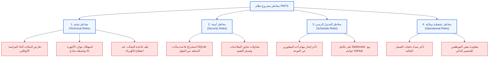

الفصل الثاني: (Literature Review)

> **وفقاً لـ «الهيكل الأساسي لمشاريع التخرج لكافة التخصصات - جامعة الرازي»**
> **مشروع التخرج:** نظام إدارة ومتابعة المشاريع (Project Management & Tracking System - PMTS)
> **حزمة التقنيات المعتمدة:** Laravel (Backend API) | Flutter (Multi-Platform UI) | Ollama (Local AI Engine) | Offline-First (SQLite & PostgreSQL)

---

## 📑 فهرس محتويات الفصل الثاني

1. [1. خلفية الدراسة (Background)](#1-خلفية-الدراسة-background)
   * [نبذة عن القطاع والتخصص](#نبذة-عن-القطاع-والتخصص)
   * [كيفية تطور الحلول التقنية عبر السنوات](#كيفية-تطور-الحلول-التقنية-عبر-السنوات)
   * [الدوافع العامة والمبررات في الوقت الراهن](#الدوافع-العامة-والمبررات-في-الوقت-الراهن)
2. [2. الدراسات السابقة (Literature Review)](#2-الدراسات-السابقة-literature-review)
   * [استعراض وتحليل الأنظمة المنافسة](#استعراض-وتحليل-الأنظمة-المنافسة)
     * [أولاً: منصة Productive.io](#أولا-منصة-productiveio)
     * [ثانياً: منصة Teamwork.com](#ثانيا-منصة-teamworkcom)
     * [ثالثاً: منصة Wrike.com](#ثالثا-منصة-wrikecom)
     * [رابعاً: منصة Monday.com](#رابعا-منصة-mondaycom)
   * [الفجوة البحثية (Research Gap)](#الفجوة-البحثية-research-gap)
   * [جدول المقارنة المعياري المفصل بين مشروعنا والأنظمة السابقة](#جدول-المقارنة-المعياري-المفصل-بين-مشروعنا-والأنظمة-السابقة)
3. [3. النظام الحالي (Existing system)](#3-النظام-الحالي-existing-system)
   * [كيفية سير العمليات والإجراءات حالياً خطوة بخطوة](#كيفية-سير-العمليات-والإجراءات-حاليا-خطوة-بخطوة)
   * [مشاكل وعيوب النظام الحالي](#مشاكل-وعيوب-النظام-الحالي)
   * [مبررات استبدال وتطوير النظام الحالي بالنظام الجديد المقترح](#مبررات-استبدال-وتطوير-النظام-الحالي-بالنظام-الجديد-المقترح)
4. [4. دراسة الجدوى (FEASIBILITY STUDY)](#4-دراسة-الجدوى-feasibility-study)
   * [a. دراسة الجدوى التقنية (Technical feasibility study)](#a-دراسة-الجدوى-التقنية-technical-feasibility-study)
   * [b. دراسة الجدوى الاقتصادية (Economic feasibility study)](#b-دراسة-الجدوى-الاقتصادية-economic-feasibility-study)
   * [c. دراسة الجدوى التشغيلية (Operational feasibility study)](#c-دراسة-الجدوى-التشغيلية-operational-feasibility-study)
5. [5. إدارة المخاطر (Risks management)](#5-إدارة-المخاطر-risks-management)
   * [a. تحديد المخاطر (Determination of risk)](#a-تحديد-المخاطر-determination-of-risk)
   * [b. التحكم في المخاطر (Risk control)](#b-التحكم-في-المخاطر-risk-control)

---

### 1. خلفية الدراسة (Background)

#### نبذة عن القطاع والتخصص

ينتمي هذا المشروع إلى قطاع **نظم المعلومات الإدارية (Management Information Systems - MIS)** وتطبيقات **هندسة البرمجيات المتقدمة (Advanced Software Engineering)** وتحديداً مجال أنظمة إدارة الأعمال والمشاريع البرمجية والتحول الرقمي للشركات الناشئة والوكالات البرمجية (Agencies). يُعد هذا القطاع المحرك الأساسي للاقتصاد الرقمي الحديث؛ حيث تعتمد الشركات البرمجية على بيئات عمل رقمية لتنسيق جهود المطورين، وحساب تكاليف المشاريع، وضمان الالتزام بمواعيد التسليم والميزانيات المرصودة.

#### كيفية تطور الحلول التقنية عبر السنوات

تطورت آليات إدارة المشاريع عبر مراحل تاريخية متتابعة:

1. **المرحلة التقليدية (الورقية والخطية):** الاعتماد على جداول الحسابات اليدوية والوثائق الورقية ومخططات نموذج الشلال (Waterfall)، والتي كانت تعاني من الجمود وعدم القدرة على مواكبة التغييرات المتسارعة.
2. **مرحلة الحوسبة المكتبية (Desktop Era):** ظهور برمجيات منفصلة مثبتة محلياً (مثل MS Project)، والتي وفرت مخططات جانت ولكنها افتقرت للتواصل اللحظي والتكامل التشاركي بين أفراد الفريق.
3. **مرحلة الحوسبة السحابية (Cloud SaaS):** الانتقال الكامل إلى المنصات السحابية (مثل Jira, Trello, Asana, Monday)، والتي قدمت ميزات التعاون عبر الإنترنت، لكنها فرضت شروطاً صارمة كالاتصال الدائم بالإنترنت واشتراكات شهرية مكلفة بالدولار عن كل مستخدم.
4. **المرحلة الحديثة (الذكاء الاصطناعي واللامركزية):** دمج أدوات الذكاء الاصطناعي لتوليد الأكواد والتنبؤ بالمخاطر، إلا أن معالجتها السحابية كشفت ثغرة أمنية فادحة تمثلت في تسريب الملكية الفكرية والأكواد الحساسة للشركات.

#### الدوافع العامة والمبررات في الوقت الراهن

تتجلى أهمية هذا المشروع في الوقت الراهن لتلبية احتياجات الشركات البرمجية الناشئة والفرق التقنية في الدول النامية (خاصة في الجمهورية اليمنية والإقليم)، مدفوعة بالأسباب الجوهرية التالية:

* **التغلب على التحديات البنيوية المحلية:** الانقطاع المتكرر لشبكات الإنترنت وضعف استقرارها، وانقطاع التيار الكهربائي المفاجئ، مما يجعل الاعتماد الحصري على الأنظمة السحابية سبباً في إهدار مئات الساعات الإنتاجية سنوياً.
* **الحاجة لحماية الملكية الفكرية وسرية الأكواد:** القضاء على مخاطر رفع الكود المصدري لسحابة الذكاء الاصطناعي عبر تشغيل نماذج الذكاء الاصطناعي محلياً بالكامل.
* **الضغط المالي وارتفاع أسعار الصرف:** التخلص من أعباء الاشتراكات الشهرية السحابية المرهقة عبر بناء حل ذاتي مستقر ومفتوح المصدر.
* **العدالة التنظيمية والمالية:** حل نزاعات تقاسم الأرباح بين الشركاء والمطورين بأتمتة محاسبية دقيقة تعتمد على نسب الإنجاز الواقعية والعقود الإلكترونية.

---

### 2. الدراسات السابقة (Literature Review)

#### استعراض وتحليل الأنظمة المنافسة

تم إجراء دراسة استقصائية ونقدية لأربع (4) منصات عالمية رائدة ومنافسة في سوق إدارة المشاريع والوكالات البرمجية:

##### أولاً: منصة Productive.io

* **سنة النشر والإطلاق:** أُطلقت عام 2014 بواسطة شركة برمجية كرواتية متخصصة في إدارة وكالات البرمجة والتسويق.
* **أهداف النظام:** توفير منصة شاملة تجمع بين إدارة المهام وتتبع الوقت وحساب ربحية الوكالات والتدفق النقدي.
* **أهم الميزات:** حاسبة الربحية المباشرة للمشاريع، تتبع الوقت والفواتير، إدارة طاقات الموظفين (Resource Planning).
* **نقاط القوة (Strengths):**
  * دقة عالية في ربط ساعات عمل المطورين بتكلفة المشروع وهوامش الربح.
  * واجهة تقارير مالية متميزة لأصحاب الوكالات.
* **نقاط الضعف والقصور (Weaknesses):**
  * سحابية بالكامل؛ تتوقف عن العمل تماماً بمجرد انقطاع شبكة الإنترنت.
  * أسعار اشتراكات مرتفعة جداً ($9 - $24 لكل موظف شهرياً).
  * لا توفر أي نموذج ذكاء اصطناعي محلي لفحص الأمان أو جودة الكود المصدري.
  * تفتقر لنظام تتبع عهد ومواصفات أجهزة المطورين (Hardware Specs).

##### ثانياً: منصة Teamwork.com

* **سنة النشر والإطلاق:** أُطلقت عام 2007 ومقرها في أيرلندا، وهي منصة مصممة لإدارة مشاريع العملاء والفرق التشاركية.
* **أهداف النظام:** تعزيز الشفافية مع العملاء وإدارة التبعيات والمراحل الزمنية ومراقبة ساعات العمل.
* **أهم الميزات:** بوابات مخصصة للعملاء، مخططات جانت، إدارة التذاكر، وتتبع معالم المشروع (Milestones).
* **نقاط القوة (Strengths):**
  * قدرات ممتازة في إشراك العميل في مراجعة المهام والتسليمات.
  * تنظيم قوي لتبعية المهام والجدول الزمني.
* **نقاط الضعف والقصور (Weaknesses):**
  * انعدام دعم العمل دون اتصال (No Offline-First Support).
  * غياب آلية محاسبية لتقاسم الأرباح بين المطورين وفق العقود.
  * لا يوجد تكامل مع GitHub لتحديث حالات المهام برمجياً عند الـ Push أو الـ Merge.
  * غياب مؤشرات العافية ومحلل إرهاق المطورين (Burnout Analyzer).

##### ثالثاً: منصة Wrike.com

* **سنة النشر والإطلاق:** أُطلقت عام 2006 في الولايات المتحدة الأمريكية وتخدم الشركات المؤسسية الضخمة.
* **أهداف النظام:** إدارة العمليات المؤسسية المعقدة وأتمتة مسارات النماذج والموافقات وسلاسل الإمداد.
* **أهم الميزات:** نماذج طلبات ديناميكية، أتمتة مسارات العمل، ومخططات جانت المتقدمة.
* **نقاط القوة (Strengths):**
  * أتمتة مؤسسية عميقة وتخصيص دقيق للصلاحيات والتقارير.
  * مناسبة للمنظمات متعددة الفروع والتحكم الإداري الضخم.
* **نقاط الضعف والقصور (Weaknesses):**
  * واجهات شديدة التعقيد تتطلب تدريباً طويلاً وتثقل كاهل الفرق الناشئة.
  * تكاليف اشتراك باهظة تبدأ من $9.80 وتتجاوز $24.80 للمستخدم شهرياً.
  * غياب الذكاء الاصطناعي المحلي (On-Premises Local AI)؛ حيث تعتمد على السحابة فقط.
  * لا توفر بوابة مستقلة للخبراء والاستشارات ولا تتيح التعاقد واستقطاب المطورين.

##### رابعاً: منصة Monday.com

* **سنة النشر والإطلاق:** أُطلقت عام 2012 كمنصة مرنة لتخصيص بيئات العمل (Work OS).
* **أهم الميزات:** لوحات بصرية ملونة وقابلة للتخصيص، وتكاملات سحابية متنوعة، وتطبيقات مصغرة.
* **نقاط القوة (Strengths):**
  * تصميم واجهات جذاب ومرن وسهل التخصيص للمستخدم العادي.
  * تنوع طرق العرض (Kanban, Calendar, Table, Timeline).
* **نقاط الضعف والقصور (Weaknesses):**
  * لا تدعم العمل دون اتصال بالإنترنت في المناطق ذات التغطية الضعيفة.
  * معالجة الذكاء الاصطناعي سحابية فقط، مما يشكل خطراً كبيراً على سرية الكود المصدري.
  * لا تحتوي على آليات لحساب العهد العتادية للمطورين ولا تتبع إرهاقهم الوظيفي.
  * غياب خوارزمية تقاسم الأرباح التلقائية بين الشركاء والمطورين.

---

#### الفجوة البحثية (Research Gap)

من خلال التحليل النقدي للأنظمة السابقة، تم رصد **فجوة علمية وتقنية واضحة** تتمثل في:

> **"عدم وجود نظام برمجي متكامل وموحد يجمع بين معمارية العمل دون اتصال أولاً (Offline-First) لضمان استمرارية العمل بنسبة 100%، وبين توطين الذكاء الاصطناعي محلياً (Local AI) لفحص أمان الأكواد وتوليد التقارير دون المساس بسرية البيانات، مع دمج منظومة محاسبية مؤتمتة لتقاسم الأرباح، وتتبع العهد الصلبة للأجهزة، وتوفير بوابات متخصصة للعملاء والخبراء والتوظيف بما يلائم قدرات وبيئة الشركات الناشئة."**

**ما يقدمه مشروعنا لسد هذه الفجوة:**

1. **العمل دون اتصال والمزامنة الذكية:** تخزين فوري محلي في SQLite/Hive مع خوارزميات فض النزاع (CRDTs) عند عودة الاتصال.
2. **محرك الذكاء الاصطناعي المحلي (Ollama):** فحص أمان وجودة الكود وتلخيص التقارير محلياً داخل شبكة الشركة دون تكلفة اشتراك ودون تسريب للبيانات.
3. **أتمتة تقاسم الأرباح:** معادلة محاسبية برمجية تحسب صافي الأرباح وتوزع الحصص بناءً على العقود ونسب الإنجاز الفعلية المعتمدة.
4. **تتبع العهد ومحلل العافية:** قاعدة بيانات ترصد العتاد الدقيق لحاسوب كل مطور (CPU, RAM, GPU) مع مستشعر يحذر من إرهاق العمل المتواصل.
5. **البوابات المتخصصة الخمس:** الفصل الصارم في الوصول بين العميل، والموظف، والمستشار، ومسؤول التوظيف، والإدارة المركزية.

---

#### جدول المقارنة المعياري المفصل بين مشروعنا والأنظمة السابقة

| معيار المقارنة / الميزة                                  |                                     مشروعنا المقترح (PMTS)                                     |            Productive.io            |     Teamwork.com     |       Wrike.com       |      Monday.com      |
| :-------------------------------------------------------------------------- | :-----------------------------------------------------------------------------------------------------------: | :----------------------------------: | :------------------: | :-------------------: | :------------------: |
| **معمارية العمل دون اتصال (Offline-First)**       |                                  **مدعوم بالكامل (100%)**                                  |         ❌ غير مدعوم         | ❌ غير مدعوم | ❌ غير مدعوم | ❌ غير مدعوم |
| **الذكاء الاصطناعي المحلي (Local AI)**           |                                **Ollama محلي (مجاني وآمن)**                                |         ❌ غير متوفر         | ❌ غير متوفر | ❌ سحابي فقط | ❌ سحابي فقط |
| **فحص أمان وجودة الكود محلياً**                |                                 **مدعوم لجميع اللغات**                                 |         ❌ غير متوفر         | ❌ غير متوفر | ❌ غير متوفر | ❌ غير متوفر |
| **أتمتة تقاسم الأرباح المحاسبي**             |                           **مدمجة وفق العقود والإنجاز**                           | مدعوم جزئياً (ربحية) | ❌ غير مدعوم | ❌ غير مدعوم | ❌ غير مدعوم |
| **تتبع عهد ومواصفات الأجهزة (Hardware)**        |                                     **مدعوم (CPU, RAM, GPU)**                                     |         ❌ غير متوفر         | ❌ غير متوفر | ❌ غير متوفر | ❌ غير متوفر |
| **محلل إرهاق وعافية المطور (Burnout)**           |                                    **مستشعر ذكي مدمج**                                    |         ❌ غير متوفر         | ❌ غير متوفر | ❌ غير متوفر | ❌ غير متوفر |
| **بوابة مخصصة للخبراء والمستشارين**       |                              **نظام حجز وجلسات متكامل**                              |         ❌ غير متوفر         | ❌ غير متوفر | ❌ غير متوفر | ❌ غير متوفر |
| **بوابة توظيف مربوطة بـ GitHub**                    |                               **استعراض كفاءات وعقود**                               |         ❌ غير متوفر         | ❌ غير متوفر | ❌ غير متوفر | ❌ غير متوفر |
| **أتمتة حالات المهام عبر Git Webhooks**            |                                **تحديث تلقائي للمهام**                                |         تكامل سطحي         | تكامل مهام | تكامل محدود | تكامل وسيط |
| **التقارير اليومية عبر الصوت (Voice-to-Text)** |                               **مدعوم محلياً أوفلاين**                               |         ❌ غير متوفر         | ❌ غير متوفر | ❌ غير متوفر | ❌ غير متوفر |
| **تكلفة الاشتراكات والتراخيص**                | **صفر $ (مفتوح المصدر)** | باهظة ($
$$
) | باهظة (
$$

) | مرتفعة جداً ($$$$) |          باهظة ($$$)          |                      |                      |                      |

---

### 3. النظام الحالي (Existing system)

#### كيفية سير العمليات والإجراءات حالياً خطوة بخطوة

تعتمد الشركات البرمجية والوكالات الناشئة حالياً على آلية عمل يدوية ومشتتة تسير وفق الخطوات التالية:

1. **تحديد وتوزيع التكليفات:** يقوم مدير المشروع بإنشاء المهام وإرسالها عبر مجموعات الدردشة (WhatsApp / Telegram) أو تدوينها في جداول Excel مشتركة، مما يؤدي لضياع سياق المحادثة وتداخل التوجيهات.
2. **تسجيل الحضور والانصراف:** يتم تسجيل الحضور يدوياً في دفاتر ورقية أو شيتات إلكترونية، دون تحقق حقيقي من بقاء المطور فاعلاً في بيئة العمل، مما يفتح باب التلاعب بساعات العمل.
3. **التواصل مع العميل:** يُرسل مدير المشروع تحديثات الإنجاز عبر البريد الإلكتروني أو لقطات الشاشة (Screenshots)، دون وجود لوحة تفاعلية موحدة، مما يخلق شكوكاً لدى العميل أو يجبر الشركة على كشف تفاصيل الكود الداخلي.
4. **فحص الكود والأمان:** يضطر المبرمجون لنسخ الكود المصدري ولصقه في أدوات ذكاء اصطناعي سحابية عامة (مثل ChatGPT) لاكتشاف الأخطاء، ما يعرض الأسرار البرمجية والملكية الفكرية للتسريب والانتهاك.
5. **المحاسبة وتوزيع المستحقات:** في نهاية كل مرحلة، تُجرى حسابات يدوية معقدة لتقدير تكاليف السيرفرات والأدوات ومحاولة توزيع الأرباح، مما يثير نزاعات متكررة بين الشركاء والمطورين حول أحقية كل فرد.
6. **إدارة العهد:** يتم تسليم الحواسيب المحمولة وقطع العتاد للموظفين دون توثيق تفصيلي لمواصفات المعالج والذاكرة وكرت الشاشة، مما يسبب ضياع الأصول عند استقالة الموظف أو صعوبة تحديد أسباب بطء جهازه.

#### مشاكل وعيوب النظام الحالي

* **بطء الإنجاز وشلل العمليات:** توقف الفريق عن تسجيل المهام أو تحديث الحالات عند انقطاع شبكة الإنترنت أو الكهرباء.
* **ضياع وتشتت البيانات:** تشتت سجلات المشروع بين محادثات واتساب، وملفات إكسل المتفرقة، وفقدان التسلسل التاريخي للتعديلات.
* **الأخطاء البشرية والنزاعات المالية:** الناتجة عن الحسابات اليدوية غير المؤتمتة لتقاسم الأرباح وتقدير ساعات العمل.
* **صعوبة استخراج التقارير التنفيذية:** استغراق مدراء المشاريع ساعات طويلة لتجهيز تقرير إنجاز واحد وتقديمه للعميل أو الإدارة.
* **ضعف الرقابة وسرية الملكية الفكرية:** مخاطر تسريب الأكواد عبر الذكاء الاصطناعي السحابي، وغياب الفصل بين ما يراه العميل وما ينفذه المطور.
* **احتراق المطورين (Burnout):** انعدام المؤشرات التحذيرية التي تنبه الإدارة إلى الإرهاق الشديد للمطورين نتيجة العمل المتصل لساعات طويلة.

#### مبررات استبدال وتطوير النظام الحالي بالنظام الجديد المقترح

* **توحيد بيئة العمل:** دمج إدارة المهام، والتحضير الذكي، والأمان، والتوظيف، والمالية في منصة مركزية واحدة.
* **استمرارية التشغيل التامة (100% Uptime):** اعتماد معمارية العمل بدون اتصال (Offline-First) لتمكين المطور من العمل تحت أي ظرف.
* **حماية الأسرار وتوفير التكاليف:** توطين نماذج الذكاء الاصطناعي محلياً عبر Ollama لإلغاء تكلفة الاشتراكات وحماية الأكواد بنسبة 100%.
* **الشفافية المطلقة:** بناء بوابات متخصصة تمنح كل مستخدم ما يحتاجه فقط وفق نظام صلاحيات صارم (RBAC).

---

### 4. دراسة الجدوى (FEASIBILITY STUDY)

#### a. دراسة الجدوى التقنية (Technical feasibility study)

##### العتاد المادي (Hardware Requirements)

* **أجهزة المطورين والمستخدمين:**
  * معالج: Intel Core i5 أو AMD Ryzen 5 (الجيل الثامن أو أحدث).
  * الذاكرة العشوائية (RAM): 8GB إلى 16GB كافية لتشغيل بيئة Flutter وقواعد البيانات المحلية ونماذج Ollama الخفيفة (4-bit).
  * التخزين: 256GB SSD لضمان سرعة القراءة والكتابة اللحظية لقواعد بيانات SQLite بنمط WAL.
* **الخادم المحلي للشركة (On-Premises Server):**
  * معالج 8 أنوية فما فوق، وذاكرة 16GB - 32GB RAM لتشغيل محرك Ollama المركزي وخدمات Laravel وPostgreSQL.

##### البرمجيات وأطر العمل (Software & Frameworks)

* **الواجهة الخلفية (Backend):** إطار عمل **Laravel (PHP 8.2+)**؛ لما يوفره من بنية RESTful APIs عالية الأمان، وإدارة متقدمة لطوابير المزامنة (Queues) ونظام الصلاحيات (Spatie RBAC).
* **واجهات المستخدم وتطبيقات الأجهزة المتعددة (Multi-Platform UI):** إطار عمل **Flutter (Dart)**؛ لإنتاج تطبيق موحد فائق السلاسة يعمل بنفس الكود على الهواتف الذكية (Android / iOS) والويب وأنظمة الحواسيب.
* **قواعد البيانات الهجينة:**
  * **PostgreSQL:** على الخادم المركزي لضمان سلامة المعاملات المالية ومعايير ACID.
  * **SQLite / Hive:** على أجهزة المستخدمين لدعم العمل المحلي السريع بدون إنترنت.
* **محرك الذكاء الاصطناعي:** **Ollama** المنشور محلياً بنماذج مفتوحة المصدر (Llama 3, Phi-3, CodeLlama) مكممة بنمط 4-bit Quantization لتوفير استهلاك الموارد.

##### تقييم المهارات والخبرات البرمجية

يمتلك فريق العمل خبرات تزيد عن عامين في تطوير مواقع وتطبيقات الويب والموبايل باستخدام Flutter وLaravel وتصميم واجهات UI/UX، مما يجعل الفريق مؤهلاً هندسياً لإنجاز المشروع وصيانته.

##### حداثة واستقرار التقنيات

كافة التقنيات المختارة هي أدوات مستقرة ومفتوحة المصدر ومدعومة عالمياً، وتضمن قابلية النظام للتوسع المستقبلي دون الارتهان لأي تراخيص تجارية احتكارية.

---

#### b. دراسة الجدوى الاقتصادية (Economic feasibility study)

##### تحليل التكاليف مقابل العوائد المتوقعة (Cost-Benefit Analysis)

* **التكاليف المباشرة:** تكاليف تطوير أولية لا تشمل أي رسوم برمجية أو اشتراكات، نظراً للاعتماد بنسبة 100% على أدوات مفتوحة المصدر (Open-Source) ومحركات ذكاء اصطناعي مجانية محلياً.
* **التكاليف غير المباشرة:** استهلاك الكهرباء والإنترنت المعتاد لدى الشركة.

##### العوائد والتوفير المالي السنوي المحقق

تم إجراء دراسة مقارنة على شركة برمجية ناشئة تضم 30 مطوراً وإدارياً ينجزون 10 مشاريع سنوياً، وأثبتت الأرقام الوفورات المالية التالية:

| بند التكلفة السحابية الملغاة                                                    | التكلفة بالأنظمة السحابية التقليدية | التكلفة مع نظامنا المقترح (PMTS) | صافي التوفير السنوي المحقق |
| :------------------------------------------------------------------------------------------------------- | :-----------------------------------------------------------------: | :----------------------------------------------------: | :-----------------------------------------------: |
| **اشتراكات منصات إدارة المشاريع السحابية** (Productive/Monday)   |                         $5,400 سنوياً                         |                           $0                           |                 **+$5,400**                 |
| **اشتراكات أدوات الذكاء الاصطناعي** لفحص الكود والأمان |                         $3,600 سنوياً                         |                  $0 (Ollama محلي)                  |                 **+$3,600**                 |
| **اشتراكات أدوات تتبع الوقت والإنتاجية** (Clockify/Hubstaff)       |                         $1,800 سنوياً                         |           $0 (مدمج في التحضير)           |                 **+$1,800**                 |
| **عمولات منصات العمل الحر والتوظيف** لاستقطاب المطورين |                         $2,000 سنوياً                         |     $0 (بوابة التوظيف المدمجة)     |                 **+$2,000**                 |
| **استهلاك حزم الإنترنت السحابية** عند توقف المزامنة       |                          $900 سنوياً                          |                   $0 (Offline-First)                   |                  **+$900**                  |
| **الإجمالي السنوي العام**                                                       |                   **$13,700 سنوياً**                   |                      **$0**                      |          **+$13,700 سنوياً**          |

> [!NOTE]
> يثبت التحليل المالي خفض التكاليف التشغيلية بنسبة تتجاوز **96%** مقارنة بالبدائل العالمية، مما يحقق عائداً استثمارياً فورياً (Immediate ROI) للمنشأة.

---

#### c. دراسة الجدوى التشغيلية (Operational feasibility study)

* **الملاءمة مع البيئة وثقافة المستخدمين:** يتطابق النظام مع ثقافة العمل في السوق المحلي؛ حيث يقضي على توتر انقطاع الإنترنت عبر ميزة الحفظ الأوفلاين التلقائي.
* **سهولة الاستخدام والواجهات المتجاوبة:** تصميم واجهات تفاعلية متجاوبة تعتمد على أحدث معايير UI/UX مع دعم كامل للغتين العربية والإنجليزية والكتابة من اليمين لليسار (RTL).
* **حل المشكلات دون عبء إداري:** يلغي النظام الأعمال الورقية والروتينية من خلال:
  * التحضير الذكي بضغطة زر.
  * أتمتة حالات المهام بمجرد دفع الكود لـ GitHub.
  * التوليد الآلي للنشرات الأسبوعية وسجلات التحديث للعملاء.
* **متطلبات التدريب:** واجهات النظام واضحة وبديهية ولا تحتاج لأكثر من جلسة تعريفية مدتها 30 دقيقة للموظفين أو العملاء.

---

### 5. إدارة المخاطر (Risks management)

#### a. تحديد المخاطر (Determination of risk)

تم رصد وتصنيف المخاطر المحتملة التي قد تواجه النظام إلى أربعة محاور رئيسية:

1. **المخاطر التقنية (Technical Risks):**
   * تعارض البيانات عند قيام أكثر من مطور بتعديل نفس السجل أثناء انقطاع الإنترنت.
   * بطء استجابة نماذج الذكاء الاصطناعي على الحواسيب الضعيفة.
   * فقدان البيانات غير المتزامنة عند انقطاع الكهرباء المفاجئ.
2. **المخاطر الأمنية (Security Risks):**
   * محاولة سرقة ملف قاعدة البيانات المحلية SQLite من حاسوب المطور.
   * محاولات انتحال الصلاحيات والوصول لبيانات الشركات الأخرى.
3. **مخاطر الجدول الزمني (Schedule Risks):**
   * تأخر تسليم بعض المهام البرمجية من قبل المطورين عن المواعيد المتفق عليها.
   * تأخر استقبال إشعارات Webhooks من GitHub نتيجة مشاكل شبكية خارجية.
4. **المخاطر التشغيلية والمالية (Operational & Financial Risks):**
   * تأخر سداد دفعات العملاء مما يعطل دورة تقاسم الأرباح.
   * تخوف بعض المطورين من انتهاك الخصوصية في نظام تتبع النشاط والتحضير.

---

#### b. التحكم في المخاطر (Risk control)

تم وضع خطة استراتيجية وإجراءات وقائية محددة للتعامل مع كل خطر محتمل لضمان استقرار وجودة النظام:

| تصنيف الخطر       | الخطر المحتمل                                                                  | مستوى الأثر | استراتيجية التخفيف والتحكم المعتمدة (Mitigation Strategy)                                                                                                                                                                                                                                                            |
| :-------------------------- | :----------------------------------------------------------------------------------------- | :-------------------: | :--------------------------------------------------------------------------------------------------------------------------------------------------------------------------------------------------------------------------------------------------------------------------------------------------------------------------------------------------- |
| **تقني**          | تعارض البيانات أثناء المزامنة الأوفلاين                 |      مرتفع      | تطبيق خوارزمية **(Conflict-Free Replicated Data Types - CRDTs)** لدمج الحقول المستقلة تلقائياً، واعتماد التعديل الأحدث زمنياً (Last-Write-Wins Timestamping) للحقول المتطابقة، مع حفظ التعديل الآخر في سجل التدقيق (Audit Log). |
| **تقني**          | بطء استجابة الذكاء الاصطناعي على حواسيب المطورين |      متوسط      | استخدام نماذج مكممة خفيفة **(4-bit Quantized Models مثل Phi-3 أو Llama-3-8B)**، مع خيار توجيه طلبات الفحص لخادم الشركة المحلي المركزي لتخفيف العبء عن الأجهزة الفردية.                                                                     |
| **تقني**          | تلف قاعدة البيانات عند انقطاع الكهرباء المفاجئ     |      مرتفع      | تفعيل نمط الكتابة الاستباقية **(Write-Ahead Logging - WAL)** في SQLite مع حفظ تلقائي فوري كل 3 ثوانٍ داخل التطبيق المحلي.                                                                                                                                                    |
| **أمني**          | محاولة الوصول للبيانات المخزنة محلياً على الجهاز |      مرتفع      | تشفير قاعدة بيانات SQLite المحلية باستخدام خوارزمية **AES-256** وعزل مفتاح التشفير داخل التخزين الآمن للنظام (Flutter Secure Storage).                                                                                                                            |
| **أمني**          | محاولات التلاعب بالصلاحيات واختراق الحسابات         |        حرج        | تطبيق نظام تحكم بالوصول صارم **(Spatie RBAC)**، وتأكيد الهوية عبر توكنات JWT المشفرة ذات مدة صلاحية محددة مع التجديد الآلي.                                                                                                                                |
| **جدول زمني** | تأخر تسليم مراحل المشروع عن المواعيد المحددة         |      متوسط      | وضع هوامش أمان زمنية (Buffer Times) بنسبة 15% في مخطط جانت، مع إطلاق تنبيهات مبكرة للإدارة فور انحراف مؤشر الإنجاز عن المسار المخطط.                                                                                                                    |
| **مالي**          | تأخر العميل في سداد الدفعة المالية المقررة             |      متوسط      | تعليق توزيع الأرباح برمجياً حتى يتم تأكيد استلام الحوالة من العميل في جدول الفواتير ($Status = Paid$)، مع حساب العوائد بالأرقام الشفافة.                                                                                                        |
| **تشغيلي**      | تخوف المطورين من انتهاك الخصوصية في التحضير           |      منخفض      | صياغة سياسة خصوصية صريحة مدمجة بالنظام تؤكد حظر أي تصوير للشاشة أو تجسس، وقصر التتبع على حالة الاتصال وحجم المهام المعتمدة فقط.                                                                                                             |
