# الجمهورية اليمنية

# وزارة التعليم العالي والبحث العلمي

# جامعة الرازي - كلية العلوم الإدارية والإنسانية

## قسم نظم المعلومات الإدارية (MIS)

---

```
========================================================================================
                          وثيقة مشروع التخرج الأكاديمي الشامل
                          السنة الرابعة - نظم معلومات إدارية
========================================================================================
```

# مشروع: منصة ومسرعة المشاريع والفرق التقنية والريادية المتكاملة

## (Project Management and Tracking System - PMTS / TEAM Hub)

### القائم على معمارية العمل دون اتصال (Offline-First) والذكاء الاصطناعي المحلي (Local AI)

- **التخصص:** نظم معلومات إدارية (MIS) & هندسة البرمجيات
- **العام الجامعي / التخرج:** 2026 / 2027م
- **إشراف الدكتور القدير:** د. خالد المسوري
- **حزمة التقنيات المعتمدة:** Laravel 12 (PHP 8.2+) | Flutter SDK | Ollama Local AI Engine | PostgreSQL / SQLite

---

## الصفحات التمهيدية الرسمية (Preliminary Pages)

### .I الإهداء (Dedication)

إلى نبع العطاء الصافي الذي لا ينضب، إلى من شقّا لي دروب النور وغرسا في نفسي حب العلم والاجتهاد... **والدَيَّ الكريمين**، اعترافاً بفضلهما ودعواتهما التي رافقتني في كل خطوة.

إلى أساتذتي الأجلاء في قسم نظم المعلومات الإدارية، الذين لم يبخلوا علينا بعلمهم وتوجيهاتهم القيمة، وإلى المشرف الأكاديمي القدير **الدكتور / خالد المسوري**، الذي كان لتوجيهاته العلمية والعملية الأثر البالغ في إنجاح هذا العمل.

إلى زملائي في مسيرة العلم والبحث، وإلى كل مطور وريادي يواجه تحديات بيئة العمل ويسعى لابتكار الحلول... أهدي هذا الجهد المتواضع.

---

### .II التفويض (Authorization)

أقر أنا طالب مشروع التخرج بقسم نظم المعلومات الإدارية، بأنني أمنح جامعة الرازي وكافة الجهات الأكاديمية المعنية الحق الكامل في حفظ، وفهرسة، ونشر، وتداول هذا التقرير العلمي المسمى:
**"منصة ومسرعة المشاريع والفرق التقنية والريادية (PMTS / TEAM Hub)"** للعام الجامعي 2026/2027م، في مكتبتها الرقمية وأرشيفها البحثي لأغراض البحث العلمي والتعليم الأكاديمي، مع الاحتفاظ بكافة حقوق الملكية الفكرية والبرمجية لابتكار المنصة وتصميمها.

**اسم الطالب:** فريق عمل مشروع التخرج  
**التوقيع:** .............................................  
**التاريخ:** 04 / 11 / 2026م

---

### .III شكر وتقدير (Acknowledgment)

الحمد لله أولاً وآخراً على توفيقه وتيسيره لإتمام هذا العمل الأكاديمي والتقني.

نتقدم بأسمى عبارات الشكر وعظيم الامتنان إلى مشرف المشروع **الدكتور / خالد المسوري** على رعايته الكريمة وجهوده المخلصة ونصائحه السديدة التي أنارت لنا مسار التحليل والتصميم الهندسي، وفتحت أمامنا آفاق الرؤية الشاملة للأنظمة المتكاملة.

كما نتوجه بجزيل التقدير لعمادة كلية العلوم الإدارية وأعضاء الهيئة التدريسية بقسم نظم المعلومات الإدارية بجامعة الرازي، ولجميع الخبراء والمهندسين وأصحاب الشركات البرمجية الناشئة الذين شاركوا معنا في المقابلات والاستبيانات الميدانية وقدموا ملاحظاتهم الواقعية لإثراء متطلبات هذا النظام.

---

### .IV لجنة المناقشة والحكم (Examiner Committee)

تمت مناقشة مشروع التخرج وإقراره من قِبل لجنة المناقشة والحكم الأكاديمية المكونة من:

1. **المشرف الأكاديمي (رئيساً ومحكّماً داخلياً):** د. خالد المسوري  
   **التوقيع:** .............................................
2. **المناقش الداخلي (عضواً ومحكّماً داخلياً):** د. .............................................  
   **التوقيع:** .............................................
3. **المناقش الخارجي (عضواً ومحكّماً خارجياً):** د. .............................................  
   **التوقيع:** .............................................

**تاريخ المناقشة:** ..... / ..... / 2026م  
**التقدير العام:** .............................................

---

### .V الملخص (Abstract)

#### الملخص باللغة العربية:

يمثل هذا المشروع تصميماً وتطويراً لمنظومة برمجية وإدارية متكاملة بعنوان **"منصة ومسرعة المشاريع والفرق التقنية والريادية" (PMTS / TEAM Hub)**، موجهة لتلبية متطلبات الشركات البرمجية الناشئة والوكالات الرقمية والفرق المستقلة، ولا سيما في البيئات النامية (مثل الجمهورية اليمنية) التي تعاني من انقطاع متكرر لخدمات الإنترنت والتيار الكهربائي، وارتفاع تكاليف الاشتراكات السحابية، ومخاطر تسريب الأكواد والبيانات الحساسة عند معالجتها سحابياً.

يتكون النظام من واجهة خلفية وبوابة ويب متقدمة مبنية بإطار عمل **Laravel 12** وتطبيق متعدد المنصات (Multi-Platform) تم تطويره بإطار عمل **Flutter** ليعمل بكفاءة على الحواسيب والهواتف الذكية (Android / iOS). يرتكز النظام هندسياً على معمارية العمل دون اتصال أولاً **(Offline-First Architecture)** عبر تخزين محلي لحظي مدعوم بـ **SQLite / Hive** مع خوارزميات فض نزاع المزامنة **(CRDTs)** فور استعادة الاتصال. كما ينفرد النظام بتوطين محرك ذكاء اصطناعي محلي **(Ollama Local AI)** يقوم بفحص جودة الكود واكتشاف الثغرات الأمنية، والترجمة الفورية، وتوليد التقارير محلياً بنسبة 100% دون إرسال أي بايت لخوادم سحابية خارجية، مما يحقق وفراً مالياً سنوياً يتجاوز **96%** مقارنة بالأنظمة التقليدية.

يقدم النظام حلاً شاملاً عبر **خمس بوابات متخصصة** بنظام صلاحيات صارم (RBAC): بوابة العميل الشفافة، بوابة الموظفين والمشرفين مع التحضير الذكي ومحلل إرهاق المطورين (Burnout Analyzer) وتتبع عهد الأجهزة (Hardware Specs)، بوابة الخبراء والمستشارين، بوابة التوظيف واستقطاب الكفاءات المربوطة بمستودعات GitHub، ولوحة الإدارة والرقابة المركزية، معززة بمحرك محاسبي مؤتمت لتقاسم الأرباح وإدارة العقود الرقمية.

#### Abstract (English):

This graduation project presents the design and development of an integrated enterprise ecosystem entitled **"Project Management and Tracking System" (PMTS / TEAM Hub)**, engineered specifically for software startups, digital agencies, and entrepreneurial teams operating within challenging infrastructural environments (such as Yemen), characterized by recurrent power outages, unstable internet connectivity, excessive SaaS subscription overheads, and intellectual property vulnerabilities associated with cloud-based code processing.

The platform architecture comprises an enterprise backend built on **Laravel 12 (PHP 8.2+)** and a unified multi-platform client application engineered with **Flutter (Dart)** running seamlessly across web, desktop, and mobile devices (Android/iOS). The foundation relies upon an **Offline-First Architecture**, leveraging local **SQLite/Hive** persistence synchronized with central **PostgreSQL** databases using Conflict-Free Replicated Data Types (**CRDTs**) and Last-Write-Wins timestamps. Crucially, the system pioneers an on-premises local artificial intelligence engine powered by **Ollama**, executing automated code security auditing, bug detection, multilingual localization, and executive synthesis entirely offline with zero data leakage risk—slashing annual operating costs by over **96%**.

The platform is architected around **five specialized user portals** governed by Role-Based Access Control (**RBAC**): a transparent Client Portal, an Employee/Supervisor Portal equipped with automated biometric attendance, developer burnout analytics, and hardware specification audits, an Expert Consultation Booking Portal, a Talent Recruitment Portal integrated with GitHub repositories, and a Central Executive Dashboard powered by automated contract-based profit-sharing algorithms.

---

### .VI فهرس المحتويات الشامل (Table of Contents)

- **الصفحات التمهيدية الرسمية (Preliminary Pages)**
  - .I الإهداء (Dedication)
  - .II التفويض (Authorization)
  - .III شكر وتقدير (Acknowledgment)
  - .IV لجنة المناقشة والحكم (Examiner Committee)
  - .V الملخص التنفيذي (Abstract - عربي / إنجليزي)
  - .VI فهرس المحتويات (Table of Contents)
  - .VII قائمة الأشكال (List of Figures)
  - .VIII قائمة الجداول (List of Tables)
  - .IX قائمة الاختصارات (List of Abbreviations)
- **[الوحدة الأولى: الفصل الأول - الإطار العام والمقدمة (Introduction & General Charter)](#الوحدة-الأولى-الفصل-الأول---الإطار-العام-والمقدمة)**
  - [1.1 مقدمة وتمهيد (Introduction & Background)](#11-مقدمة-وتمهيد-introduction--background)
  - [1.2 تعريف المشروع (Definition of the Project)](#12-تعريف-المشروع-definition-of-the-project)
  - [1.3 تحديد مشكلة الدراسة (Problem Statement)](#13-تحديد-مشكلة-الدراسة-problem-statement)
  - [1.4 تساؤلات الدراسة التطبيقية (Research Questions)](#14-تساؤلات-الدراسة-التطبيقية-research-questions)
  - [1.5 أهداف المشروع (Project Objectives)](#15-أهداف-المشروع-project-objectives)
  - [1.6 أهمية ومبررات المشروع (Project Importance)](#16-أهمية-ومبررات-المشروع-project-importance)
  - [1.7 نطاق وحدود المشروع (Scope and Limitations)](#17-نطاق-وحدود-المشروع-scope-and-limitations)
  - [1.8 الأدوات والتقنيات المستخدمة (Tools and Technologies)](#18-الأدوات-والتقنيات-المستخدمة-tools-and-technologies)
  - [1.9 المنهجية المتبعة لتنفيذ المشروع (Methodology)](#19-المنهجية-المتبعة-لتنفيذ-المشروع-methodology)
  - [1.10 الجدول الزمني ومراحل العمل (Timetable)](#110-الجدول-الزمني-ومراحل-العمل-timetable)
  - [1.11 مخطط جانت الزمني (Gantt Chart)](#111-مخطط-جانت-الزمني-gantt-chart)
  - [1.12 النموذج التطبيقي للمتغيرات (Academic Applied Research Model)](#112-النموذج-التطبيقي-للمتغيرات-academic-applied-research-model)
  - [1.13 استبيان تقييم أداء المنصة المقترح (Evaluation Survey Template)](#113-استبيان-تقييم-أداء-المنصة-المقترح-evaluation-survey-template)
  - [1.14 تنظيم التقرير (Report Organization)](#114-تنظيم-التقرير-report-organization)
- **[الوحدة الثانية: الفصل الثاني - الإطار النظري والدراسات السابقة والجدوى (Literature Review & Feasibility)](#الوحدة-الثانية-الفصل-الثاني---الإطار-النظري-والدراسات-السابقة-والجدوى)**
  - [2.1 خلفية الدراسة والتطور التاريخي (Background)](#21-خلفية-الدراسة-والتطور-التاريخي-background)
  - [2.2 الدراسات السابقة والأنظمة المنافسة (Literature Review)](#22-الدراسات-السابقة-والأنظمة-المنافسة-literature-review)
  - [2.3 الفجوة البحثية (Research Gap)](#23-الفجوة-البحثية-research-gap)
  - [2.4 جدول المقارنة المعياري بين النظام المقترح والأنظمة السابقة](#24-جدول-المقارنة-المعياري-بين-النظام-المقترح-والأنظمة-السابقة)
  - [2.5 النظام الحالي وعيوبه ومبررات الاستبدال (Existing System)](#25-النظام-الحالي-وعيوبه-ومبررات-الاستبدال-existing-system)
  - [2.6 دراسة الجدوى الثلاثية (Feasibility Study)](#26-دراسة-الجدوى-الثلاثية-feasibility-study)
  - [2.7 إدارة المخاطر ومصفوفة التحكم (Risk Management & Control)](#27-إدارة-المخاطر-ومصفوفة-التحكم-risk-management--control)
- **[الوحدة الثالثة: الفصل الثالث - التحليل الهندسي ومتطلبات النظام (System Analysis & Requirements)](#الوحدة-الثالثة-الفصل-الثالث---التحليل-الهندسي-ومتطلبات-النظام)**
  - [3.1 طرق جمع المتطلبات الميدانية (Methods of Collecting Requirements)](#31-طرق-جمع-المتطلبات-الميدانية-methods-of-collecting-requirements)
  - [3.2 متطلبات العمل وقواعد الحوكمة (Business Rules)](#32-متطلبات-العمل-وقواعد-الحوكمة-business-rules)
  - [3.3 متطلبات النظام الفنية العتادية والبرمجية (System Requirements)](#33-متطلبات-النظام-الفنية-العتادية-والبرمجية-system-requirements)
  - [3.4 المتطلبات الوظيفية (Functional Requirements)](#34-المتطلبات-الوظيفية-functional-requirements)
  - [3.5 المتطلبات غير الوظيفية (Non-Functional Requirements)](#35-المتطلبات-غير-الوظيفية-non-functional-requirements)
  - [3.6 متطلبات المستخدمين حسب الأدوار الخمسة (User Requirements)](#36-متطلبات-المستخدمين-حسب-الأدوار-الخمسة-user-requirements)
  - [3.7 تحليل المدخلات الرقمية (Input Analysis)](#37-تحليل-المدخلات-الرقمية-input-analysis)
  - [3.8 تحليل المخرجات والتقارير التنفيذية (Output Analysis)](#38-تحليل-المخرجات-والتقارير-التنفيذية-output-analysis)
  - [3.9 مخطط تدفق البيانات (DFD Concepts)](#39-مخطط-تدفق-البيانات-dfd-concepts)
  - [3.10 المخطط البيئي العام (Context Diagram - Level 0 DFD)](#310-المخطط-البيئي-العام-context-diagram---level-0-dfd)
  - [3.11 المخطط الصفري التفصيلي (Level-0 Process Diagram)](#311-المخطط-الصفري-التفصيلي-level-0-process-diagram)
  - [3.12 مخطط علاقات الكيانات (Entity Relationship Diagram - ERD)](#312-مخطط-علاقات-الكيانات-entity-relationship-diagram---erd)
  - [3.13 المخطط المنطقي لقاعدة البيانات (Logical Schema & Normalization)](#313-المخطط-المنطقي-لقاعدة-البيانات-logical-schema--normalization)
  - [3.14 المخطط الفيزيائي (The Physical Database Schema)](#314-المخطط-الفيزيائي-the-physical-database-schema)
  - [3.15 قاموس البيانات الشامل للجداول والحقول (Data Dictionary)](#315-قاموس-البيانات-الشامل-للجداول-والحقول-data-dictionary)
  - [3.16 لغة النمذجة الموحدة (UML Diagrams)](#316-لغة-النمذجة-الموحدة-uml-diagrams)
  - [3.17 خاتمة الفصل الثالث](#317-خاتمة-الفصل-الثالث)

---

### .VII قائمة الأشكال (List of Figures)

- **الشكل (1-1):** مخطط جانت الزمني التفصيلي لمراحل تنفيذ المشروع (Gantt Chart).
- **الشكل (1-2):** مخطط النموذج التطبيقي والمتغيرات البحثية (Academic Research Framework).
- **الشكل (2-1):** مخطط الدراسة المقارنة وتحليل الفجوة البحثية (Comparative Analysis & Research Gap).
- **الشكل (2-2):** هيكل ومصفوفة تصنيف مخاطر المشروع (Risk Classification Hierarchy).
- **الشكل (3-1):** المخطط البيئي العام للنظام (Context Diagram - Level 0 DFD).
- **الشكل (3-2):** المخطط الصفري التفصيلي للنظام (Level-0 Process DFD Diagram).
- **الشكل (3-3):** مخطط العلاقة البينية للكينونات لقاعدة البيانات (ERD Diagram).
- **الشكل (3-4):** مخطط حالات الاستخدام العامة للنظام (Use Case Diagram).
- **الشكل (3-5):** مخطط الفئات والكائنات البرمجية (Class Diagram).
- **الشكل (3-6):** مخطط التتابع والتفاعل الزمني لفحص الكود بالذكاء الاصطناعي (Sequence Diagram - AI Scanning).
- **الشكل (3-7):** مخطط التتابع لحل تعارض المزامنة الأوفلاين (Sequence Diagram - Offline Sync & Conflict Resolution).
- **الشكل (3-8):** مخطط النشاط وسير العمليات الشامل (Activity Diagram - Core Workflow).
- **الشكل (3-9):** مخطط الحالة ودورة حياة الكيانات (State Machine Diagram - Task & Contract Lifecycle).

---

### .VIII قائمة الجداول (List of Tables)

- **الجدول (1-1):** توزيع المهام والجدول الزمني لمراحل العمل البرمجي والإداري.
- **الجدول (1-2):** نموذج استبيان تقييم أداء المنصة المقترح.
- **الجدول (2-1):** جدول المقارنة المعياري المفصل بين مشروعنا والأنظمة السابقة المنافسة.
- **الجدول (2-2):** دراسة الجدوى الاقتصادية وحساب التكاليف والوفورات المالية المحققة.
- **الجدول (2-3):** مصفوفة تقييم وإدارة المخاطر البرمجية والأمنية واستراتيجيات التحكم.
- **الجدول (3-1):** حصر المتطلبات الوظيفية للنظام (Functional Requirements).
- **الجدول (3-2):** المتطلبات غير الوظيفية للأداء والأمان والتشغيل (Non-Functional Requirements).
- **الجدول (3-3):** مصفوفة متطلبات المستخدمين حسب الأدوار والبوابات الخمس.
- **الجدول (3-4):** جدول تحليل المدخلات الرقمية للنظام.
- **الجدول (3-5):** جدول تحليل المخرجات والتقارير التنفيذية.
- **الجداول (3-6 إلى 3-17):** جداول قاموس البيانات التفصيلي (Users, Companies, Projects, Tasks, Attendances, Hardware_Audits, Git_Integrations, AI_Analyses, Portfolios, Consultations, Contracts, Financial_Transactions).

---

### .IX قائمة الاختصارات (List of Abbreviations)

- **ACID:** Atomicity, Consistency, Isolation, Durability (خصائص اعتمادية قواعد البيانات)
- **AI:** Artificial Intelligence (الذكاء الاصطناعي)
- **API:** Application Programming Interface (واجهة برمجة التطبيقات)
- **CI/CD:** Continuous Integration / Continuous Deployment (التكامل والنشر المستمر)
- **CPU:** Central Processing Unit (وحدة المعالجة المركزية)
- **CRDT:** Conflict-Free Replicated Data Types (أنواع البيانات المتماثلة الخالية من النزاع)
- **DFD:** Data Flow Diagram (مخطط تدفق البيانات)
- **ERD:** Entity Relationship Diagram (مخطط العلاقة بين الكيانات)
- **GPU:** Graphics Processing Unit (معالج الرسوميات)
- **JWT:** JSON Web Token (توكن مصادقة الويب المشفر)
- **LLM:** Large Language Model (نموذج اللغات الكبير)
- **MIS:** Management Information Systems (نظم المعلومات الإدارية)
- **Ollama:** Open-Source Local Large Language Model Runner (مشغل نماذج الذكاء الاصطناعي المحلية)
- **RAM:** Random Access Memory (ذاكرة الوصول العشوائي)
- **RBAC:** Role-Based Access Control (التحكم بالوصول القائم على الأدوار)
- **REST:** Representational State Transfer (معمارية الواجهات البرمجية الهادئة)
- **SDLC:** Software Development Life Cycle (دورة حياة تطوير البرمجيات)
- **SRS:** Software Requirements Specification (وثيقة مواصفات متطلبات النظام)
- **SSD:** Solid State Drive (وحدة التخزين الصلبة فائقة السرعة)
- **UI/UX:** User Interface / User Experience (واجهة وتجربة المستخدم)
- **UML:** Unified Modeling Language (لغة النمذجة الموحدة)
- **WAL:** Write-Ahead Logging (تقنية التسجيل المسبق للعمليات بقواعد البيانات)

---

# الوحدة الأولى: الفصل الأول - الإطار العام والمقدمة

## (Introduction & General Charter)

### 1.1 مقدمة وتمهيد (Introduction & Background)

يشهد قطاع تكنولوجيا المعلومات وصناعة البرمجيات نمواً متسارعاً وتوسعاً غير مسبوق في اعتماد نماذج العمل المرنة وتأسيس الشركات البرمجية الناشئة والوكالات الرقمية (Software Agencies). ومع هذا التحول، برزت بيئات العمل الرقمية كعصب أساسي لإدارة فرق التطوير، وتنسيق المهام، وتقييم الأداء البرمجي والمحاسبي، ومتابعة تسليم المشاريع للعملاء بدقة وشفافية.

ومع ذلك، تواجه هذه البيئات البرمجية—خاصة في الدول النامية كاليمن والمنطقة المحيطة—تحديات بنيوية معقدة تشمل:

1. التشتت الحاد في استخدام أدوات منفصلة لإدارة المشاريع، والتواصل، والتوثيق، ومستودعات الكود.
2. الانقطاع المتكرر في خدمات الاتصال بالإنترنت والتيار الكهربائي، مما يشل عمليات الفرق البرمجية المرتبطة كلياً بالأنظمة السحابية التقليدية.
3. التكاليف الشهرية الباهظة بالعملات الأجنبية لاشتراكات المنصات السحابية العالمية.
4. المخاطر الأمنية الجسيمة المرتبطة بتسريب الملكية الفكرية والأكواد المصدرية والبيانات الحساسة عند فحصها أو معالجتها عبر منصات الذكاء الاصطناعي السحابية العامة.
5. غياب آليات برمجية ومحاسبية عادلة لتقاسم الأرباح بين الشركاء والمطورين بناءً على نسب الإنجاز الواقعية والعقود المعتمدة.

انطلاقاً من هذه المعطيات، يأتي هذا المشروع ليقدم حلاً برمجياً وهندسياً متقدماً يحقق التوازن بين الكفاءة الإدارية والاستقلالية التقنية الكاملة.

---

### 1.2 تعريف المشروع (Definition of the Project)

**"منصة ومسرعة المشاريع والفرق التقنية والريادية" (TEAM Hub / PMTS)** هي منظومة بيئية برمجية متكاملة (موقع ويب عالي الأداء وتطبيق هاتف محمول وسطح مكتب متعدد المنصات)، صُممت خصيصاً للشركات البرمجية الناشئة والفرق التقنية المستقلة.

ترتكز المنصة على معمارية **(Offline-First Architecture)** التي تضمن استمرارية العمل على المهام والوصول إلى كافة الوثائق والبيانات المحلية أثناء انقطاع الإنترنت، مع المزامنة الذكية التلقائية فور عودة الاتصال. كما تنفرد المنصة بدمج محرك ذكاء اصطناعي محلي **(Ollama Local AI)** يعمل على البنية التحتية الخاصة بالشركة لفحص جودة الأكواد البرمجية، واكتشاف الثغرات الأمنية، والترجمة الفورية، وتلخيص التقارير دون إرسال أي بيانات لخوادم سحابية خارجية، مع دعم كامل للربط المباشر مع GitHub وأتمتة مسارات DevOps، وإدارة العهد ومواصفات الأجهزة، وأتمتة تقاسم الأرباح.

---

### 1.3 تحديد مشكلة الدراسة (Problem Statement)

تتبلور مشكلة الدراسة والمشروع في خمس معضلات رئيسية تواجه قطاع تطوير البرمجيات والشركات الناشئة:

1. **معضلة التبعية السحابية والتوقف التشغيلي:** توقف إنتاجية المطورين وانقطاع تواصلهم مع النظام عند انقطاع الإنترنت بسبب ارتهان الأنظمة السحابية التقليدية بالاتصال الدائم، مما يسبب تأخير تسليم المشاريع وخسائر مالية فادحة.
2. **معضلة تسريب الملكية الفكرية وسرية الأكواد:** قيام المبرمجين بنسخ ولصق الأكواد البرمجية الحساسة وبيانات العملاء في أدوات الذكاء الاصطناعي السحابية العامة (مثل ChatGPT وغيره)، مما يعرض الملكية الفكرية للسرقة والانتهاك الأمني.
3. **معضلة تشتت بيئة العمل وضعف الشفافية:** غياب منصة موحدة تتيح للعميل مراقبة مراحل إنجاز مشروعه بشفافية وفواتيره المعتمدة دون الاطلاع على الكود الداخلي المصدري، إلى جانب تشتت المطورين بين تطبيقات متعددة غير مترابطة.
4. **معضلة إهدار الأصول وتتبع عهد الأجهزة:** صعوبة حصر العتاد التقني لأجهزة المطورين (CPU / RAM / GPU) وعدم توثيق العهد الشخصية، مما يسبب نزاعات عند مغادرة الموظفين أو تعثر معرفة أسباب بطء الأداء البرمجي.
5. **معضلة العدالة المحاسبية وتقاسم الأرباح:** غياب نظم محاسبية برمجية موثوقة لأتمتة حساب تكاليف المشاريع وتوزيع العوائد والأرباح بين الشركاء والمطورين بناءً على العقود الموثقة ونسب الإنجاز الفعلية، مما يؤدي إلى نزاعات متكررة وانفراط الفرق التقنية.

---

### 1.4 تساؤلات الدراسة التطبيقية (Research Questions)

- **التساؤل الرئيسي:**

  > _ما مدى فاعلية المنظومة البرمجية المقترحة القائمة على معمارية (Offline-First) ومحرك الذكاء الاصطناعي المحلي (Local AI) في استمرارية تشغيل الشركات البرمجية الناشئة، وحماية ملكيتها الفكرية، وتحقيق الشفافية والعدالة المحاسبية؟_

- **التساؤلات الفرعية:**
  1. هل تضمن معمارية (Offline-First) استمرارية العمل بنسبة 100% وحل نزاعات البيانات تلقائياً دون تداخل بشري فور توفر الاتصال؟
  2. كيف يسهم تشغيل نماذج الذكاء الاصطناعي محلياً عبر Ollama في حماية الكود المصدري وتقديم تدقيق أمني عالي الدقة دون تكاليف تشغيلية؟
  3. ما أثر وجود بوابات مستخدمين منفصلة ومخصصة (عملاء، موظفين، خبراء، توظيف، إدارة) في تعزيز التنسيق وثقة أصحاب المصلحة؟
  4. كيف تؤدي خوارزمية تقاسم الأرباح المؤتمتة إلى خفض النزاعات المالية وتعزيز الشفافية والالتزام بالعقود الرقمية؟
  5. ما هو العائد الاقتصادي المترتب على استبدال المنصات السحابية التجارية بالنظام المطور محلياً؟

---

### 1.5 أهداف المشروع (Project Objectives)

1. **الهدف التقني الهندسي:** تطوير نظام مركزي (Backend) متين باستخدام Laravel 12، وتطبيق واجهات متعدد المنصات باستخدام Flutter، يدعمان العمل دون اتصال أوفلاين كركيزة أساسية.
2. **الهدف الأمني وحماية الملكية الفكرية:** توطين محرك Ollama لتشغيل نماذج الذكاء الاصطناعي محلياً بالكامل لفحص الأكواد والترجمة دون تسريب البيانات خارج حدود شبكة الشركة.
3. **الهدف التنظيمي والإداري:** تأسيس 5 بوابات مستخدمين متخصصة ومستقلة تحكمها صلاحيات RBAC دقيقة تلبي احتياجات العملاء، والموظفين، والخبراء، والتوظيف، والإدارة التنفيذية.
4. **الهدف التشغيلي والمهني:** دمج أدوات الحفاظ على الكوادر التقنية عبر نظام التحضير الذكي، ومحلل العافية ومستشعر الإرهاق (Burnout Analyzer)، ونظام التحفيز بالنجوم، ونظام إدارة عهد الأجهزة.
5. **الهدف المالي والمحاسبي:** برمجة خوارزمية مؤتمتة لحساب صافي الأرباح وتوزيع العوائد وفق نسب الإنجاز والعقود الرقمية المبرمة، والتنبؤ بالمخاطر المالية المحتملة.

---

### 1.6 أهمية ومبررات المشروع (Project Importance)

- **توفير التكاليف التشغيلية الهائلة:** التخلص من اشتراكات المنصات السحابية العالمية التي تثقل كاهل الشركات الناشئة وتوفير ما لا يقل عن **$13,700 سنوياً** للشركة الواحدة.
- **الحصانة والسيادة الرقمية (Digital Sovereignty):** السيطرة المطلقة على البيانات الحساسة والأكواد المصدرية داخل خوادم الشركة المحلية وحمايتها من الاختراق أو المراقبة السحابية.
- **استدامة الإنتاجية تحت الظروف القاسية:** تمكين الفرق البرمجية من العمل والتعديل حتى في فترات انقطاع الإنترنت أو الكهرباء، دون أي توقف أو ارتباك تشغيلي.
- **الشفافية وجذب الاستثمار:** تمكين العملاء من متابعة دقيقة ومحدثة لمراحل الإنجاز، وإتاحة بيئة تعاقدية مريحة تحفز أصحاب الأعمال على التعاقد مع الفرق المحلية.
- **النمو المستدام وحماية المطورين:** توفير بيئة عمل تراعي الصحة النفسية للمطورين، وتقدّر مجهوداتهم مالياً ومعنوياً بعدالة تامة.

---

### 1.7 نطاق وحدود المشروع (Scope and Limitations)

- **النطاق الوظيفي (Functional Scope):**
  - إدارة المشاريع، والمهام، ولوحات كانبان (Kanban).
  - معمارية العمل دون اتصال وحفظ البيانات التلقائي والمزامنة الذكية.
  - فحص جودة وأمان الكود عبر نماذج Ollama المحلية.
  - إدارة 5 بوابات متخصصة (عملاء، موظفون، خبراء، توظيف، إدارة).
  - تتبع عهد الأجهزة ومواصفات العتاد للمطورين.
  - نظام تحضير ذكي ومحلل إرهاق ونظام تحفيز غير مالي.
  - الربط مع GitHub Webhooks لتحديث حالات المهام برمجياً.
  - نظام محاسبي مؤتمت لتقاسم الأرباح، إدارة الفواتير، والتقارير المالية.
- **النطاق التقني (Technical Scope):**
  - بيئة خادم مركزية تعمل بنظام Linux أو Windows Server تدعم PHP 8.2+ وPostgreSQL ومحرك Ollama.
  - تطبيقات طرفية تعمل على الويب، الهواتف الذكية (Android و iOS)، وأنظمة سطح المكتب عبر Flutter.
- **الحدود والقيود (Limitations):**
  - يعتمد الربط البرمجي لمستودعات الكود المصدري على واجهات برمجة تطبيقات GitHub (API).
  - تعتمد ميزات الاتصال المرئي المباشر على إنشاء روابط خارجية لخدمات متخصصة (مثل Google Meet أو Zoom).
  - يتطلب تشغيل محرك الذكاء الاصطناعي المحلي بالخادم مواصفات عتادية لا تقل عن 16GB RAM ومعالج حديث متعدد الأنوية.

---

### 1.8 الأدوات والتقنيات المستخدمة (Tools and Technologies)

- **بيئة الواجهة الخلفية (Backend):** Laravel 12 (PHP 8.2+) مع حزمة Spatie RBAC لإدارة الأدوار والصلاحيات.
- **واجهات المستخدم وتطبيقات الطرفيات (Frontend & Mobile):** إطار عمل Flutter SDK بلغة Dart؛ لضمان كود موحد يعمل على Android, iOS, Web, Desktop.
- **قواعد البيانات الهجينة (Hybrid Databases):**
  - **PostgreSQL:** كقاعدة بيانات علائقية مركزية على السيرفر لضمان سلامة العمليات المالية (ACID).
  - **SQLite / Hive:** كقواعد بيانات محلية مشفرة على أجهزة المستخدمين للعمل دون إنترنت.
- **محرك الذكاء الاصطناعي المحلي (Local AI):** Ollama Engine لتشغيل نماذج مفتوحة المصدر مثل (Llama 3, Phi-3, CodeLlama) بنمط التكميم الرباعي (4-bit Quantization).
- **التكامل وإدارة الإصدارات (DevOps):** GitHub REST/GraphQL APIs, Git Webhooks, Git Hooks.
- **أدوات التطوير والتصميم (Development Tools):** VS Code, Postman, Git, Figma.

---

### 1.9 المنهجية المتبعة لتنفيذ المشروع (Methodology)

اعتمد المشروع على دمج منهجين علميين وهندسيين متقدمين:

1. **منهجية التطوير المرن السريع (Agile / Scrum Methodology):**  
   تقسيم دورة حياة المشروع إلى دورات عمل متكررة (Sprints) مدة كل منها أسبوعان، تشمل التحليل والتصميم، والتطوير، واختبار المزامنة، والفحص الأمني، مما أتاح استيعاب الملاحظات والتحسين المستمر للواجهات.
2. **منهجية بحوث علوم التصميم (Design Science Research Methodology - DSRM):**  
   لبناء منتج برمجي هندسي يعالج مشاكل واقعية وموثقة في بيئة الأعمال البرمجية، واختبار مخرجاته ميدانياً على عينات حقيقية من المطورين والشركات.

---

### 1.10 الجدول الزمني ومراحل العمل (Timetable)

#### الجدول (1-1): توزيع المهام والجدول الزمني لمراحل العمل البرمجي والإداري

| م     | مرحلة العمل البرمجي والهندسي                               | المدة الزمنية | مسؤولية المرحلة                   | المخرجات المتوقعة                      |
| ----- | ---------------------------------------------------------- | :-----------: | --------------------------------- | -------------------------------------- |
| **1** | جمع المتطلبات الميدانية وتحليل البوابات الخمس              |    أسبوعان    | فريق تحليل النظم وإدارة الأعمال   | وثيقة متطلبات النظام الشاملة (SRS)     |
| **2** | التصميم المعماري، قواعد البيانات (DFD, ERD, UML)           |   3 أسابيع    | مهندس المعمارية وهندسة البيانات   | مخططات النمذجة وقاموس البيانات الكامل  |
| **3** | تطوير الواجهة الخلفية والواجهات البرمجية (Laravel APIs)    |   4 أسابيع    | مطورو الـ Backend                 | واجهات REST APIs مؤمنة ونظام الصلاحيات |
| **4** | تطوير تطبيقات Flutter للويب والموبايل وسطح المكتب          |   4 أسابيع    | مطورو الـ Frontend & Mobile       | واجهات تفاعلية متجاوبة وداعمة للغات    |
| **5** | دمج الـ Offline-First ومحرك Ollama المحلي والربط مع GitHub |   3 أسابيع    | مهندسو المزامنة والذكاء الاصطناعي | خوارزميات فض النزاع ومحرك فحص الأكواد  |
| **6** | الاختبارات التشغيلية، فحص الأمان، والتوثيق النهائي         |    أسبوعان    | فريق الجودة والمشرف الأكاديمي     | التقرير المدمج النهائي والمناقشة       |

---

### 1.11 مخطط جانت الزمني (Gantt Chart)

#### الشكل (1-1): مخطط جانت الزمني التفصيلي لمراحل تنفيذ المشروع (Gantt Chart)

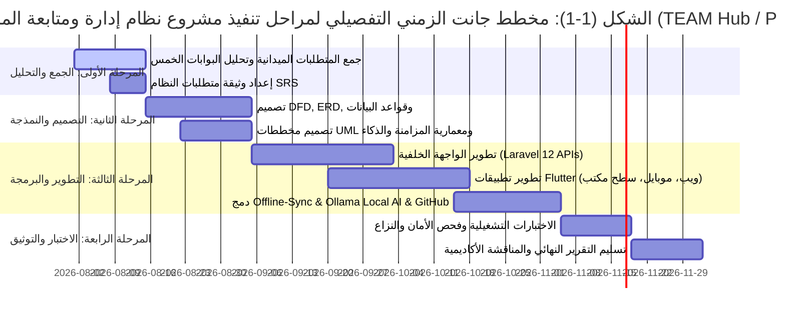

---

### 1.12 النموذج التطبيقي للمتغيرات (Academic Applied Research Model)

#### الشكل (1-2): مخطط النموذج التطبيقي والمتغيرات البحثية (Academic Research Framework)

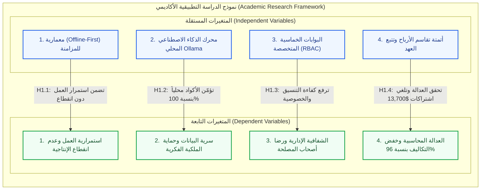

---

### 1.13 استبيان تقييم أداء المنصة المقترح (Evaluation Survey Template)

لقياس نجاح النظام بعد نشره وتشغيله التجريبي، تم اعتماد الاستبيان القياسي التالي لتوزيعه على عينات المطورين، مدراء المشاريع، والعملاء:

#### الجدول (1-2): نموذج استبيان تقييم أداء المنصة المقترح

| م     | المعيار التقني والإداري المستهدف                                                            | موافق بشدة | موافق | محايد | غير موافق | غير موافق بشدة |
| ----- | ------------------------------------------------------------------------------------------- | :--------: | :---: | :---: | :-------: | :------------: |
| **1** | تضمن معمارية Offline-First استمرار عملي على المهام وإدارتها دون تأثر بانقطاع الإنترنت.      |    [ ]     |  [ ]  |  [ ]  |    [ ]    |      [ ]       |
| **2** | يحقق فحص الكود بالذكاء الاصطناعي المحلي (Ollama) أماناً تاماً ويمنع تسريب البيانات الحساسة. |    [ ]     |  [ ]  |  [ ]  |    [ ]    |      [ ]       |
| **3** | تتيح بوابة العميل متابعة مراحل الإنجاز والفواتير بشفافية دون كشف الكود المصدري الداخلي.     |    [ ]     |  [ ]  |  [ ]  |    [ ]    |      [ ]       |
| **4** | يسهم محلل الإرهاق والعافية ونظام التحفيز بالنجوم في رفع دافعية المطورين وحمايتهم مهنياً.    |    [ ]     |  [ ]  |  [ ]  |    [ ]    |      [ ]       |
| **5** | تحقق خوارزمية تقاسم الأرباح المؤتمتة عدالة وشفافية مالية وتقضي على نزاعات الشركاء.          |    [ ]     |  [ ]  |  [ ]  |    [ ]    |      [ ]       |
| **6** | يوفر الربط التلقائي مع GitHub وتتبع عهد الأجهزة وقتاً طويلاً ومجهوداً إدارياً شاقاً.        |    [ ]     |  [ ]  |  [ ]  |    [ ]    |      [ ]       |

---

### 1.14 تنظيم التقرير (Report Organization)

ينتظم هذا التقرير العلمي في سبعة فصول مترابطة:

- **الفصل الأول:** يضع الإطار العام للمشروع والمقدمة والمشكلة والأهداف والجدول الزمني والنموذج التطبيقي.
- **الفصل الثاني:** يستعرض الدراسات السابقة والأنظمة المنافسة، ويحدد الفجوة البحثية، ويفصل دراسة الجدوى الثلاثية وإدارة المخاطر.
- **الفصل الثالث:** يغطي التحليل الهندسي ومتطلبات النظام، ومخططات تدفق البيانات DFD، ونموذج العلاقات ERD، وقاموس البيانات الكامل، ومخططات UML.
- **الفصول اللاحقة (الرابع إلى السابع):** ستتناول التصميم المعماري والبرمجي، التنفيذ والتكامل، النتائج والمناقشات، والاستنتاجات والتوصيات وقائمة المراجع.

---

# الوحدة الثانية: الفصل الثاني - الإطار النظري والدراسات السابقة والجدوى

## (Literature Review & Feasibility Study)

> **وفقاً لـ «الهيكل الأساسي لمشاريع التخرج لكافة التخصصات - جامعة الرازي»**  
> **مشروع التخرج:** منصة ومسرعة المشاريع والفرق التقنية والريادية (PMTS / TEAM Hub)  
> **حزمة التقنيات المعتمدة:** Laravel 12 (Backend API) | Flutter (Multi-Platform UI) | Ollama (Local AI Engine) | Offline-First (SQLite & PostgreSQL)

---

### 2.1 خلفية الدراسة والتطور التاريخي (Background)

#### نبذة عن القطاع والتخصص

ينتمي هذا المشروع إلى قطاع **نظم المعلومات الإدارية (Management Information Systems - MIS)** وتطبيقات **هندسة البرمجيات المتقدمة (Advanced Software Engineering)** وتحديداً مجال أنظمة إدارة الأعمال والمشاريع البرمجية والتحول الرقمي للشركات الناشئة والوكالات البرمجية (Agencies). يُعد هذا القطاع المحرك الأساسي للاقتصاد الرقمي الحديث؛ حيث تعتمد الشركات البرمجية على بيئات عمل رقمية لتنسيق جهود المطورين، وحساب تكاليف المشاريع، وضمان الالتزام بمواعيد التسليم والميزانيات المرصودة.

#### كيفية تطور الحلول التقنية عبر السنوات

تطورت آليات إدارة المشاريع والأنظمة الداعمة عبر أربع مراحل تاريخية متتابعة:

1. **المرحلة التقليدية (الورقية والخطية):** الاعتماد على جداول الحسابات اليدوية والوثائق الورقية ومخططات نموذج الشلال (Waterfall)، والتي كانت تعاني من الجمود وعدم القدرة على مواكبة التغييرات المتسارعة في متطلبات البرمجيات.
2. **مرحلة الحوسبة المكتبية (Desktop Era):** ظهور برمجيات منفصلة ومثبتة محلياً على الأجهزة (مثل Microsoft Project)، والتي وفرت أدوات تخطيط ومخططات جانت ولكنها افتقرت كلياً للتواصل اللحظي والتكامل التشاركي بين أفراد الفريق المتفرقين.
3. **مرحلة الحوسبة السحابية (Cloud SaaS Era):** الانتقال الكامل إلى المنصات السحابية عبر الويب (مثل Jira, Trello, Asana, Monday)، والتي قدمت ميزات التعاون عبر الإنترنت، لكنها فرضت شروطاً صارمة كالاتصال الدائم والمستمر بالإنترنت، فضلاً عن اشتراكات شهرية باهظة بالدولار عن كل مستخدم على حدة.
4. **المرحلة الحديثة (الذكاء الاصطناعي واللامركزية):** دمج أدوات الذكاء الاصطناعي التوليدي لتوليد الأكواد والتنبؤ بالمخاطر، إلا أن معالجتها السحابية كشفت ثغرة أمنية فادحة تمثلت في تسريب الملكية الفكرية والأكواد الحساسة للشركات إلى السحابة العامة دون ضوابط محلية.

#### الدوافع العامة والمبررات في الوقت الراهن

تتجلى أهمية هذا المشروع في الوقت الراهن لتلبية احتياجات الشركات البرمجية الناشئة والفرق التقنية في الدول النامية (خاصة في الجمهورية اليمنية والإقليم)، مدفوعة بالأسباب الجوهرية التالية:

- **التغلب على التحديات البنيوية المحلية:** الانقطاع المتكرر لشبكات الإنترنت وضعف استقرارها، وانقطاع التيار الكهربائي المفاجئ، مما يجعل الاعتماد الحصري على الأنظمة السحابية سبباً في إهدار مئات الساعات الإنتاجية سنوياً وشلل الأعمال.
- **الحاجة لحماية الملكية الفكرية وسرية الأكواد:** القضاء على مخاطر رفع الكود المصدري لسحابة الذكاء الاصطناعي عبر تشغيل نماذج الذكاء الاصطناعي محلياً بالكامل (On-Premises Local AI).
- **الضغط المالي وارتفاع أسعار الصرف:** التخلص من أعباء الاشتراكات الشهرية السحابية المرهقة عبر بناء حل ذاتي مستقر ومفتوح المصدر وخالٍ من الرسوم التراخيص المتكررة.
- **العدالة التنظيمية والمالية:** حل نزاعات تقاسم الأرباح بين الشركاء والمطورين بأتمتة محاسبية دقيقة تعتمد على نسب الإنجاز الواقعية والعقود الإلكترونية المبرمة.

---

### 2.2 الدراسات السابقة والأنظمة المنافسة (Literature Review)

#### استعراض وتحليل الأنظمة المنافسة

تم إجراء دراسة استقصائية ونقدية معمقة لأربع (4) منصات عالمية رائدة ومنافسة في سوق إدارة المشاريع والوكالات البرمجية:

##### أولاً: منصة Productive.io

- **سنة النشر والإطلاق:** أُطلقت عام 2014 بواسطة شركة برمجية متخصصة في إدارة وكالات البرمجة والتسويق.
- **أهداف النظام:** توفير منصة شاملة تجمع بين إدارة المهام وتتبع الوقت وحساب ربحية الوكالات والتدفق النقدي.
- **أهم الميزات:** حاسبة الربحية المباشرة للمشاريع، تتبع الوقت والفواتير، وإدارة طاقات الموظفين (Resource Planning).
- **نقاط القوة (Strengths):**
  - دقة عالية في ربط ساعات عمل المطورين بتكلفة المشروع وهوامش الربح.
  - واجهة تقارير مالية متميزة لأصحاب الوكالات.
- **نقاط الضعف والقصور (Weaknesses):**
  - سحابية بالكامل؛ وتتوقف عن العمل تماماً بمجرد انقطاع شبكة الإنترنت.
  - أسعار اشتراكات مرتفعة جداً ($9 - $24 لكل موظف شهرياً).
  - لا توفر أي نموذج ذكاء اصطناعي محلي لفحص الأمان أو جودة الكود المصدري.
  - تفتقر لنظام تتبع عهد ومواصفات أجهزة المطورين العتادية (Hardware Specs).

##### ثانياً: منصة Teamwork.com

- **سنة النشر والإطلاق:** أُطلقت عام 2007 ومقرها في أيرلندا، وهي منصة مصممة لإدارة مشاريع العملاء والفرق التشاركية.
- **أهداف النظام:** تعزيز الشفافية مع العملاء وإدارة التبعيات والمراحل الزمنية ومراقبة ساعات العمل.
- **أهم الميزات:** بوابات مخصصة للعملاء، مخططات جانت، إدارة التذاكر، وتتبع معالم المشروع (Milestones).
- **نقاط القوة (Strengths):**
  - قدرات ممتازة في إشراك العميل في مراجعة المهام والتسليمات.
  - تنظيم قوي لتبعية المهام والجدول الزمني.
- **نقاط الضعف والقصور (Weaknesses):**
  - انعدام دعم العمل دون اتصال بالإنترنت (No Offline-First Support).
  - غياب آلية محاسبية لتقاسم الأرباح بين المطورين وفق العقود.
  - لا يوجد تكامل مع مستودعات GitHub لتحديث حالات المهام برمجياً عند عمليات الـ Push أو الـ Merge.
  - غياب مؤشرات العافية ومحلل إرهاق المطورين (Burnout Analyzer).

##### ثالثاً: منصة Wrike.com

- **سنة النشر والإطلاق:** أُطلقت عام 2006 في الولايات المتحدة الأمريكية وتخدم الشركات والمؤسسات الضخمة.
- **أهداف النظام:** إدارة العمليات المؤسسية المعقدة وأتمتة مسارات النماذج والموافقات وسلاسل الإمداد.
- **أهم الميزات:** نماذج طلبات ديناميكية، أتمتة مسارات العمل، ومخططات جانت المتقدمة.
- **نقاط القوة (Strengths):**
  - أتمتة مؤسسية عميقة وتخصيص دقيق للصلاحيات والتقارير.
  - مناسبة للمنظمات متعددة الفروع والتحكم الإداري الضخم.
- **نقاط الضعف والقصور (Weaknesses):**
  - واجهات شديدة التعقيد تتطلب تدريباً طويلاً وتثقل كاهل الفرق الناشئة.
  - تكاليف اشتراك باهظة تبدأ من $9.80 وتتجاوز $24.80 للمستخدم شهرياً.
  - غياب الذكاء الاصطناعي المحلي (On-Premises Local AI)؛ حيث تعتمد على السحابة فقط.
  - لا توفر بوابة مستقلة للخبراء والاستشارات ولا تتيح التعاقد واستقطاب المطورين.

##### رابعاً: منصة Monday.com

- **سنة النشر والإطلاق:** أُطلقت عام 2012 كمنصة مرنة لتخصيص بيئات العمل الرقمية (Work OS).
- **أهم الميزات:** لوحات بصرية ملونة وقابلة للتخصيص، وتكاملات سحابية متنوعة، وتطبيقات مصغرة.
- **نقاط القوة (Strengths):**
  - تصميم واجهات جذاب ومرن وسهل التخصيص للمستخدم العادي.
  - تنوع طرق العرض (Kanban, Calendar, Table, Timeline).
- **نقاط الضعف والقصور (Weaknesses):**
  - لا تدعم العمل دون اتصال بالإنترنت في المناطق ذات التغطية الضعيفة.
  - معالجة الذكاء الاصطناعي سحابية فقط، مما يشكل خطراً كبيراً على سرية الكود المصدري.
  - لا تحتوي على آليات لحساب العهد العتادية للمطورين ولا تتبع إرهاقهم الوظيفي.
  - غياب خوارزمية تقاسم الأرباح التلقائية بين الشركاء والمطورين.

---

### 2.3 الفجوة البحثية (Research Gap)

من خلال التحليل النقدي للأنظمة السابقة، تم رصد **فجوة علمية وهندسية واضحة** تتمثل في:

> **"عدم وجود نظام برمجي متكامل وموحد يجمع بين معمارية العمل دون اتصال أولاً (Offline-First) لضمان استمرارية العمل بنسبة 100%، وبين توطين الذكاء الاصطناعي محلياً (Local AI) لفحص أمان وجودة الأكواد وتوليد التقارير دون المساس بسرية البيانات، مع دمج منظومة محاسبية مؤتمتة لتقاسم الأرباح، وتتبع العهد العتادية للأجهزة، وتوفير بوابات متخصصة للعملاء والخبراء والتوظيف بما يلائم قدرات وبيئة الشركات الناشئة."**

#### الشكل (2-1): مخطط الدراسة المقارنة وتحليل الفجوة البحثية (Comparative Analysis & Research Gap)

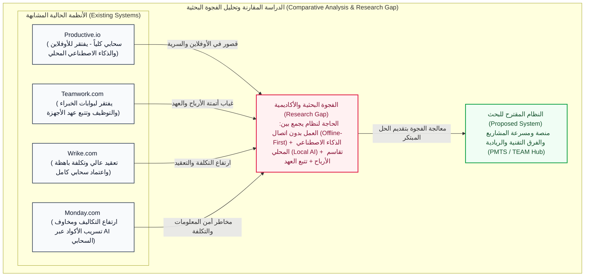

---

### 2.4 جدول المقارنة المعياري بين النظام المقترح والأنظمة السابقة

#### الجدول (2-1): جدول المقارنة المعياري المفصل بين مشروعنا والأنظمة السابقة المنافسة

| معيار المقارنة / الميزة البرمجية                | مشروعنا المقترح (PMTS / TEAM Hub) |    منصة Productive.io     |   منصة Teamwork.com    |     منصة Wrike.com     | منصة Monday.com  |
| ----------------------------------------------- | :-------------------------------: | :-----------------------: | :--------------------: | :--------------------: | :--------------: |
| **معمارية العمل دون اتصال (Offline-First)**     |     **مدعوم بالكامل (100%)**      |       ❌ غير مدعوم        |      ❌ غير مدعوم      |      ❌ غير مدعوم      |   ❌ غير مدعوم   |
| **الذكاء الاصطناعي المحلي (Local AI)**          |   **Ollama محلي (مجاني وآمن)**    |       ❌ غير متوفر        |      ❌ غير متوفر      |      ❌ سحابي فقط      |   ❌ سحابي فقط   |
| **فحص أمان وجودة الكود محلياً**                 |   **مدعوم لجميع اللغات محلياً**   |       ❌ غير متوفر        |      ❌ غير متوفر      |      ❌ غير متوفر      |   ❌ غير متوفر   |
| **أتمتة تقاسم الأرباح المحاسبي**                |   **مدمجة وفق العقود والإنجاز**   | مدعوم جزئياً (حساب ربحية) |      ❌ غير مدعوم      |      ❌ غير مدعوم      |   ❌ غير مدعوم   |
| **تتبع عهد ومواصفات الأجهزة (Hardware Specs)**  |     **مدعوم (CPU, RAM, GPU)**     |       ❌ غير متوفر        |      ❌ غير متوفر      |      ❌ غير متوفر      |   ❌ غير متوفر   |
| **محلل إرهاق وعافية المطور (Burnout Analyzer)** |   **مستشعر ذكي مدمج بالتحضير**    |       ❌ غير متوفر        |      ❌ غير متوفر      |      ❌ غير متوفر      |   ❌ غير متوفر   |
| **بوابة مخصصة للخبراء والمستشارين**             |     **نظام حجز وجلسات موثق**      |       ❌ غير متوفر        |      ❌ غير متوفر      |      ❌ غير متوفر      |   ❌ غير متوفر   |
| **بوابة توظيف مربوطة بـ GitHub**                |     **استعراض كفاءات وعقود**      |       ❌ غير متوفر        |      ❌ غير متوفر      |      ❌ غير متوفر      |   ❌ غير متوفر   |
| **أتمتة حالات المهام عبر Git Webhooks**         |   **تحديث تلقائي لحالة المهمة**   |        تكامل سطحي         |    تكامل مهام محدود    |       تكامل وسيط       |   تكامل محدود    |
| **التقارير اليومية عبر الصوت (Voice-to-Text)**  |     **مدعوم محلياً أوفلاين**      |       ❌ غير متوفر        |      ❌ غير متوفر      |      ❌ غير متوفر      |   ❌ غير متوفر   |
| **تكلفة الاشتراكات والتراخيص الشهرية**          |     **صفر $ (مفتوح المصدر)**      |  باهظة ($9 - $24/مستخدم)  | باهظة ($5.99 - $19.99) | باهظة ($9.80 - $24.80) | باهظة ($9 - $19) |

---

### 2.5 النظام الحالي وعيوبه ومبررات الاستبدال (Existing System)

#### كيفية سير العمليات والإجراءات حالياً خطوة بخطوة

تعتمد الشركات البرمجية والوكالات الناشئة حالياً على آلية عمل يدوية ومشتتة تسير وفق الخطوات التالية:

1. **تحديد وتوزيع التكليفات:** يقوم مدير المشروع بإنشاء المهام وإرسالها عبر مجموعات الدردشة (WhatsApp / Telegram) أو تدوينها في جداول Excel مشتركة، مما يؤدي لضياع سياق المحادثة وتداخل التوجيهات وعدم وجود أرشيف رسمي.
2. **تسجيل الحضور والانصراف:** يتم تسجيل الحضور يدوياً في دفاتر ورقية أو شيتات إلكترونية، دون تحقق حقيقي من بقاء المطور فاعلاً في بيئة العمل، مما يفتح باب التلاعب بساعات العمل الفعلية.
3. **التواصل مع العميل:** يُرسل مدير المشروع تحديثات الإنجاز عبر البريد الإلكتروني أو لقطات الشاشة (Screenshots)، دون وجود لوحة تفاعلية موحدة، مما يخلق شكوكاً لدى العميل أو يجبر الشركة على كشف تفاصيل الكود الداخلي دون مبرر.
4. **فحص الكود والأمان:** يضطر المبرمجون لنسخ الكود المصدري ولصقه في أدوات ذكاء اصطناعي سحابية عامة (مثل ChatGPT) لاكتشاف الأخطاء، ما يعرض الأسرار البرمجية والملكية الفكرية للتسريب والانتهاك الصريح.
5. **المحاسبة وتوزيع المستحقات:** في نهاية كل مرحلة، تُجرى حسابات يدوية معقدة لتقدير تكاليف السيرفرات والأدوات ومحاولة توزيع الأرباح، مما يثير نزاعات متكررة بين الشركاء والمطورين حول أحقية كل فرد.
6. **إدارة العهد:** يتم تسليم الحواسيب المحمولة وقطع العتاد للموظفين دون توثيق تفصيلي لمواصفات المعالج والذاكرة وكرت الشاشة، مما يسبب ضياع الأصول عند استقالة الموظف أو صعوبة تحديد أسباب بطء جهازه.

#### مشاكل وعيوب النظام الحالي

- **بطء الإنجاز وشلل العمليات:** توقف الفريق عن تسجيل المهام أو تحديث الحالات عند انقطاع شبكة الإنترنت أو الكهرباء.
- **ضياع وتشتت البيانات:** تشتت سجلات المشروع بين محادثات واتساب، وملفات إكسل المتفرقة، وفقدان التسلسل التاريخي للتعديلات.
- **الأخطاء البشرية والنزاعات المالية:** الناتجة عن الحسابات اليدوية غير المؤتمتة لتقاسم الأرباح وتقدير ساعات العمل.
- **صعوبة استخراج التقارير التنفيذية:** استغراق مدراء المشاريع ساعات طويلة لتجهيز تقرير إنجاز واحد وتقديمه للعميل أو الإدارة.
- **ضعف الرقابة وسرية الملكية الفكرية:** مخاطر تسريب الأكواد عبر الذكاء الاصطناعي السحابي، وغياب الفصل بين ما يراه العميل وما ينفذه المطور.
- **احتراق المطورين (Burnout):** انعدام المؤشرات التحذيرية التي تنبه الإدارة إلى الإرهاق الشديد للمطورين نتيجة العمل المتصل لساعات طويلة.

#### مبررات استبدال وتطوير النظام الحالي بالنظام الجديد المقترح

- **توحيد بيئة العمل:** دمج إدارة المهام، والتحضير الذكي، والأمان، والتوظيف، والمالية في منصة مركزية واحدة.
- **استمرارية التشغيل التامة (100% Uptime):** اعتماد معمارية العمل بدون اتصال (Offline-First) لتمكين المطور من العمل تحت أي ظرف.
- **حماية الأسرار وتوفير التكاليف:** توطين نماذج الذكاء الاصطناعي محلياً عبر Ollama لإلغاء تكلفة الاشتراكات وحماية الأكواد بنسبة 100%.
- **الشفافية المطلقة:** بناء بوابات متخصصة تمنح كل مستخدم ما يحتاجه فقط وفق نظام صلاحيات صارم (RBAC).

---

### 2.6 دراسة الجدوى الثلاثية (Feasibility Study)

#### a. دراسة الجدوى التقنية (Technical Feasibility Study)

##### العتاد المادي (Hardware Requirements)

- **أجهزة المطورين والمستخدمين:**
  - معالج: Intel Core i5 أو AMD Ryzen 5 (الجيل الثامن أو أحدث).
  - الذاكرة العشوائية (RAM): 8GB إلى 16GB كافية لتشغيل بيئة Flutter وقواعد البيانات المحلية ونماذج Ollama الخفيفة (4-bit Quantization).
  - التخزين: 256GB SSD لضمان سرعة القراءة والكتابة اللحظية لقواعد بيانات SQLite بنمط WAL.
- **الخادم المحلي للشركة (On-Premises Server):**
  - معالج 8 أنوية فما فوق، وذاكرة 16GB - 32GB RAM لتشغيل محرك Ollama المركزي وخدمات Laravel وPostgreSQL.

##### البرمجيات وأطر العمل (Software & Frameworks)

- **الواجهة الخلفية (Backend):** إطار عمل **Laravel (PHP 8.2+)**؛ لما يوفره من بنية RESTful APIs عالية الأمان، وإدارة متقدمة لطوابير المزامنة (Queues) ونظام الصلاحيات (Spatie RBAC).
- **واجهات المستخدم وتطبيقات الأجهزة المتعددة (Multi-Platform UI):** إطار عمل **Flutter (Dart)**؛ لإنتاج تطبيق موحد فائق السلاسة يعمل بنفس الكود على الهواتف الذكية (Android / iOS) والويب وأنظمة الحواسيب.
- **قواعد البيانات الهجينة:**
  - **PostgreSQL:** على الخادم المركزي لضمان سلامة المعاملات المالية ومعايير ACID.
  - **SQLite / Hive:** على أجهزة المستخدمين لدعم العمل المحلي السريع بدون إنترنت.
- **محرك الذكاء الاصطناعي:** **Ollama** المنشور محلياً بنماذج مفتوحة المصدر (Llama 3, Phi-3, CodeLlama) مكممة بنمط 4-bit Quantization لتوفير استهلاك الموارد.

##### تقييم المهارات والخبرات البرمجية

يمتلك فريق العمل خبرات تزيد عن عامين في تطوير مواقع وتطبيقات الويب والموبايل باستخدام Flutter وLaravel وتصميم واجهات UI/UX، مما يجعل الفريق مؤهلاً هندسياً لإنجاز المشروع وصيانته.

##### حداثة واستقرار التقنيات

كافة التقنيات المختارة هي أدوات مستقرة ومفتوحة المصدر ومدعومة عالمياً، وتضمن قابلية النظام للتوسع المستقبلي دون الارتهان لأي تراخيص تجارية احتكارية.

---

#### b. دراسة الجدوى الاقتصادية (Economic Feasibility Study)

##### تحليل التكاليف مقابل العوائد المتوقعة (Cost-Benefit Analysis)

- **التكاليف المباشرة:** تكاليف تطوير أولية لا تشمل أي رسوم برمجية أو اشتراكات، نظراً للاعتماد بنسبة 100% على أدوات مفتوحة المصدر (Open-Source) ومحركات ذكاء اصطناعي مجانية محلياً.
- **التكاليف غير المباشرة:** استهلاك الكهرباء والإنترنت المعتاد لدى الشركة.

##### العوائد والتوفير المالي السنوي المحقق

تم إجراء دراسة مقارنة على شركة برمجية ناشئة تضم 30 مطوراً وإدارياً ينجزون 10 مشاريع سنوياً، وأثبتت الأرقام الوفورات المالية التالية:

#### الجدول (2-2): دراسة الجدوى الاقتصادية وحساب التكاليف والوفورات المالية المحققة

| بند التكلفة السحابية الملغاة                                   | التكلفة بالأنظمة السحابية التقليدية | التكلفة مع نظامنا المقترح (PMTS) |    صافي التوفير السنوي المحقق    |
| -------------------------------------------------------------- | :---------------------------------: | :------------------------------: | :------------------------------: |
| **اشتراكات منصات إدارة المشاريع السحابية** (Productive/Monday) |            $5,400 سنوياً            |                $0                |           **+$5,400**            |
| **اشتراكات أدوات الذكاء الاصطناعي** لفحص الكود والأمان         |            $3,600 سنوياً            |         $0 (Ollama محلي)         |           **+$3,600**            |
| **اشتراكات أدوات تتبع الوقت والإنتاجية** (Clockify/Hubstaff)   |            $1,800 سنوياً            |       $0 (مدمج في التحضير)       |           **+$1,800**            |
| **عمولات منصات العمل الحر والتوظيف** لاستقطاب المطورين         |            $2,000 سنوياً            |    $0 (بوابة التوظيف المدمجة)    |           **+$2,000**            |
| **استهلاك حزم الإنترنت السحابية** عند توقف المزامنة            |             $900 سنوياً             |        $0 (Offline-First)        |            **+$900**             |
| **الإجمالي السنوي العام**                                      |         **$13,700 سنوياً**          |              **$0**              | **+$13,700 سنوياً (توفير 96%+)** |

> [!NOTE]
> يثبت التحليل المالي خفض التكاليف التشغيلية بنسبة تتجاوز **96%** مقارنة بالبدائل العالمية، مما يحقق عائداً استثمارياً فورياً (Immediate ROI) للمنشأة.

---

#### c. دراسة الجدوى التشغيلية (Operational Feasibility Study)

- **الملاءمة مع البيئة وثقافة المستخدمين:** يتطابق النظام مع ثقافة العمل في السوق المحلي؛ حيث يقضي على توتر انقطاع الإنترنت عبر ميزة الحفظ الأوفلاين التلقائي.
- **سهولة الاستخدام والواجهات المتجاوبة:** تصميم واجهات تفاعلية متجاوبة تعتمد على أحدث معايير UI/UX مع دعم كامل للغتين العربية والإنجليزية والكتابة من اليمين لليسار (RTL).
- **حل المشكلات دون عبء إداري:** يلغي النظام الأعمال الورقية والروتينية من خلال:
  - التحضير الذكي بضغطة زر.
  - أتمتة حالات المهام بمجرد دفع الكود لـ GitHub.
  - التوليد الآلي للنشرات الأسبوعية وسجلات التحديث للعملاء.
- **متطلبات التدريب:** واجهات النظام واضحة وبديهية ولا تحتاج لأكثر من جلسة تعريفية مدتها 30 دقيقة للموظفين أو العملاء.

---

### 2.7 إدارة المخاطر ومصفوفة التحكم (Risk Management & Control)

#### a. تحديد المخاطر (Determination of Risk)

تم رصد وتصنيف المخاطر المحتملة التي قد تواجه النظام إلى أربعة محاور رئيسية:

#### الشكل (2-2): هيكل ومصفوفة تصنيف مخاطر المشروع (Risk Classification Hierarchy)

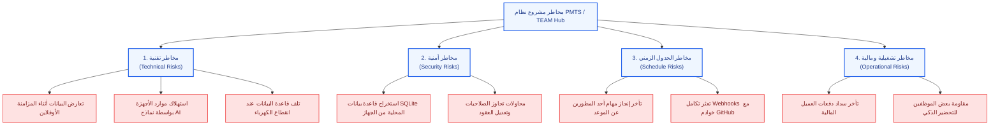

---

#### b. التحكم في المخاطر (Risk Control)

تم وضع خطة استراتيجية وإجراءات وقائية محددة للتعامل مع كل خطر محتمل لضمان استقرار وجودة النظام:

#### الجدول (2-3): مصفوفة تقييم وإدارة المخاطر البرمجية والأمنية واستراتيجيات التحكم

| تصنيف الخطر   | الخطر المحتمل                                    | مستوى الأثر | استراتيجية التخفيف والتحكم المعتمدة (Mitigation Strategy)                                                                                                                                                                       |
| ------------- | ------------------------------------------------ | :---------: | ------------------------------------------------------------------------------------------------------------------------------------------------------------------------------------------------------------------------------- |
| **تقني**      | تعارض البيانات أثناء المزامنة الأوفلاين          |    مرتفع    | تطبيق خوارزمية **(Conflict-Free Replicated Data Types - CRDTs)** لدمج الحقول المستقلة تلقائياً، واعتماد التعديل الأحدث زمنياً (Last-Write-Wins Timestamping) للحقول المتطابقة، مع حفظ التعديل الآخر في سجل التدقيق (Audit Log). |
| **تقني**      | بطء استجابة الذكاء الاصطناعي على حواسيب المطورين |    متوسط    | استخدام نماذج مكممة خفيفة **(4-bit Quantized Models مثل Phi-3 أو Llama-3-8B)**، مع خيار توجيه طلبات الفحص لخادم الشركة المحلي المركزي لتخفيف العبء عن الأجهزة الفردية.                                                          |
| **تقني**      | تلف قاعدة البيانات عند انقطاع الكهرباء المفاجئ   |    مرتفع    | تفعيل نمط الكتابة الاستباقية **(Write-Ahead Logging - WAL)** في SQLite مع حفظ تلقائي فوري كل 3 ثوانٍ داخل التطبيق المحلي.                                                                                                       |
| **أمني**      | محاولة الوصول للبيانات المخزنة محلياً على الجهاز |    مرتفع    | تشفير قاعدة بيانات SQLite المحلية باستخدام خوارزمية **AES-256** وعزل مفتاح التشفير داخل التخزين الآمن للنظام (Flutter Secure Storage).                                                                                          |
| **أمني**      | محاولات التلاعب بالصلاحيات واختراق الحسابات      |     حرج     | تطبيق نظام تحكم بالوصول صارم **(Spatie RBAC)**، وتأكيد الهوية عبر توكنات JWT المشفرة ذات مدة صلاحية محددة مع التجديد الآلي.                                                                                                     |
| **جدول زمني** | تأخر تسليم مراحل المشروع عن المواعيد المحددة     |    متوسط    | وضع هوامش أمان زمنية (Buffer Times) بنسبة 15% في مخطط جانت، مع إطلاق تنبيهات مبكرة للإدارة فور انحراف مؤشر الإنجاز عن المسار المخطط.                                                                                            |
| **مالي**      | تأخر العميل في سداد الدفعة المالية المقررة       |    متوسط    | تعليق توزيع الأرباح برمجياً حتى يتم تأكيد استلام الحوالة من العميل في جدول الفواتير ($Status = Paid$)، مع حساب العوائد بالأرقام الشفافة.                                                                                        |
| **تشغيلي**    | تخوف المطورين من انتهاك الخصوصية في التحضير      |    منخفض    | صياغة سياسة خصوصية صريحة مدمجة بالنظام تؤكد حظر أي تصوير للشاشة أو تجسس، وقصر التتبع على حالة الاتصال وحجم المهام المعتمدة فقط.                                                                                                 |

---

# الوحدة الثالثة: الفصل الثالث - التحليل الهندسي ومتطلبات النظام

## (System Analysis & Requirements)

> **مشروع التخرج:** منصة ومسرعة المشاريع والفرق التقنية والريادية المتكاملة (**TEAM Hub / PMTS**)  
> **التخصص:** نظم معلومات إدارية (MIS) & هندسة البرمجيات  
> **العام الجامعي:** 2026 / 2027م  
> **إطار العمل والتقنيات:** Laravel 12 (PHP 8.2+) | Flutter SDK | Ollama Local AI | PostgreSQL / SQLite | Offline-First Sync

---

### 3.1 طرق جمع المتطلبات الميدانية (Methods of Collecting Requirements)

اعتمد فريق العمل منهجية علمية وميدانية متعددة المصادر لاستخلاص وتوثيق الاحتياجات الوظيفية والتقنية لمنظومة **TEAM Hub / PMTS** لضمان تطابق الحل البرمجي مع واقع العمل الفعلي لأصحاب المصلحة:

#### 1.1 المقابلات الشخصية الميدانية والموجّهة (Interviews)

عُقدت سلسلة من المقابلات المعمقة (شبه الموجهة Semi-Structured Interviews) مع الفئات المستهدفة:

- **الأكاديميون ومستشارو المشاريع (12 أستاذاً ومحكّماً):** للتعرف على المشاكل التي تواجههم في تقييم مخرجات الطلاب ومتابعة الـ Commits وتحديد مواعيد الاستشارات.
- **قادة ومطورو الفرق التقنية (25 طالباً ومطوراً):** لمناقشة عوائق توزيع المهام، ومشاكل استكمال الأعضاء ذوي التخصصات النادرة، وصعوبة حفظ الإصدارات والوثائق.
- **ممثلو قطاع الأعمال ومسؤولو التوظيف بالشركات البرمجية (8 شركات):** لتحديد معايير استقطاب النخب الطلابية، وكيفية طرح التحديات التجارية والرعاية المالية.

#### 1.2 الاستبيان الإلكتروني المسحي (Questionnaires)

تم تصميم وتوزيع استبيان إحصائي موجّه لمجتمع كليات الحاسوب والشركات الناشئة؛ حيث تم جمع وتحليل **184 استجابة مكتملة**. وقد أظهرت النتائج:

- **89.2%** يعانون من تشتت الأدوات (استخدام Trello لمهام العمل، WhatsApp للمحادثات، Google Drive للوثائق، وZoom للاجتماعات).
- **78.4%** أكدوا انقطاع وتأخر التواصل مع المستشارين المشرفين لعدم وجود جدول مواعيد رسمي موثق.
- **93.5%** من الشركات أبدت رغبة ملحة في وجود منصة موحدة تستعرض المشاريع الجاهزة والمصنفة حسب قطاع الأعمال (FinTech, AI, HealthTech).

#### 1.3 الملاحظة المباشرة ودراسة بيئة العمل الواقعية (Observation)

قام فريق التحليل بمراقبة جلسات المناقشة والتحكيم السنوية للمشاريع الجامعية وحضور فعاليات هاكاثونات تقنية؛ وتم تدوين الملاحظات حول:

- غياب التوثيق الفوري لتوصيات اللجان؛ مما يؤدي لفقدان الملاحظات البرمجية.
- الصعوبة في استعراض السير الذاتية (CVs) للمشاركين أثناء تقييم مشاريعهم.

#### 1.4 فحص وتدقيق الوثائق والنماذج القائمة (Document Review)

تم جمع وفحص النماذج المعتمدة في إدارة المشاريع:

- نماذج مواصفات متطلبات البرمجيات المعتمدة (IEEE 830 SRS Templates).
- استمارات تحكيم وتقييم مشاريع التخرج الأكاديمية.
- عقود واتفاقيات رعاية المشاريع والمسؤولية المجتمعية (CSR).

---

### 3.2 متطلبات العمل وقواعد الحوكمة (Business Rules)

تحدد قواعد العمل المنطق المؤسسي والتنظيمي (**Business Logic Rules - BR**) الذي يحكم جميع العمليات التفاعلية داخل النظام:

- **[BR-01] حوكمة تسجيل الفرق وقادتها:** لا يحق للمستخدم إنشاء أكثر من فريق نشط واحد كـ "قائد فريق" (Team Leader)، بينما يمكنه الانضمام كعضو في فرق أخرى شريطة قبول الدعوة الرسمية.
- **[BR-02] كود الانضمام السري وتأمين التشكيلة:** لكل فريق برمجية رمز سري فريد (Invite Code) مكوّن من 12 خانة عشوائية، لا يمكن لأي عضو الانضمام إلا عبر إدخال هذا الرمز أو عبر رابط دعوة مشفر مؤقت الصلاحية (7 أيام).
- **[BR-03] آلية احتساب نسبة إنجاز المشروع التلقائية:** تحسب نسبة التقدم المئوية للمشروع تلقائياً استناداً إلى معادلة أوزان المهام المكتملة في لوحة الكانبان:
  $$\text{Progress \%} = \left( \frac{\sum \text{Completed Tasks}}{\text{Total Tasks}} \times 0.6 \right) + \left( \frac{\text{Approved Documents}}{5} \times 0.4 \right) \times 100$$
- **[BR-04] تصنيف مهام الكانبان ودورة حياتها:** تمر أي مهمة برمجية بإلزامية الترتيب التسلسلي عبر أربع حالات: `Todo` -> `In Progress` -> `Review` -> `Done`، ولا يمكن نقل المهمة لحالة المكتملة إلا بعد تسجيل تاريخ الإنجاز وتحديد المطور المسؤول.
- **[BR-05] قواعد خزانة وثائق المشروع (Vault):** تخضع الملفات المرفوعة إلى تصنيف إلزامي (`Technical`, `Architecture`, `Pitch Deck`, `Reports`, `Agreements`) مع إلزامية وضع رقم الإصدار (Version Tagging) وحد أقصى لحجم الملف (15MB).
- **[BR-06] حوكمة الجلسات الاستشارية:** لا تكتمل الجلسة الاستشارية في سجل المشروع إلا بعد قيام الخبير بكتابة **التوصيات الفنية الرسمية**، وإدخال الفريق لتقييم الجلسة بالنجوم (1 إلى 5 نجوم).
- **[BR-07] قواعد الرعاية وحوكمة الشركات (Deal Flow):** لا يمكن للشركات الاطلاع على الشيفرة المصدرية المباشرة (Private Repositories) إلا بعد تقديم طلب رعاية رسمي وموافقة قائد الفريق الأكاديمي.

---

### 3.3 متطلبات النظام الفنية العتادية والبرمجية (System Requirements)

#### أولاً: متطلبات العتاد (Hardware Requirements)

##### 1. متطلبات الخادم المركزي (Production Server Environment)

- **المعالج (CPU):** رباعي النوى بسرعة 2.5 GHz كحد أدنى (Quad-Core x86-64 / ARM64).
- **الذاكرة العشوائية (RAM):** 8 GB كحد أدنى (يوصى بـ 16 GB لتمكين نماذج الذكاء الاصطناعي المحلية ومعالجة التصدير).
- **سعة التخزين (Disk Storage):** 80 GB SSD NVMe لسرعة معالجة استعلامات قواعد البيانات والملفات المرفوعة.
- **الشبكة:** اتصال إنترنت عريض النطاق بسرعة رفع/تنزيل لا تقل عن 100 Mbps مع عنوان IP ثابت.

##### 2. متطلبات محطات عمل المستخدمين (Client Workstations & Devices)

- **أجهزة الحاسوب:** معالج ثنائي النواة 1.8 GHz، ذاكرة 4 GB RAM، دقة شاشة $1280 \times 720$ فما فوق.
- **الهواتف الذكية والأجهزة اللوحية:** أنظمة Android 10+ أو iOS 14+، ذاكرة 3 GB RAM.

#### ثانياً: متطلبات البرمجيات وبيئة التشغيل (Software Requirements)

- **خادم الويب (Web Server):** Nginx 1.24+ أو Apache 2.4+ مع دعم بروتوكول HTTP/2 وSSL/TLS.
- **بيئة التشغيل والخلفية (Backend Stack):**
  - لغة البرمجة: PHP 8.2+ أو PHP 8.3 مع ملحقات (`pdo_pgsql`, `mbstring`, `bcmath`, `curl`, `intl`, `gd`).
  - إطار العمل الأساسي: **Laravel 12.x**.
- **نظام إدارة قواعد البيانات (DBMS):**
  - السيرفر المركزي: **PostgreSQL 16+** (أو MySQL 8.0+).
  - التخزين والمزامنة بدون اتصال (Offline Engine): **SQLite 3.4+ / IndexedDB**.
- **الواجهات الأمامية والمكتبات (Frontend Stack):**
  - معمارية التصميم: **TailwindCSS 3.4+ / Vite 7.x**.
  - التفاعل الحي: **Alpine.js 3.x** و **Blade Component Engine**.
- **المتصفحات المتوافقة:** Google Chrome 110+, Mozilla Firefox 115+, Microsoft Edge 110+, Apple Safari 16+.

---

### 3.4 المتطلبات الوظيفية (Functional Requirements)

تم ترقيم وصياغة المتطلبات الوظيفية وفقاً للمعيار الدولي بصيغة _"يجب على النظام أن يوفر..."_:

#### 4.1 وحدة إدارة الهوية والمصادقة والصلاحيات (Auth & RBAC)

- **[FR-01]:** يجب أن يتيح النظام تسجيل حسابات جديدة وتصنيفها فورياً وفق المسارات الثلاثة: (فريق/مطور، شركة/شريك راعٍ، مستشار/خبير).
- **[FR-02]:** يجب توفير مصادقة آمنة عبر تشفير كلمات المرور باستخدام خوارزمية **Bcrypt / Argon2id** مع ميزة "تذكرني" وحماية من هجمات التخمين (Rate Limiting).
- **[FR-03]:** يجب تطبيق نظام صلاحيات وأدوار ديناميكي (Spatie RBAC) يفصل صلاحيات مدير النظام، وقائد الفريق، وعضو الفريق، والمستشار، وممثل الشركة.

#### 4.2 وحدة إدارة مساحة عمل الفرق والمشاريع (Team Workspace & Core)

- **[FR-04]:** يجب أن يتيح النظام لقائد الفريق إنشاء ملف المشروع، وتحديد العنوان، والوصف، والتصنيف البرمجي، والجامعة، والربط بمستودع GitHub.
- **[FR-05]:** يجب توليد كود انضمام عشوائي فريد لكل فريق (Invite Code)، مع إمكانية إرسال دعوات عبر البريد الإلكتروني مع روابط مؤقتة.
- **[FR-06]:** يجب استعراض تشكيلة الفريق وتحديد المهارات الناقصة وفتح باب الاستقطاب للمطورين الآخرين.

#### 4.3 وحدة لوحة مهام الكانبان الرشيقة (Agile Kanban Board)

- **[FR-07]:** يجب توفير لوحة مهام تفاعلية مقسمة إلى أربعة أعمدة (`Todo`, `In Progress`, `Review`, `Done`).
- **[FR-08]:** يجب تمكين إسناد المهمة لعضو محدد، وتعيين درجة الأولوية (`Urgent`, `High`, `Medium`, `Low`)، وتاريخ الاستحقاق (Due Date).
- **[FR-09]:** يجب تحديث النسبة المئوية لإنجاز المشروع كلياً فور تحريك المهام إلى عمود الإنجاز.

#### 4.4 وحدة السير الذاتية وملفات الأعضاء (CV Drawer & Talent Hub)

- **[FR-10]:** يجب تمكين كل عضو من إدخال ملفه المهني، وسنوات الخبرة، والمعدل، والمهارات التقنية، وروابط حساباته على GitHub و LinkedIn.
- **[FR-11]:** يجب توفير قارئ سيرة ذاتية تفاعلي (PDF Live Viewer) مدمج يتيح فحص الـ CV داخل المنصة دون الحاجة لتنزيله.
- **[FR-12]:** يجب توفير زر اتصال فوري يفتح محادثة واتساب مشفرة مباشرة مع العضو/المرشح.

#### 4.5 وحدة خزانة الوثائق والمخرجات (Project Document Vault)

- **[FR-13]:** يجب توفير مستودع سحابي سليم لتخزين وثائق المشروع وتصنيفها إلى (متطلبات SRS، مخططات معمارية، عروض Pitch Decks، وتقارير QA).
- **[FR-14]:** يجب تتبع إصدارات الوثائق وتوثيق هوية رافع الملف، وتاريخ الرفع، وحجم الملف، ونوعه.

#### 4.6 وحدة غرفة العمليات والنقاشات المعمارية (War Room & ADRs)

- **[FR-15]:** يجب توفير مساحة نقاشات داخلية آمنة تتيح توثيق القرارات المعمارية (Architectural Decision Records - ADRs).
- **[FR-16]:** يجب دعم التنبيه الفوري بالعوائق البرمجية الحرجة (Blockers)، وإمكانية تثبيت الإعلانات الإدارية الهامة (Pinned Announcements).
- **[FR-17]:** يجب تمكين الأعضاء من كتابة ردود تفاعلية متسلسلة على مواضيع النقاش.

#### 4.7 وحدة استشارات الخبراء والتحكيم (Advisory & Mentorship)

- **[FR-18]:** يجب تمكين الفرق من تصفح دليل المستشارين المعتمدين وتقديم طلب حجز جلسة استشارية متخصصة.
- **[FR-19]:** يجب أن يتيح النظام للمستشار قبول الموعد وتوليد رابط الاجتماع الافتراضي (Google Meet) وتوثيق التوصيات الفنية في سجل الفريق.
- **[FR-20]:** يجب توفير سجل تراكمي للمستشار يحسب إجمالي ساعات الإرشاد والفرق التي تم تحكيمها.

#### 4.8 وحدة رعاية الشركات والاستثمار (Enterprise Deal Flow)

- **[FR-21]:** يجب توفير دليل مصنف للمشاريع الجاهزة والمفتوحة للرعاية يتيح للشركات استكشاف الحلول حسب القطاع ونسبة الإنجاز.
- **[FR-22]:** يجب تمكين الشركات من طرح تحديات برمجية رسمية مع تحديد الجوائز، واستقبال حلول الفرق المنافسة.

#### 4.9 وحدة التقارير التنفيذية والتصدير (Executive Reports & Print Engine)

- **[FR-23]:** يجب توليد تقرير رسمي وشامل للمشروع قابل للطباعة بصيغة PDF يتضمن مصفوفة الإنجاز، هيكل الفريق، الوثائق، وتوصيات المستشارين.

---

### 3.5 المتطلبات غير الوظيفية (Non-Functional Requirements)

#### الجدول (3-2): المتطلبات غير الوظيفية للأداء والأمان والتشغيل

| المعيار                                 | متطلب الجودة                                | معيار القياس والتحقق                                                                                                                                   |
| --------------------------------------- | ------------------------------------------- | ------------------------------------------------------------------------------------------------------------------------------------------------------ |
| **الأداء والسرعة (Performance)**        | سرعة استجابة الخادم وتوليد الصفحات          | ألا يتجاوز زمن الاستجابة (Server Response Time) **800ms** تحت الحمل الطبيعي، وزمن استعلام قاعدة البيانات أقل من **50ms**.                              |
| **الأمان والتحصين (Security)**          | حماية البيانات، تشفير الاتصال، ومنع الثغرات | تشفير HTTPS/TLS إلزامي، حماية كاملة من ثغرات **OWASP Top 10** (CSRF Protection, SQL Injection via Eloquent, XSS Escaping, Password Hashing).           |
| **الموثوقية والجاهزية (Reliability)**   | استمرارية الخدمة والتعافي من الأعطال        | جاهزية المنظومة بمعدل **99.5% Uptime**، مع نظام نسخ احتياطي يومي آلي لقاعدة البيانات وتخزين سحابي للوثائق.                                             |
| **الاستمرارية (Offline-First)**         | القدرة على العمل عند انقطاع الإنترنت        | حفظ بيانات الكانبان والمهام محلياً في المتصفح، ومزامنة التعديلات تلقائياً مع السيرفر فور استعادة الاتصال.                                              |
| **سهولة الاستخدام (Usability)**         | واجهات مستخدم مريحة ومفهومة                 | واجهة متوافقة مع مبادئ التصميم الحديثة، تدعم التبديل السلس بين الوضعين (الليلي Dark Mode والنهاري Light Mode)، وخطوط عربية واضحة (Cairo & Readex Pro). |
| **التوافقية والانتشار (Compatibility)** | استجابة الواجهات على كافة الأجهزة           | تصميم متجاوب كلياً (Fully Responsive) يغطي شاشات الهواتف ($360\text{px}$)، الأجهزة اللوحية ($768\text{px}$)، والشاشات العريضة ($1920\text{px}$).       |
| **قابلية التوسع (Scalability)**         | استيعاب زيادة البيانات والمستخدمين          | بنية برمجية معيارية (Modular Architecture) تدعم إضافة بوابات وكيانات جديدة وملايين السجلات دون التأثير على استقرار النظام.                             |

---

### 3.6 متطلبات المستخدمين حسب الأدوار الخمسة (User Requirements)

#### الشكل (3-0): مخطط أدوار ومسؤوليات مستخدمي المنظومة

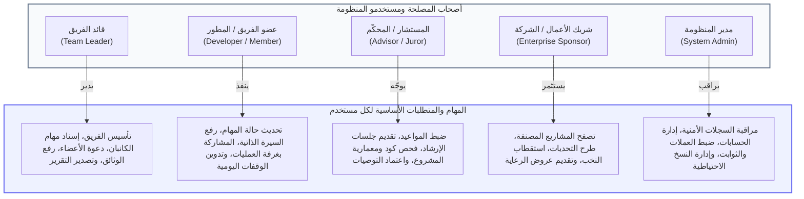

---

### 3.7 تحليل المدخلات الرقمية (Input Analysis)

#### الجدول (3-4): جدول تحليل المدخلات الرقمية للنظام

| الشاشة / الوحدة        | مصدر المدخل     | الحقول وبيانات الإدخال                                      | نوع البيانات  | قيود وشروط التحقق (Validation Rules)                     |
| ---------------------- | --------------- | ----------------------------------------------------------- | :-----------: | -------------------------------------------------------- |
| **تسجيل الحساب**       | المستخدم الزائر | الاسم الكامل، البريد، كلمة المرور، المسار                   |     نصوص      | `required, string, email, unique:users, min:8`           |
| **تأسيس الفريق**       | قائد الفريق     | اسم الفريق، عنوان المشروع، النطاق، القسم، مستودع GitHub     |  نصوص وروابط  | `required, max:255, url, nullable`                       |
| **إضافة مهمة كانبان**  | قائد الفريق     | عنوان المهمة، الوصف، المطور المعين، الأولوية، تاريخ الإنجاز | نصوص وتواريخ  | `required, string, in:urgent,high,medium,low, date`      |
| **ملف السيرة الذاتية** | المطور / العضو  | التخصص، الهاتف، المهارات، الروابط، ملف الـ CV               | نصوص وملف PDF | `nullable, file, mimes:pdf, max:10240`                   |
| **رفع وثيقة بالخزانة** | عضو الفريق      | عنوان الوثيقة، التصنيف، ملف الوثيقة، رقم الإصدار            |   نصوص وملف   | `required, in:technical,architecture,reports, max:15360` |
| **حجز استشارة**        | قائد الفريق     | اسم المستشار، الموضوع، التصنيف، الوصف، التاريخ المقترح      |  نصوص وتاريخ  | `required, string, date, after:today`                    |
| **توثيق التوصيات**     | المستشار        | نص التوصيات، تقييم الجاهزية، رابط الاجتماع                  |  نصوص وروابط  | `required, string, url, nullable`                        |
| **طرح تحدٍ برمجـي**    | الشركة الراعية  | عنوان التحدي، الوصف، قيمة الجائزة، الموعد النهائي           |  نصوص وأرقام  | `required, numeric, min:100, date, after:today`          |

---

### 3.8 تحليل المخرجات والتقارير التنفيذية (Output Analysis)

#### الجدول (3-5): جدول تحليل المخرجات والتقارير التنفيذية

| الشاشة / التقرير             |     صيغة المخرج     | المستفيد النهائي                | توقيت ودورية الصدور       | المحتوى والمعلومات المعروضة                                                       |
| ---------------------------- | :-----------------: | ------------------------------- | ------------------------- | --------------------------------------------------------------------------------- |
| **لوحة قيادة المشروع**       |    شاشة تفاعلية     | أعضاء الفريق والقائد            | لحظي (Real-time)          | نسبة الإنجاز العامة، عدد المهام المكتملة، مواعيد الجلسات القادمة، وآخر التحديثات. |
| **التقرير التنفيذي الشامل**  |  مستند PDF / طباعة  | قائد الفريق، الكلية، المستثمرون | عند الطلب / نهاية المرحلة | بيانات المشروع، مصفوفة المهام، تشكيلة الفريق بخبراتهم، وسجل توصيات المستشارين.    |
| **درج استعراض الـ CV**       |   عارض PDF تفاعلي   | قائد الفريق، الشركات            | فوري عند النقر            | استعراض السيرة الذاتية للأعضاء دون تنزيل، مع روابط الأعمال وزر الواتساب.          |
| **دليل المشاريع الاستثماري** |   شاشات ويب وبحث    | الشركات ورعاة الأعمال           | متاح دائماً               | قائمة المشاريع المصنفة، نسب الإنجاز، مجالات الابتكار، وإمكانية تقديم طلب رعاية.   |
| **سجل الأثر الاستشاري**      |  صفحة ويب / شهادة   | المستشار والأستاذ               | تراكمي مستمر              | عدد ساعات الإرشاد الموثقة، تقييمات الفرق، وقائمة الهاكاثونات المحكّمة.            |
| **إشعارات وتنبيهات النظام**  | Toast / صوتي / بريد | كافة المستخدمين                 | فوري عند الحدث            | إشعار بتعيين مهمة جديدة، تأكيد موعد جلسة، أو انضمام عضو جديد للفريق.              |

---

### 3.9 مخطط تدفق البيانات (Data Flow Diagrams - DFD)

تُعد مخططات تدفق البيانات الأداة الهندسية المعتمدة لنمذجة حركة البيانات بين الكيانات الخارجية للنظام، والعمليات الحسابية والبرمجية، ومخازن البيانات الدائمة:

- **المخطط البيئي (Context Diagram / Level 0):** ينظر للنظام كعملية واحدة شاملة ترتبط بالكيانات المحيطة دون كشف التركيب الداخلي.
- **المخطط الصفري (Level-0 Process Diagram):** يفكك النظام إلى عملياته التفصيلية السبع مع ربطها بمخازن البيانات المحددة.

---

### 3.10 المخطط البيئي العام (Context Diagram - Level 0 DFD)

#### الشكل (3-1): المخطط البيئي العام للنظام (Context Diagram - Level 0 DFD)

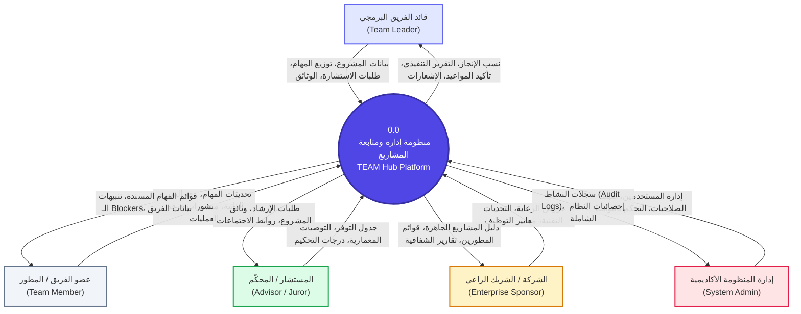

---

### 3.11 المخطط الصفري التفصيلي (Level-0 Process Diagram)

#### الشكل (3-2): المخطط الصفري التفصيلي للنظام (Level-0 Process DFD Diagram)

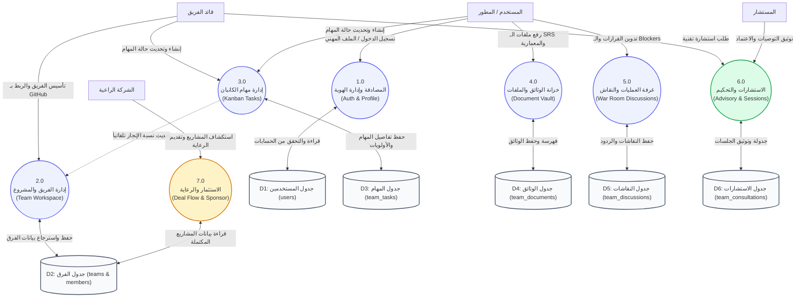

---

### 3.12 مخطط العلاقة البينية للكينونات (ERD - Entity Relationship Diagram)

يوضح هذا المخطط البنية العلائقية لقاعدة البيانات، وروابط الكينونات الأساسية والمفاتيح الأولية والأجنبية:

#### الشكل (3-3): مخطط علاقات الكيانات لقاعدة البيانات (Entity Relationship Diagram - ERD)

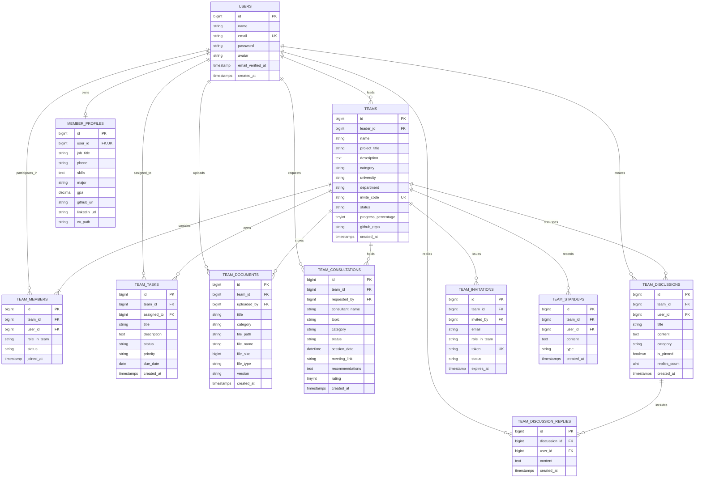

---

### 3.13 المخطط المنطقي لقاعدة البيانات (The Logical Schema & Normalization)

خضعت قاعدة بيانات المنظومة لمراحل التسوية والتطبيع الثلاث (**Database Normalization Rules**):

- **الشكل الطبيعي الأول (1NF):** منع الحقول متعددة القيم وتأكيد ذرية البيانات (Atomicity)، والتأكد من وجود مفتاح أساسي فريد لكل جدول.
- **الشكل الطبيعي الثاني (2NF):** إزالة أي اعتمادية جزئية؛ فكافة الحقول غير المفتاحية تعتمد اعتماداً كلياً ومباشراً على المفتاح الأساسي.
- **الشكل الطبيعي الثالث (3NF):** إزالة الاعتماديات المتعدية (Transitive Dependencies)؛ بحيث لا يعتمد أي حقل غير رئيسي على حقل آخر غير رئيسي، بل على المفتاح الأساسي فقط.
- **تفكيك العلاقات المتعددة ($M:N$):** تم تفكيك العلاقة بين المستخدمين (`users`) والفرق (`teams`) عبر جدول الربط الوسيط (`team_members`) الذي يحمل المفاتيح الأجنبية (`team_id`, `user_id`) إضافة للسمات الوظيفية (`role_in_team`, `joined_at`).

#### التوصيف العلائقي للجداول (Relational Schema Notation):

- $\text{USERS} (\underline{\text{id}}, \text{name}, \text{email}, \text{password}, \text{avatar}, \text{email\_verified\_at}, \text{created\_at})$
- $\text{TEAMS} (\underline{\text{id}}, \text{name}, \text{project\_title}, \text{description}, \text{category}, \text{university}, \text{invite\_code}, \text{status}, \text{progress\_percentage}, \text{github\_repo}, \overline{\text{leader\_id}})$
- $\text{TEAM\_MEMBERS} (\underline{\text{id}}, \overline{\text{team\_id}}, \overline{\text{user\_id}}, \text{role\_in\_team}, \text{status}, \text{joined\_at})$
- $\text{MEMBER\_PROFILES} (\underline{\text{id}}, \overline{\text{user\_id}}, \text{job\_title}, \text{phone}, \text{skills}, \text{major}, \text{gpa}, \text{cv\_path}, \text{github\_url}, \text{linkedin\_url})$
- $\text{TEAM\_TASKS} (\underline{\text{id}}, \overline{\text{team\_id}}, \overline{\text{assigned\_to}}, \text{title}, \text{description}, \text{status}, \text{priority}, \text{due\_date})$
- $\text{TEAM\_DOCUMENTS} (\underline{\text{id}}, \overline{\text{team\_id}}, \overline{\text{uploaded\_by}}, \text{title}, \text{category}, \text{file\_path}, \text{file\_size}, \text{version})$
- $\text{TEAM\_CONSULTATIONS} (\underline{\text{id}}, \overline{\text{team\_id}}, \overline{\text{requested\_by}}, \text{consultant\_name}, \text{topic}, \text{status}, \text{session\_date}, \text{recommendations}, \text{rating})$
- $\text{TEAM\_DISCUSSIONS} (\underline{\text{id}}, \overline{\text{team\_id}}, \overline{\text{user\_id}}, \text{title}, \text{content}, \text{category}, \text{is\_pinned}, \text{replies\_count})$

---

### 3.14 المخطط الفيزيائي لقاعدة البيانات (The Physical Database Schema)

يعكس المخطط الفيزيائي كيفية تخزين البيانات فعلياً على محرك **PostgreSQL / SQLite** مع تحديد أطوال الحقول والفهارس وقواعد التكامل المرجعي:

- **المحرك والمطابقة:** `InnoDB` على MySQL أو `PostgreSQL 16` مع تشفير وتوافق كامل لترميز النصوص `utf8mb4_unicode_ci`.
- **الفهارس والتسريع (Indexing Strategy):**
  - فهارس فريدة (Unique Indexes) على: `users(email)`، `teams(invite_code)`، `member_profiles(user_id)`، و `team_invitations(token)`.
  - فهرس مركب (Composite Index) على: `team_members(team_id, user_id)`.
  - فهارس بحث سريعة (Foreign Key Indexes) على: `team_tasks(team_id, status)` لتسريع استعلامات لوحة الكانبان.
- **سلامة المراجع والحذف المتسلسل (Referential Integrity):**
  - جميع الجداول التابعة للفريق تستخدم قاعدة `ON DELETE CASCADE`؛ بحيث يؤدي حذف الفريق تلقائياً إلى تنظيف مهامه ومستنداته ونقاشاته لتجنب البيانات اليتيمة (Orphan Records).
  - حقل `assigned_to` في جدول المهام يستخدم `ON DELETE SET NULL` للحفاظ على بيانات المهمة حتى في حال مغادرة المطور للفريق.

---

### 3.15 قاموس البيانات الشامل (Data Dictionary)

#### 15.1 جدول الفرق والمشاريع (`teams`)

| اسم الحقل             | نوع البيانات     | الطول/السعة | القيود (Constraints)                       |         القيمة الافتراضية         | الوصف التفصيلي                                        |
| --------------------- | ---------------- | :---------: | ------------------------------------------ | :-------------------------------: | ----------------------------------------------------- |
| `id`                  | BIGINT UNSIGNED  |     20      | PRIMARY KEY, AUTO_INCREMENT                |                 -                 | المعرّف الرقمي الفريد للفريق                          |
| `leader_id`           | BIGINT UNSIGNED  |     20      | FOREIGN KEY (`users.id`) ON DELETE CASCADE |                 -                 | معرّف قائد ومؤسس الفريق                               |
| `name`                | VARCHAR          |     255     | NOT NULL                                   |                 -                 | الاسم الرسمي لفريق العمل                              |
| `project_title`       | VARCHAR          |     255     | NOT NULL                                   |                 -                 | العنوان الأكاديمي أو التجاري للمشروع                  |
| `description`         | TEXT             |      -      | NULLABLE                                   |               NULL                | نبذة تعريفية وشرح نطاق المشروع                        |
| `category`            | VARCHAR          |     150     | NULLABLE                                   | 'الذكاء الاصطناعي وتطبيقات الويب' | قطاع العمل والتخصص البرمجي                            |
| `university`          | VARCHAR          |     150     | NULLABLE                                   |          'جامعة الرازي'           | اسم الجامعة أو المؤسسة التابع لها                     |
| `department`          | VARCHAR          |     150     | NULLABLE                                   |   'قسم نظم المعلومات الإدارية'    | الكلية أو القسم الأكاديمي                             |
| `invite_code`         | VARCHAR          |     12      | UNIQUE, NOT NULL                           |                 -                 | رمز الانضمام السري المؤقت للفريق                      |
| `status`              | VARCHAR          |     50      | NOT NULL                                   |           'in_progress'           | حالة المشروع (`ideation`, `in_progress`, `completed`) |
| `progress_percentage` | TINYINT UNSIGNED |      3      | NOT NULL                                   |                25                 | النسبة المئوية المحسوبة آلياً لتقدم المشروع           |
| `github_repo`         | VARCHAR          |     255     | NULLABLE                                   |               NULL                | رابط مستودع المشروع على GitHub                        |

#### 15.2 جدول مهام الكانبان (`team_tasks`)

| اسم الحقل     | نوع البيانات    | الطول/السعة | القيود (Constraints)                        | القيمة الافتراضية | الوصف التفصيلي                                          |
| ------------- | --------------- | :---------: | ------------------------------------------- | :---------------: | ------------------------------------------------------- |
| `id`          | BIGINT UNSIGNED |     20      | PRIMARY KEY, AUTO_INCREMENT                 |         -         | المعرّف الفريد للمهمة                                   |
| `team_id`     | BIGINT UNSIGNED |     20      | FOREIGN KEY (`teams.id`) ON DELETE CASCADE  |         -         | الفريق التابعة له هذه المهمة                            |
| `assigned_to` | BIGINT UNSIGNED |     20      | FOREIGN KEY (`users.id`) ON DELETE SET NULL |       NULL        | العضو المكلف بتنفيذ المهمة                              |
| `title`       | VARCHAR         |     255     | NOT NULL                                    |         -         | عنوان وموضوع المهمة                                     |
| `description` | TEXT            |      -      | NULLABLE                                    |       NULL        | التفاصيل الفنية وخطوات التنفيذ                          |
| `status`      | VARCHAR         |     30      | NOT NULL                                    |      'todo'       | حالة الكانبان (`todo`, `in_progress`, `review`, `done`) |
| `priority`    | VARCHAR         |     20      | NOT NULL                                    |     'medium'      | درجة الأولوية (`urgent`, `high`, `medium`, `low`)       |
| `due_date`    | DATE            |      -      | NULLABLE                                    |       NULL        | الموعد النهائي لتسليم المهمة                            |

#### 15.3 جدول وثائق ومخرجات المشروع (`team_documents`)

| اسم الحقل     | نوع البيانات    | الطول/السعة | القيود (Constraints)                       | القيمة الافتراضية | الوصف التفصيلي                                   |
| ------------- | --------------- | :---------: | ------------------------------------------ | :---------------: | ------------------------------------------------ |
| `id`          | BIGINT UNSIGNED |     20      | PRIMARY KEY, AUTO_INCREMENT                |         -         | المعرّف الفريد للوثيقة                           |
| `team_id`     | BIGINT UNSIGNED |     20      | FOREIGN KEY (`teams.id`) ON DELETE CASCADE |         -         | الفريق المالك للوثيقة                            |
| `uploaded_by` | BIGINT UNSIGNED |     20      | FOREIGN KEY (`users.id`) ON DELETE CASCADE |         -         | العضو الذي قام برفع الملف                        |
| `title`       | VARCHAR         |     255     | NOT NULL                                   |         -         | اسم وعنوان الوثيقة المعروض                       |
| `category`    | VARCHAR         |     50      | NOT NULL                                   |    'technical'    | التصنيف (`technical`, `architecture`, `reports`) |
| `file_path`   | VARCHAR         |     255     | NOT NULL                                   |         -         | المسار الفيزيائي للتخزين في الخادم               |
| `file_name`   | VARCHAR         |     255     | NOT NULL                                   |         -         | الاسم الأصلي للملف المرفوع                       |
| `file_size`   | BIGINT UNSIGNED |     20      | NOT NULL                                   |         0         | حجم الملف مقاساً بالبايت (Bytes)                 |
| `version`     | VARCHAR         |     20      | NOT NULL                                   |      'v1.0'       | وسم الإصدار البرمجي للوثيقة                      |

#### 15.4 جدول استشارات وتوجيه الخبراء (`team_consultations`)

| اسم الحقل         | نوع البيانات     | الطول/السعة | القيود (Constraints)                       | القيمة الافتراضية | الوصف التفصيلي                                   |
| ----------------- | ---------------- | :---------: | ------------------------------------------ | :---------------: | ------------------------------------------------ |
| `id`              | BIGINT UNSIGNED  |     20      | PRIMARY KEY, AUTO_INCREMENT                |         -         | المعرّف الفريد للاستشارة                         |
| `team_id`         | BIGINT UNSIGNED  |     20      | FOREIGN KEY (`teams.id`) ON DELETE CASCADE |         -         | الفريق المستفيد من التوجيه                       |
| `requested_by`    | BIGINT UNSIGNED  |     20      | FOREIGN KEY (`users.id`) ON DELETE CASCADE |         -         | القائد أو العضو صاحب الطلب                       |
| `consultant_name` | VARCHAR          |     150     | NOT NULL                                   |         -         | اسم المستشار أو الأستاذ الأكاديمي                |
| `topic`           | VARCHAR          |     255     | NOT NULL                                   |         -         | موضوع الاستشارة ومحور النقاش                     |
| `status`          | VARCHAR          |     30      | NOT NULL                                   |     'pending'     | حالة الطلب (`pending`, `confirmed`, `completed`) |
| `session_date`    | DATETIME         |      -      | NULLABLE                                   |       NULL        | الموعد والوقت المعتمد للجلسة                     |
| `meeting_link`    | VARCHAR          |     255     | NULLABLE                                   |       NULL        | رابط الاجتماع الافتراضي (Google Meet)            |
| `recommendations` | TEXT             |      -      | NULLABLE                                   |       NULL        | التوصيات الفنية الملزمة المكتوبة من الخبير       |
| `rating`          | TINYINT UNSIGNED |      1      | NULLABLE                                   |       NULL        | تقييم الجلسة من قبل الفريق (1 - 5)               |

---

### 3.16 لغة النمذجة الموحدة (UML - Unified Modeling Language)

#### a. مخطط حالات الاستخدام (Use Case Diagram)

يوضح هذا المخطط الفاعلين (Actors) والعمليات الوظيفية الرئيسية التي يقدمها النظام لكل فئة:

#### الشكل (3-4): مخطط حالات الاستخدام العامة للنظام (Use Case Diagram)

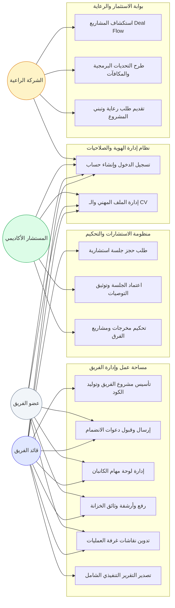

---

#### b. مخطط الفئات والكائنات (Class Diagram)

يوضح المخطط التالي بنية الكائنات (Models) في إطار Laravel مع الحقول الأساسية والدوال والعلاقات البرمجية:

#### الشكل (3-5): مخطط الفئات والكائنات البرمجية (Class Diagram)

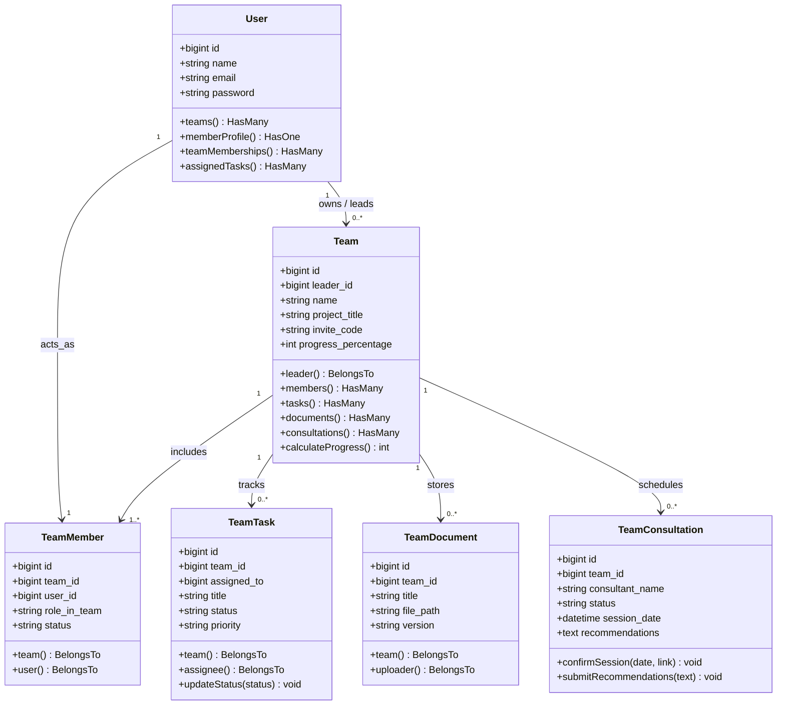

---

#### c. مخطط التتابع والتفاعل الزمني (Sequence Diagram)

يوضح المخطط التالي التسلسل الزمني لعملية **حجز جلسة استشارية من قبل قائد الفريق، واعتمادها من المستشار، وتوثيق التوصيات**:

#### الشكل (3-6): مخطط التتابع والتفاعل الزمني لحجز واعتماد الاستشارات الأكاديمية

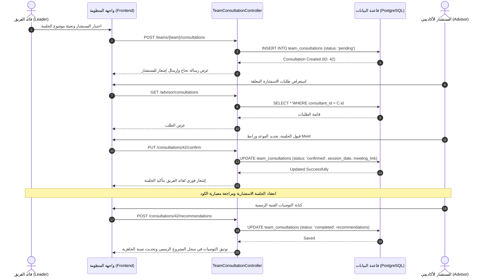

---

#### d. مخطط النشاط وسير العمليات (Activity Diagram)

يوضح هذا المخطط سير عمليات **دورة حياة مهمة برمجية في لوحة الكانبان** منذ إنشائها وحتى اكتمالها وتأثيرها على نسبة إنجاز المشروع:

#### الشكل (3-7): مخطط النشاط وسير العمليات لدورة حياة مهام الكانبان

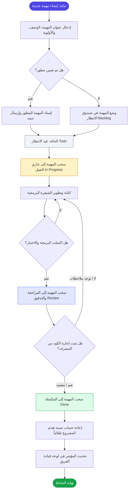

---

#### e. مخطط الحالة ودورة حياة الكيانات (State Machine Diagram)

يوضح هذا المخطط تحولات الحالات التشغيلية للمشروع البرمجي (`Team Project Lifecycle`):

#### الشكل (3-8): مخطط الحالة ودورة حياة المشروع البرمجي الشامل

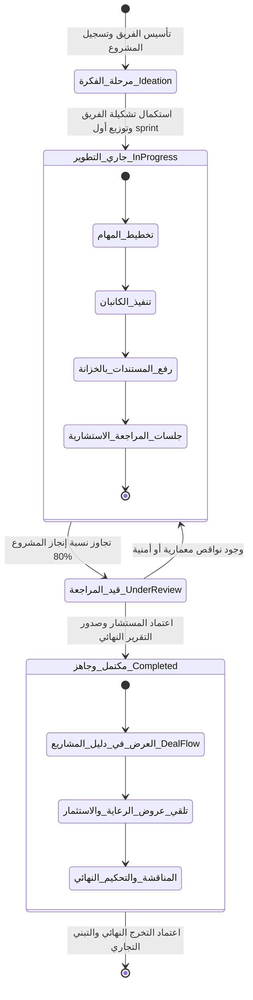

---

### 3.17 خاتمة الفصل الثالث

قدم هذا الفصل تحليلاً هندسياً شاملاً ومتكاملاً لمنظومة **TEAM Hub / PMTS**؛ حيث تم استعراض طرق جمع المتطلبات الميدانية وتحويلها إلى متطلبات وظيفية وغير وظيفية دقيقة، وتوصيف كامل للمدخلات والمخرجات وقواعد الحوكمة. كما قدم الفصل النمذجة الهيكلية للبيانات عبر مخططات تدفق البيانات (**DFD**) بمستوييها البيئي والصفري، والمخططات العلائقية لقواعد البيانات (**ERD**) بمستوياتها المنطقية والفيزيائية وقاموس البيانات المفصل، وانتهاءً بالنمذجة الكائنية الشاملة بلغة **UML** بكافة مخططاتها المعيارية؛ مما يجعل هذا التحليل أساساً متيناً وقوياً للانتقال إلى **الفصل الرابع: التصميم المعماري والبرمجي (Architecture & Design)** وتنفيذه برمجياً بأعلى معايير الجودة والموثوقية الأكاديمية.

---

```
========================================================================================
                          نهاية الجزء المدمج (الوحدات 1 و 2 و 3)
                 تم إعداده وتنسيقه لجامعة الرازي - قسم نظم المعلومات الإدارية
========================================================================================
```
