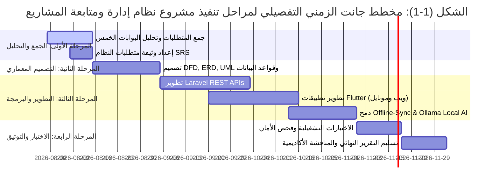
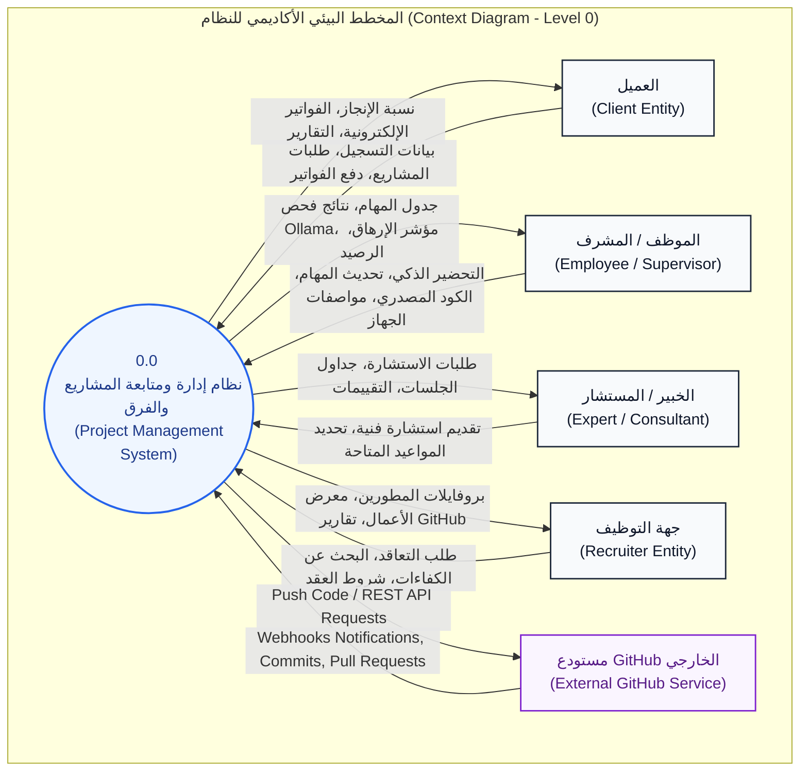
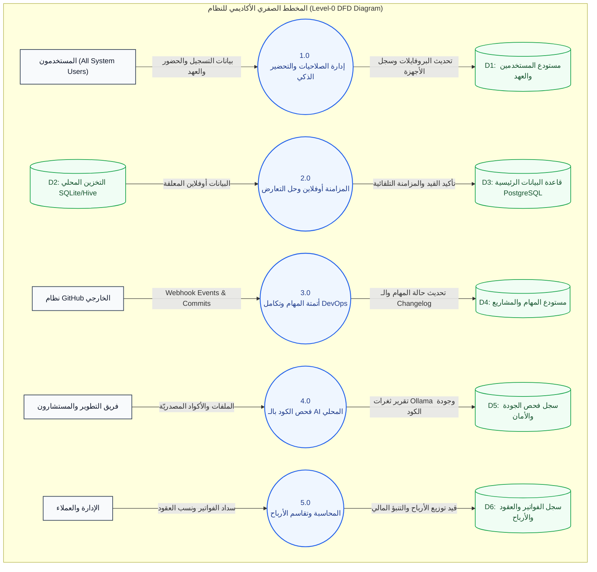
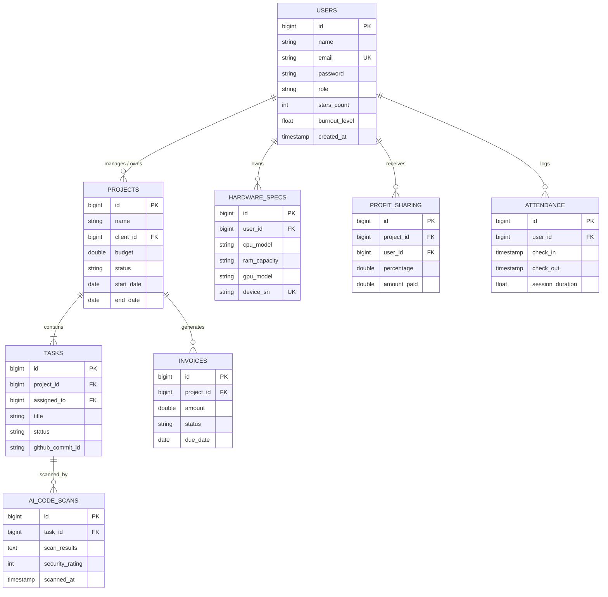
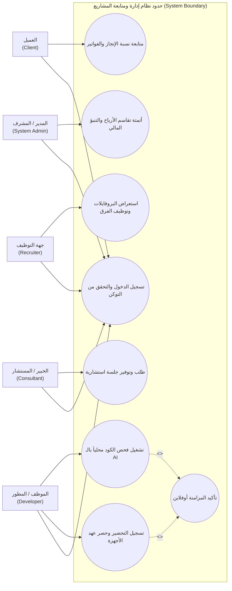

# الهيكل الأساسي والمفصل لمشروع التخرج: نظام إدارة ومتابعة المشاريع

**التطبيق الميداني والهيكلي الشامل لنظام إدارة ومتابعة المشاريع (Project Management & Tracking System)**

---

## جدول المحتويات والصفحات التمهيدية (Table of Contents)

* **I. الإهداء (Dedication)**: إلى كل من أنار درب العلم والعمل، إلى أسرنا الكريمة وأساتذتنا الأفاضل.
* **II. التفويض (Authorization)**: نموذج تفويض الجامعة بنشر وتداول البحث لأغراض أكاديمية.
* **III. شكر وتقدير (Acknowledgment)**: كلمة شكر للجامعة، الكلية، الدكتور المشرف، والشركات الناشئة المشاركة بالدراسة.
* **IV. لجنة المناقشة (Examiner Committee)**: أسماء أعضاء لجنة الحكم والمناقشة والتواقيع.
* **V. الملخص (Abstract)**:
  * **باللغة العربية**: ملخص شامل يتناول فكرة المنصة (ويب Laravel وموبايل Flutter)، معمارية العمل بدون اتصال (Offline-First)، دمج الذكاء الاصطناعي المحلي (Ollama)، البوابات الخمس، وتقاسم الأرباح المحاسبي.
  * **باللغة الإنجليزية**: Full abstract summarizing the platform's vision, Laravel & Flutter stack, Offline-First synchronization, Local AI implementation, multi-portal design, and profit-sharing capabilities.
* **VI. فهرس المحتويات (Table of Contents)**
* **VII. قائمة الأشكال (List of Figures)**: مخططات DFD, ERD, UML, واجهات المستخدم وشاشات المزامنة.
* **VIII. قائمة الجداول (List of Tables)**: جداول قاعدة البيانات، دراسة الجدوى، والتحليل المقارن.
* **IX. قائمة الاختصارات (List of Abbreviations)**: (MIS, AI, ERD, DFD, UML, CI/CD, CPU, RAM, GPU, REST API).

---

## الفصل الأول: الإطار العام للمشروع (Introduction & General Charter)

### 1. مقدمة (Introduction)
مقدمة مفصلة حول تحول بيئات العمل نحو الفرق البرمجية الناشئة والتحديات التشغيلية (انقطاع الشبكة، سرية الأكواد، تكلفة الأدوات السحابية).

### 2. تعريف المشروع (Definition of the project)
منصة إدارية متكاملة للشركات البرمجية الصغيرة والناشئة والفرق المستقلة، تتكون من موقع ويب (Laravel) وتطبيق موبايل (Flutter) يعملان بأسلوب (Offline-First) مع دمج الذكاء الاصطناعي المحلي (Ollama).

### 3. تحديد المشكلة (Problem Statement)
توقف إنتاجية الفرق عند انقطاع الإنترنت، مخاطر تسريب أسرار الأكواد عبر الذكاء الاصطناعي السحابي، عدم الشفافية مع العملاء، غياب تتبع العهد ومواصفات أجهزة المطورين، والنزاعات في توزيع الأرباح.

### 4. أهداف المشروع (Project Objectives)
* بناء منصة تعمل دون اتصال بشبكة الإنترنت مع مزامنة تلقائية.
* فحص جودة الكود والأمان وتوطين النصوص محلياً عبر الذكاء الاصطناعي (Ollama).
* توفير 5 بوابات مخصصة (العميل، الموظفون، الخبراء، التوظيف، الإدارة الكلية).
* أتمتة حساب وتقاسم الأرباح والتنبؤ بالمخاطر المالية والعقود الإلكترونية.
* تتبع مواصفات الأجهزة والعهد والتحفيز غير المالي ومحلل الإرهاق.

### 5. أهمية المشروع (Project Importance)
تمكين الشركات الناشئة من رفع الإنتاجية، خفض الاشتراكات، حماية الملكية الفكرية، وتحقيق العدالة المالية والشفافية.

### 6. نطاق وحدود المشروع (Project Scope and Limitations)
* **النطاق الوظيفي**: إدارة المهام، المزامنة، الذكاء الاصطناعي المحلي، 5 بوابات، التوظيف، التقارير الصوتية، وتقاسم الأرباح.
* **الحدود التقنية والمكانية**: بيئة العمل على خوادم محلية وسحابية، موجه للشركات البرمجية الناشئة في اليمن والإقليم.

### 7. الأدوات والتقنيات المستخدمة (Tools used in the project)
* **Backend**: Laravel Framework (PHP 8.x), MySQL Database.
* **Frontend & Mobile**: Flutter (Dart) لضمان العمل الموحد على الويب والموبايل.
* **Local AI**: Ollama Engine (Llama 3 / Mistral) للفحص والتأمين المحلي.
* **DevOps & Integration**: GitHub API, Docker, CI/CD Pipeline.
* **IDE & Tools**: VS Code, Git, Postman, Figma.

### 8. المنهجية المستخدمة لعمل المشروع (Research & Development Methodology)
اعتماد منهجية التطوير السريع **(Agile / Scrum)** بالإضافة إلى منهج بحوث تطوير النظم **(Design Science Research Methodology)**.

### 9. الجدول الزمني للمشروع (Timetable for the project)
جدول مفصل مقسم على 16 أسبوعاً (تحليل المتطلبات، التصميم، البرمجة، دمج الذكاء الاصطناعي، اختبار Offline-First، والتسليم).

### 10. مخطط جانت للمشروع (Gantt Chart for the project)

#### الشكل (1-1): مخطط جانت الزمني للمشروع (Gantt Chart)

### 11. تنظيم التقرير (Report Organization)
عرض موجز لمحتويات الفصول الخمسة للمشروع.

---

## الفصل الثاني: الإطار النظري والدراسات السابقة (Literature Review)

### 1. خلفية الدراسة (Background)
استعراض التطور التاريخي لأدوات إدارة المشاريع والتحول نحو معمارية (Offline-First) والذكاء الاصطناعي المحلي.

### 2. الدراسات السابقة والمنصات المنافسة (Literature Review)
* **Productive.io**: إدارة الوكالات والربحية (سحابي كلياً).
* **Teamwork.com**: إدارة المهام والمشاريع (يفتقر للأوفلاين والعهد).
* **Wrike.com**: إدارة الأعمال المؤسسية (معقد ومكلف).
* **Monday.com**: التخصيص وإدارة بيئات العمل (لا يدعم فحص الكود المحلي دون إنترنت).
* **الفجوة البحثية**: تقديم منصة تجمع بين الأوفلاين والذكاء الاصطناعي المحلي وتقاسم الأرباح وتتبع العهد الصلبة.

### 3. النظام الحالي وتحدياته (Existing system)
تحليل الاعتماد على جداول Excel وتطبيقات الدردشة العادية والمنصات المشتتة.

### 4. دراسة الجدوى (Feasibility Study)
* **أ. الجدوى التقنية (Technical Feasibility)**: توفر تقنيات Laravel وFlutter وOllama مجاناً كتقنيات مفتوحة المصدر.
* **ب. الجدوى الاقتصادية (Economic Feasibility)**: توفير تكاليف الاشتراكات الشهرية السحابية وزيادة الأرباح الناتجة عن عدم توقف الإنتاجية.
* **ج. الجدوى التشغيلية (Operational Feasibility)**: سهولة واجهات المستخدم للموظفين والعملاء وسلاسة المزامنة.

### 5. إدارة المخاطر (Risks management)
* **أ. تحديد المخاطر (Determination of risk)**: تعارض البيانات أثناء المزامنة، بطء الذكاء الاصطناعي المحلي على الأجهزة الضعيفة، مخاطر التأخير المالي.
* **ب. التحكم بالمخاطر (Risk control)**: آليات حل تعارض البيانات (CRDTs / Timestamp resolution)، اختيار نماذج AI خفيفة (Ollama 3B/7B)، والإنذار المبكر للتكاليف.

---

## الفصل الثالث: تحليل النظام (System Analysis)

### 1. طرق جمع المتطلبات (Methods of collecting requirements)
المقابلات مع المطورين والمدراء، الاستبيانات، وتحليل الوثائق ومستودعات GitHub.

### 2. متطلبات العمل (Work requirements)
دورة عمل إدارة المشاريع، تسجيل الحضور، رفع الكود، فحص الأمان، وإصدار الفواتير وتقاسم الأرباح.

### 3. متطلبات النظام (System Requirements)
متطلبات السيرفرات والأجهزة العتادية ومحرك الذكاء الاصطناعي.

### 4. المتطلبات الوظيفية (Functional requirements)
* **بوابة العميل**: عرض نسبة الإنجاز، الفواتير، جدول المراحل، النشرات الأسبوعية الآلية.
* **بوابة الموظفين والمشرفين**: التحضير الذكي، تتبع النشاط والجهد، السير الذاتية وGitHub، إدارة مواصفات الأجهزة والعهد (CPU/RAM/GPU)، نظام النجوم، ومحلل الإرهاق.
* **بوابة الخبراء والمستشارين**: تقديم الاستشارات وتنظيم الجلسات.
* **بوابة التوظيف**: استعراض البروفايلات والتعاقد مع الأفراد والفرق.
* **لوحة التحكم الإدارة**: المتابعة الميزانيات، المهل الزمنية، السيرفرات، وإدارة الإعلانات.
* **الذكاء الاصطناعي والـ DevOps**: فحص جودة الكود محلياً، توطين النصوص، المزامنة فور عودة الشبكة، التقارير الصوتية.

### 5. المتطلبات غير الوظيفية (Non-functional requirements)
* **الأداء والتوافقية**: زمن استجابة سريع ومزامنة خلفية سلسة.
* **الأمان والخصوصية**: تشفير البيانات المحلية وسرية أسرار الكود المصدري.
* **الموثوقية وقابلية التوسع**: العمل المستمر (Offline-First) ودعم التوسع المستقبلي.

### 6. متطلبات المستخدم (User requirements)
سهولة التنقل، الدعم اللغوي المزدوج، والوضوح المحاسبي.

### 7. تحليل المدخلات (Input analysis)
بيانات المهام، ساعات الحضور، بيانات الأجهزة، كود GitHub، النشرات، والفواتير.

### 8. تحليل المخرجات (Output analysis)
تقارير نسبة الإنجاز، الفواتير، توزيع الأرباح، تقارير جودة الكود والأمان، وتحليلات الإرهاق.

### 9. مخطط تدفق البيانات (DFD)

#### الشكل (3-1): المخطط البيئي الأكاديمي للنظام (Context Diagram - Level 0)

#### الشكل (3-2): المخطط الصفري الأكاديمي للنظام (Level-0 DFD Diagram)

### 10. مخطط العلاقة البينية للكينات ERD والقاموس المنطقي والفيزيائي

#### الشكل (3-3): مخطط العلاقات بين الكيانات الأكاديمي (Academic ERD Diagram)

### 11. لغة النمذجة الموحدة UML

#### الشكل (3-4): مخطط حالات الاستخدام الأكاديمي (Academic Use Case Diagram)

---

## الفصل الرابع: تصميم النظام (System Design)

### 1. خوارزميات النظام (System algorithms)
* خوارزمية تسجيل الدخول والتحقق من الصلاحيات والبوابات.
* خوارزمية مزامنة البيانات وتعيين التعارضات (Offline Sync Algorithm).
* خوارزمية الذكاء الاصطناعي المحلي لفحص الكود والأمان (Ollama Code Analyzer).
* خوارزمية تقاسم الأرباح المحاسبية بناءً على نسب الإنجاز والمبيعات.
* خوارزمية تحليل الإرهاق والعافية المهنية.

### 2. واجهات النظام (System Interfaces)
* تصميم واجهات الشاشات الرئيسية لكل بوابة من البوابات الخمس.
* الشاشات التفاعلية للموظفين والعملاء ومحرك البحث واستعراض الكفاءات.
* تقارير الأداء والفواتير والنشرات التلقائية.

---

## الفصل الخامس: تنفيذ النظام (System Implementation)

### 1. لوحة التحكم للنظام (Control Panel)
توصيف الكود المكتوب بإطار Laravel وتفعيل أدوات DevOps وإدارة السيرفرات.

### 2. شاشة القيادة (Dashboard)
عرض المؤشرات الحيوية للمشاريع والميزانية ومعدل المزامنة.

### 3. شاشات المستخدمين والتطبيقات
عرض واجهات تطبيق Flutter الموبايل والويب أثناء العمل بدون اتصال وفي حالة الاتصال.

### 4. صلاحيات المستخدم (User Permissions)
تحديد الأدوار والتحكم في الوصول الصارم بين أعضاء الفريق وحماية خصوصية الأقران.

---

## الفصول الختامية

### الفصل السادس: النتائج والمناقشات (Results and Discussions)
* تحسين استمرارية العمل بنسبة 100% أثناء انقطاع الشبكة بفضل معمارية Offline-First.
* حماية الأكواد والبيانات من التسريب عبر الفحص المحلي (Ollama).
* خفض النزاعات المالية بين الفرق والشركاء بفضل نظام تقاسم الأرباح المؤتمت.

### الفصل السابع: الاستنتاجات والتوصيات (Conclusions and Recommendations)
* **الاستنتاجات**: تم بناء نموذج متكامل يعالج كافة التحديات التشغيلية والمالية والأمنية للشركات البرمجية الناشئة.
* **التوصيات**: التوسع في تطبيق الذكاء الاصطناعي المحلي وتطوير إضافات برمجية لـ IDEs الشهيرة.

### المراجع (References)
قائمة كاملة بالمراجع العلمية العربية والفيزيائية والروابط المرجعية للمنصات المنافسة.
