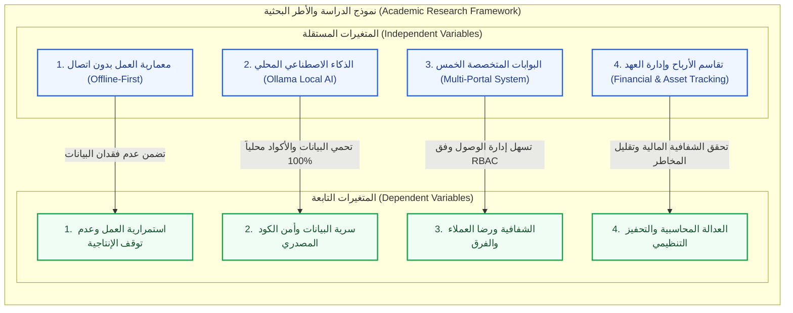

# خطة بحث: نظام ذكي متكامل لإدارة ومتابعة المشاريع المعتمد على معمارية العمل بدون اتصال (Offline-First) والذكاء الاصطناعي المحلي

**دراسة ميدانية وتطبيقية على الشركات البرمجية الناشئة والفرق التقنية**

---

## البيانات التعريفية للمشروع

* **الجامعة**: إحدى الجامعات اليمنية / الجامعة الوطنية.
* **الكلية**: كلية العلوم الإدارية والمالية.
* **القسم**: قسم نظم المعلومات الإدارية (MIS) / المحاسبة.
* **اسم المشروع**: نظام إدارة ومتابعة المشاريع (Project Management and Tracking System).
* **إعداد الطلاب / الباحثين**: فريق مشروع التخرج (السنة الرابعة).
* **إشراف الدكتور**: د. حميد عبدالله علي مسواك / د. خالد المسوري.
* **العام الجامعي**: 2023 - 2024م / 2026 - 2027م.

---

## الفصل الأول: الإطار العام للدراسة والدراسات السابقة

### أولاً: مقدمة الدراسة (Background & Introduction)

شهدت صناعة البرمجيات تحولاً جذرياً في بيئات العمل وتوزيع المهام، حيث برزت الشركات البرمجية الصغيرة والناشئة والفرق البرمجية (Agencies) كعنصر رئيسي في تنفيذ الحلول التقنية وإدارة المشاريع. غير أن الاعتماد المطلق على المنصات السحابية التقليدية لإدارة المشاريع (مثل Jira, Monday, Wrike) أوجد ثغرات تشغيلية حرجة، أبرزها توقف العمل المفاجئ عند انقطاع شبكة الإنترنت أو التيار الكهربائي في الدول الناشئة، بالإضافة إلى التكلفة المرتفعة للاشتراكات السحابية، ومخاطر تسريب البيانات والكود المصدري الحساس عند معالجته عبر محركات الذكاء الاصطناعي السحابية الخارجية.

تستعرض هذه الدراسة تطوير حل برمجي وإداري متكامل يتكون من منصة ويب (Laravel) وتطبيق هاتف محمول (Flutter) يعمل وفق معمارية **(Offline-First)**، مدمجاً بذكاء اصطناعي محلي **(Ollama)** لضمان استمرارية العمل وفحص جودة الأكواد دون اتصال، وتوفير 5 بوابات متخصصة وآلية محاسبية مؤتمتة لتقاسم الأرباح وتتبع العهد والأجهزة.

---

### ثانياً: مشكلة الدراسة (Research Problem)

تتلخص مشكلة الدراسة في المعضلات التي تواجه الشركات الناشئة والفرق البرمجية من خلال الأبعاد التالية:
1. **توقف الإنتاجية والانقطاع الشبكي**: تراجع كفاءة المطورين وتوقف إدارة المهام عند انقطاع الإنترنت نظراً لتبعية الأنظمة الحالية للسحابة.
2. **مخاطر السرية والأمن السيبراني**: المخاطر المترتبة على رفع الكود المصدري للمشروع والبيانات المالية إلى خوادم ذكاء اصطناعي خارجية دون ضمانات للملكية الفكرية.
3. **غياب الشفافية والتشتت مع العملاء**: صعوبة تتبع العميل لنفس نسبة الإنجاز والفواتير بشكل مباشر دون السماح له بالاطلاع على تفاصيل الأكواد الداخلية.
4. **ضعف تتبع عهد الأجهزة وموارد المطورين**: عدم وجود آلية متكاملة لحصر مكونات أجهزة المطورين (CPU/RAM/GPU) وتتبع عهد الشركة وتحليل إرهاق الفريق.
5. **النزاعات المحاسبية وتوزيع الأرباح**: غياب أنظمة محاسبية مؤتمتة تعتمد على العقود ونسب الإنجاز والمبيعات لتقاسم الأرباح بين الشركاء والمستقلين بصورة عادلة.

---

### ثالثاً: تساؤلات الدراسة (Research Questions)

تتحدد تساؤلات الدراسة في التساؤل الرئيسي التالي:
> **كيف يمكن لبناء نظام إداري متكامل يعتمد معمارية (Offline-First) والذكاء الاصطناعي المحلي (Local AI) أن يعزز استمرارية العمل، ويرفع الإنتاجية، ويحقق الشفافية المالية والأمنية للشركات البرمجية الناشئة؟**

وينبثق عن هذا التساؤل الرئيسي التساؤلات الفرعية التالية:
1. ما فاعلية معمارية العمل بدون اتصال (Offline-First) في ضمان استمرارية إدخال المهام وحل تعارض البيانات تلقائياً فور إعادة الاتصال؟
2. كيف يسهم دمج الذكاء الاصطناعي المحلي (Ollama) في فحص جودة الكود واكتشاف الثغرات وتأمين الملفات دون الاتصال بالإنترنت؟
3. ما أثر توفير 5 بوابات متخصصة (العميل، الموظفون، الخبراء، التوظيف، الإدارة) في تحسين التواصل والتنسيق بين كافة الأطراف؟
4. كيف يوفر النظام آلية محاسبية عادلة ومؤتمتة لتقاسم الأرباح وتتبع الفواتير والعقود الإلكترونية؟
5. ما دور نظام تتبع عهد الأجهزة ومحلل العافية والإرهاق في الحفاظ على الموارد والسلالم الوظيفية والتحفيز غير المالي للمطورين؟

---

### رابعاً: أهداف الدراسة (Research Objectives)

تسعى هذه الدراسة إلى تحقيق الأهداف الرئيسية والفرعية التالية:
* **الهدف الرئيسي**: تطوير وتصميم منصة إدارية متكاملة (ويب وموبايل) لإدارة ومتابعة المشاريع تعمل بكفاءة عالية دون الحاجة للاتصال الدائم بالإنترنت مع ضمان السرية التامة وتوفير الذكاء الاصطناعي المحلي.
* **الأهداف الفرعية**:
  1. بناء معمارية **Offline-First** متقدمة تتضمن المزامنة التلقائية وحل التعارضات فور عودة الشبكة.
  2. دمج نموذج ذكاء اصطناعي محلي (مثل Ollama) لفحص جودة الكود، وتوطين النصوص، وتوليد التقارير وتوفير الأمن الذكي للملفات محلياً.
  3. تصميم وتنفيذ 5 بوابات متخصصة:
     * **بوابة العميل**: لمتابعة الإنجاز والفواتير والجدول الزمني.
     * **بوابة الموظفين والمشرفين**: التحضير الذكي، تتبع النشاط، البروفايلات، إدارة العهد والأجهزة، نظام التحفيز ومحلل الإرهاق.
     * **بوابة الخبراء والمستشارين**: تقديم الاستشارات وتنظيم الجلسات.
     * **بوابة التوظيف**: استعراض الفرق والأفراد والتعاقد المباشر.
     * **لوحة إدارة المنصة الكلية**: لمتابعة المشاريع والميزانيات والجدول الزمني.
  4. الربط المباشر مع مستودعات **GitHub** وخدمات **DevOps** ومراقبة الخوادم والموارد.
  5. تفعيل نظام محاسبي مؤتمت لتقاسم الأرباح، والتنبؤ بالمخاطر المالية، وإدارة العقود الإلكترونية والتوقيع الرقمي.

---

### خامساً: أهمية الدراسة (Research Importance)

تتكتسب الدراسة أهميتها من خلال جانبين رئيسيين:

#### 1. الأهمية العلمية (الأكاديمية):
* رفد المكتبة الأكاديمية بدراسة تطبيقية تدمج بين علوم نظم المعلومات الإدارية (MIS) وتطبيقات الهندسة البرمجية المتقدمة (Offline-First Architecture & Local AI Integration).
* تقديم نموذج علمي في كيفية توطين الذكاء الاصطناعي لحماية الملكية الفكرية وحل معضلات انقطاع البنية التحتية الشبكية.

#### 2. الأهمية العملية (التطبيقية):
* **للشركات الناشئة والفرق البرمجية**: تقليل تكاليف الاشتراكات السحابية، وضمان عدم ضياع ساعات العمل عند انقطاع الإنترنت.
* **للمطورين والموظفين**: حماية خصوصية الأداء، توفير بيئة عمل مريحة مع محلل الإرهاق، ونظام تحفيز بالنجوم، وتتبع دقیق لمواصفات الأجهزة والعهد.
* **للعملاء**: تعزيز الشفافية من خلال متابعة نسبة الإنجاز والتقارير الأسبوعية التلقائية دون المساس بأسرار الكود.
* **للمستثمرين والخبراء**: توفير منصة سهلة للوصول إلى الكفاءات وتنظيم الجلسات الاستشارية.

---

### سادساً: فرضيات الدراسة (Research Hypotheses)

بناءً على مشكلة الدراسة وأهدافها، تم صياغة الفرضيات التالية:

* **الفرضية الرئيسية الأولى ($H_{01}$)**: لا توجد فروق ذات دلالة إحصائية بين استخدام معمارية (Offline-First) والأنظمة السحابية التقليدية في استمرارية إنتاجية المطورين أثناء انقطاع الشبكة.
  * *الفرضية البديلة ($H_{11}$)*: تؤدي معمارية (Offline-First) إلى زيادة جوهرية في استمرارية الإنتاجية وتقليل الفقد في ساعات العمل.
* **الفرضية الرئيسية الثانية ($H_{02}$)**: لا يساهم استخدام الذكاء الاصطناعي المحلي (Ollama) في خفض مخاطر تسريب البيانات وجرائم الأمن السيبراني مقارنة بالحلول السحابية.
  * *الفرضية البديلة ($H_{12}$)*: يساهم الذكاء الاصطناعي المحلي بشكل معنوي في رفع مستوى أمان الأكواد والملفات وحماية الخصوصية.
* **الفرضية الرئيسية الثالثة ($H_{03}$)**: لا يؤثر تفعيل آلية تقاسم الأرباح المؤتمتة والبوابات المتخصصة على مستوى رضا العملاء والمطورين والشركاء.
  * *الفرضية البديلة ($H_{13}$)*: يؤدي تفعيل تقاسم الأرباح المؤتمت والبوابات المتخصصة إلى زيادة مستوى الشفافية والرضا التنظيمي والمالي.

---

### سابعاً: منهج البحث ونموذج الدراسة (Methodology & Model)

#### 1. منهج البحث:
تعتمد الدراسة على المزيج بين:
* **المنهج الوصفي التحليلي**: لدراسة واقع الشركات البرمجية الناشئة واحتياجات إدارة المشاريع وتحليل أدبيات الأنظمة المشابهة.
* **المنهج التطبيقي والتطويري (Design Science Research / Software Engineering)**: لتصميم وبناء المنصة (ويب وموبايل) واختبار كفاءتها التشغيلية والأمنية.

#### الشكل (1-1): نموذج الدراسة الأكاديمي والمتغيرات (Academic Research Model)

---

### ثامناً: أدوات البحث ومصادر جمع البيانات (Data Collection Tools)

1. **أدوات نظرية**: مراجعة الكتب والدراسات السابقة والبحوث المنشورة والمستندات التقنية الخاصة بـ Laravel, Flutter, GitHub APIs, Ollama Models.
2. **أدوات تطبيقية**:
   * **المقابلات الشخصية**: إجراء مقابلات مع مدراء مشاريع ومطورين في شركات ناشئة لاستقصاء مشاكل الانقطاع الشبكي والاشتراكات.
   * **الاستبيان**: توزيع استبيان لقياس مستوى الرضا عن معمارية العمل بدون اتصال ومستوى أمان الكود.
   * **أدوات فحص وتتبع الأداء**: مقتبسات أداء الخوادم ومقاييس زمن الاستجابة والمزامنة.

---

### تاسعاً: مجتمع وعينة الدراسة (Population & Sample)

* **مجتمع الدراسة**: الشركات البرمجية الناشئة، الفرق البرمجية المستقلة (Agencies)، المطورون، والعملاء والخبراء في الجمهورية اليمنية والإقليم.
* **عينة الدراسة**: عينة قصدية/عشوائية تتكون من (50-100) شخص من مطورين ومدراء مشاريع وعملاء لتقييم المنصة واستخدامها ميدانياً.

---

### عاشراً: حدود الدراسة (Study Scope & Limitations)

1. **الحدود الموضوعية**: تركز الدراسة على تطوير منصة إدارة ومتابعة المشاريع وفق معمارية Offline-First والذكاء الاصطناعي المحلي والروابط المالية والعهد.
2. **الحدود الجغرافية**: الشركات الناشئة والفرق التقنية في الجمهورية اليمنية (صنعاء والمدن الرئيسية).
3. **الحدود البشرية**: المطورون، المشرفون، مدراء المشاريع، العملاء، المستشارون والخبراء.
4. **الحدود الزمانية**: الفترة الزمنية الممتدة خلال العام الجامعي (2023 - 2024م / 2026 - 2027م).

---

### حادي عشر: مصطلحات الدراسة (Definition of Terms)

* **Offline-First Architecture**: معمارية تقنية تقوم بإنشاء وتخزين كافة البيانات والمعاملات محلياً على جهاز المستخدم أولاً، ثم إجراء المزامنة مع السيرفر الرئيسي عند توفر الشبكة.
* **Local AI (Ollama)**: تشغيل نماذج الذكاء الاصطناعي مفتوحة المصدر محلياً على أجهزة المؤسسة دون الحاجة لإرسال البيانات إلى سحابة خارجية.
* **Profit-Sharing Mechanism**: نظام محاسبي يوزع الإيرادات بين أعضاء الفريق بناءً على العقود الإلكترونية ونسب الإنجاز والمبيعات.
* **Asset & Hardware Tracking**: تتبع الخصائص الفنية لأجهزة المطورين (CPU, RAM, GPU) والعهد الشخصية المسلمة لهم.

---

### ثاني عشر: الدراسات السابقة والمناظرة (Literature Review)

تستعرض الدراسة مقارنة المنصة الحالية بالأنظمة العالمية الرائدة في مجال إدارة المشاريع والوكالات:
1. **منصة Productive (productive.io)**: ممتازة في إدارة الوكالات والربحية، ولكنها تعتمد كلياً على السحابة وتكلف اشتراكات مرتفعة ولا تدعم الذكاء الاصطناعي المحلي.
2. **منصة Teamwork (teamwork.com)**: متخصصة في إدارة المشاريع، تفتقر لمعمارية Offline-First وتتبع مكونات أجهزة المطورين.
3. **منصة Wrike (wrike.com)**: منصة احترافية ممتازة، ولكنها معقدة للشركات الناشئة ولا توفر نظام تقاسم الأرباح بين المطورين بالذكاء الاصطناعي.
4. **منصة Monday.com (monday.com)**: تتميز بالمرونة والتخصيص، ولكنها تفتقر لتكامل فحص الكود المحلي دون إنترنت وخصوصية البيانات الحساسة.

**الفجوة البحثية (Research Gap)**: يسد هذا المشروع الفجوة من خلال الدمج الفريد بين معمارية العمل بدون اتصال (Offline-First)، والذكاء الاصطناعي المحلي (Ollama)، والنظام المحاسبي المؤتمت لتقاسم الأرباح وتتبع العهد الصلبة.

---

### ثالث عشر: هيكل البحث المقترح (Report Organization)

* **الفصل الأول**: الإطار العام للدراسة والدراسات السابقة.
* **الفصل الثاني**: الإطار النظري وتوصيف الأنظمة ودراسة الجدوى وإدارة المخاطر.
* **الفصل الثالث**: تحليل متطلبات النظام، ومخطط تدفق البيانات (DFD)، ومخطط العلاقات (ERD)، ومخططات (UML).
* **الفصل الرابع**: تصميم خوارزميات النظام والشاشات والواجهات والتقارير.
* **الفصل الخامس**: التنفيذ، بيئة العمل، اختبارات المزامنة والنتائج والتوصيات.

---

### رابع عشر: المراجع والمصادر المقترحة (References)

1. مسواك، حميد عبدالله علي (2024)، *محاضرات منهجية البحث العلمي ومشاريع التخرج*، كلية العلوم الإدارية والمالية.
2. Fowler, M. (2021). *Offline-First Web Applications and Synchronisation Patterns*. Addison-Wesley.
3. Productive.io (2025). *Agency Management Systems and Profitability Tracking*. Available at: https://productive.io/
4. Teamwork Software (2025). *Project Management and Task Automation*. Available at: https://www.teamwork.com/
5. Wrike, Inc. (2025). *Enterprise Work Management Solutions*. Available at: https://www.wrike.com/
6. Monday.com (2025). *Work OS and Team Collaboration*. Available at: https://monday.com/
