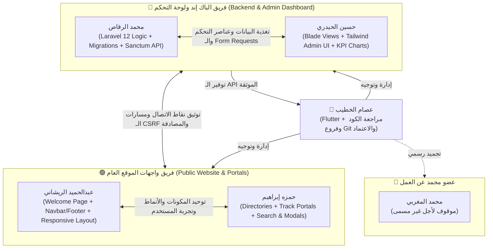

# 🌐 دليل الفريق وخريطة التنسيق والتكامل — مشروع PMMS
## نظام إدارة ومتابعة المشاريع (Project Management & Monitoring System)
**مشروع تخرج قسم نظم المعلومات الإدارية (MIS) — جامعة الوطنية (2026 / 2027م)**  
**المشرف العام وقائد الفريق:** عصام الخطيب

---

## 📌 1. نظرة عامة ورؤية المشروع المحدثة

نظام **PMMS** هو منصة متكاملة لإدارة المشاريع التقنية والبرمجية، تجمع بين:

1. **الواجهات العامة للموقع (Public Website & Portals):** بوابات تعريفية حديثة، استعراض الفرق والشركات والخبراء، ونماذج التفاعل والتسجيل.
2. **لوحة تحكم إدارية متقدمة (Laravel Admin Dashboard & Workspaces):** مبنية بـ Laravel 12، TailwindCSS، و Alpine.js للتحكم بالمشاريع والفرق والصلاحيات.
3. **تطبيق موبايل متعدد المنصات (Cross-Platform Mobile App):** مبني بـ Flutter ويعمل وفق مبدأ العمل دون اتصال أولاً (**Offline-First**).
4. **كتاب ومشروع التخرج الأكاديمي:** توثيق هندسي وتحليلي شامل ومحكّم وفق معايير الأبحاث ومشاريع التخرج بجامعة الوطنية.

---

## 👥 2. مصفوفة توزيع الأدوار الجديدة وحالة الأعضاء

تمت إعادة هيكلة المسؤوليات وتوزيع فرق العمل التشغيلية وفق التوجيه الإداري الأخير:

| الرقم | العضو | الفريق / المسار التشغيلي | الدور والمسؤوليات المحدثة | مجلد العمل | الحالة |
| :---: | :--- | :--- | :--- | :--- | :---: |
| **1** | **عصام الخطيب** | **القيادة والمراجعة العامة** | قائد المشروع + مطور تطبيق الموبايل (Flutter) + إدارة فروع Git والاعتماد النهائي | [`01_عصام_الخطيب/`](./01_عصام_الخطيب/README.md) | 🟢 نشط |
| **2** | **حسين الحيدري** | **لوحة التحكم (Admin Dashboard)** | مهندس واجهات لوحة التحكم والتحكم الإداري (Blade / Tailwind / Alpine.js) والربط مع الـ Backend | [`02_حسين_الحيدري/`](./02_حسين_الحيدري/README.md) | 🟢 نشط |
| **3** | **محمد الرقاص** | **الباك إند (Laravel Core)** | مهندس الباك إند ومنطق الأعمال وقواعد البيانات والـ API (Laravel 12 / Models / Services / Sanctum) | [`04_محمد_الرقاص/`](./04_محمد_الرقاص/README.md) | 🟢 نشط |
| **4** | **عبدالحميد الريشاني** | **واجهات الموقع (Website Frontend)** | مهندس صفحات الهبوط والتجربة العامة وتكامل بوابات المسارات والـ Responsive Design | [`06_عبدالحميد_الريشاني/`](./06_عبدالحميد_الريشاني/README.md) | 🟢 نشط |
| **5** | **حمزه إبراهيم** | **بوابات الموقع والنماذج (Portals & Forms)** | مهندس بوابات استعراض الفرق والشركات والمستشارين، ونماذج التفاعل والبحث الحي | [`05_حمزه_إبراهيم/`](./05_حمزه_إبراهيم/README.md) | 🟢 نشط |
| **6** | **محمد المغربي** | **معلق (Suspended)** | **مُوقَف عن العمل إلى أجل غير مسمى — تم تجميد كافة مهامه ولا تسند إليه أي أعمال حالياً** | [`03_محمد_المغربي/`](./03_محمد_المغربي/README.md) | 🔴 مجمد |

---

## 🔄 3. مصفوفة التكامل والاعتمادات التشغيلية (Dependencies Matrix)

---

## ⏱️ 4. الخطة الزمنية للأسبوع الكامل (Sprint 7 Days)

- **الهدف العام:** إنجاز وإطلاق لوحة التحكم الإدارية بالكامل عبر Laravel 12، واكتمال الواجهات العامة للموقع وبواباته، وربطها بنظام مصادقة وتدقيق متين خلال 7 أيام عمل متواصلة.
- **المدة الزمنية:** أسبوع كامل (7 أيام عمل).

| اليوم | مسار الباك إند ولوحة التحكم (حسين & محمد الرقاص) | مسار واجهات الموقع العام (عبدالحميد & حمزه) | نقطة التحقق والاعتماد (عصام الخطيب) |
| :---: | :--- | :--- | :--- |
| **اليوم 1** | مراجعة الـ Migrations، ضبط بنية المجلدات، وهيكلة قالب لوحة التحكم (`layouts/app.blade.php`). | تجهيز قالب الموقع العام (`layouts/frontend.blade.php`)، وضبط الهيدر والفوتر ومكتبة المكونات. | فحص واعتماد الـ Master Layouts ومعايير التصميم. |
| **اليوم 2** | برمجة `DashboardController` وبناء شاشة `dashboard.blade.php` وبطاقات الـ KPIs التفاعلية. | بناء واجهة الصفحة الرئيسية (`welcome.blade.php`)، قسم الترحيب Hero والميزات ونبذة المشروع. | تجربة تسجيل الدخول والتنقل السلس للمشرف. |
| **اليوم 3** | برمجة شاشات إدارة المستخدمين (`/users`) والأدوار ومصفوفة الصلاحيات (`/roles` و Spatie). | تطوير صفحات المسارات الثلاثة (`tracks/teams`, `tracks/companies`, `tracks/consultants`). | اختبار مصفوفة الصلاحيات والحماية من الوصول غير المصرح. |
| **اليوم 4** | بناء مساحة عمل الفرق (`team/workspace.blade.php`)، لوحة مهام الكانبان، وإدارة الأعضاء. | بناء صفحات الأدلة العامة للفرق (`/teams`)، الشركات (`/companies`)، والمستشارين (`/consultants`). | التحقق من مسار إنشاء المهام وتحديث حالتها بالكانبان. |
| **اليوم 5** | بناء غرف النقاشات والاستشارات، شاشات التدقيق (`/audit`)، والنسخ الاحتياطي (`/backups`). | بناء نماذج التواصل والانضمام، محرك البحث بالواجهة العامة (`/search`)، وفلاتر التصفية. | فحص سجل التدقيق الأمني ومحرك النسخ الاحتياطي. |
| **اليوم 6** | ضبط تجاوب لوحة التحكم على الموبايل والتابلت، تحسين استعلامات SQL، وحماية الـ CSRF. | فحص التجاوب التام لواجهات الموقع على جميع الأجهزة وتحسين سرعة التحميل والانتقالات. | فحص شامل وتجربة رحلة المستخدم كاملة (E2E Test). |
| **اليوم 7** | اختبارات الأداء النهائية، معالجة أي استثناءات، وتنظيف الكود. | تدقيق المحتوى الأكاديمي للواجهات والتأكد من مطابقتها لمتطلبات قسم الـ MIS. | التجميد البرمجي (Code Freeze)، دمج الفروع في `main`، واعتماد التسليم. |

---

## 📋 5. ميثاق العمل وقواعد التدقيق البرمجي (Sprint Policy)

1. **الاعتماد على النفس في التصميم:** في ظل تجميد محمد المغربي، يعتمد الفريقان على إمكانيات TailwindCSS ومكتبة المكونات المعيارية والبرومتات الذكية لإنتاج شاشات عالية الجودة دون الحاجة لانتظار تصاميم خارجية.
2. **سياسة الفروع في Git:**
   * فرع `dev-dashboard`: خاص بـ (حسين ومحمد الرقاص).
   * فرع `dev-website`: خاص بـ (عبدالحميد وحمزه).
   * لا يتم الدمج إلى الفرع الرئيسي `main` إلا بعد مراجعة وموافقة المشرف العام **عصام الخطيب**.
3. **التوثيق اليومي المستمر:** يلتزم كل عضو بتسجيل إنجازه اليومي في ملف `02_...` الخاص به.
4. **التزامن المسائي اليومي:** اجتماع يومي لمدة 15 دقيقة في تمام الساعة 9:00 مساءً للوقوف على التحديات والجاهزية لليوم التالي.
