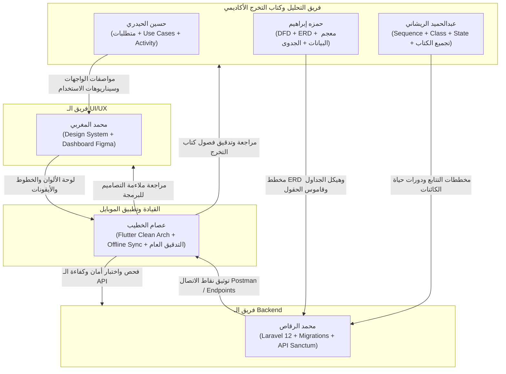

# 🌐 دليل الفريق وخريطة التنسيق والتكامل — مشروع PMMS

**نظام إدارة ومتابعة المشاريع (Project Management & Monitoring System)**  
**مشروع تخرج قسم نظم المعلومات الإدارية (MIS) — جامعة الوطنية (2026 / 2027م)**  
**المشرف العام وقائد الفريق:** عصام الخطيب

---

## 📌 1. نظرة عامة ورؤية المشروع

نظام **PMMS** هو منصة متكاملة لإدارة المشاريع التقنية والبرمجية، تجمع بين:

1. **لوحة تحكم إدارية حديثة (Web & Admin Dashboard):** مبنية بـ Laravel 12، TailwindCSS، و Alpine.js.
2. **تطبيق موبايل متعدد المنصات (Cross-Platform Mobile App):** مبني بـ Flutter ويعمل وفق مبدأ العمل دون اتصال أولاً (**Offline-First**).
3. **خمس بوابات متخصصة:** بوابة العميل، بوابة الموظفين والمشرفين، بوابة الخبراء، بوابة استقطاب الكفاءات، واللوحة الإدارية المركزية.
4. **كتاب ومشروع التخرج الأكاديمي:** توثيق هندسي وتحليلي شامل ومحكّم وفق معايير الأبحاث ومشاريع التخرج بجامعة الوطنية.

---

## 👥 2. مجلدات أفراد الفريق ومسؤولياتهم الأساسية

تم تخصيص مجلد مستقل لكل عضو يحتوي على خطة عمله، برومتات الذكاء الاصطناعي، ومسودات مخرجاته وسجل إنجازه:

| الرقم | العضو                  | الدور الرئيسي                                                                   | المجلد الخاص بالعضو                                           |
| :---: | :--------------------- | :------------------------------------------------------------------------------ | :------------------------------------------------------------ |
| **1** | **عصام الخطيب**        | قائد المشروع + مطور تطبيق الموبايل (Flutter) + المراجع العام                    | [`01_عصام_الخطيب/`](./01_عصام_الخطيب/README.md)               |
| **2** | **حسين الحيدري**       | محلل النظم والمخططات + مسؤول المتطلبات وحالات الاستخدام بكتاب التخرج            | [`02_حسين_الحيدري/`](./02_حسين_الحيدري/README.md)             |
| **3** | **محمد المغربي**       | مصمم واجهات وتجربة المستخدم (UI/UX) للموقع ولوحة التحكم                         | [`03_محمد_المغربي/`](./03_محمد_المغربي/README.md)             |
| **4** | **محمد الرقاص**        | مطور الباك إند وواجهات البرمجة (Laravel 12 & RESTful API)                       | [`04_محمد_الرقاص/`](./04_محمد_الرقاص/README.md)               |
| **5** | **حمزه إبراهيم**       | محلل النظم والمخططات + مسؤول تدفق البيانات وقواعد البيانات والجدوى بكتاب التخرج | [`05_حمزه_إبراهيم/`](./05_حمزه_إبراهيم/README.md)             |
| **6** | **عبدالحميد الريشاني** | محلل النظم والمخططات + مسؤول النمذجة المعمارية والتتابع وتجميع كتاب التخرج      | [`06_عبدالحميد_الريشاني/`](./06_عبدالحميد_الريشاني/README.md) |

---

## 🔄 3. مصفوفة الاعتمادات والتكامل (Dependencies Matrix)

---

## ⏱️ 4. الخطة الزمنية للمرحلة الحالية (Sprint 1: التأسيس والتجهيز)

- **الهدف العام:** الانتهاء من التأسيس الهندسي الأكاديمي (كتاب التخرج والمخططات)، والانتهاء من الهيكل البرمجي وقاعدة البيانات والتصاميم الأساسية.
- **المدة الزمنية:** 7 إلى 10 أيام عمل.

| المسار                                    | المخرجات المستهدفة بنهاية المرحلة                                                                    | المستلم النهائي                    |
| :---------------------------------------- | :--------------------------------------------------------------------------------------------------- | :--------------------------------- |
| **فريق التحليل** (حسين، حمزه، عبدالحميد)  | مسودة كتاب التحليل الأكاديمي كاملة (فصول 1، 2، 3) + حزمة المخططات بصيغ كودية ورسومية عالية الدقة     | عصام الخطيب (للتدقيق الأكاديمي)    |
| **فريق التصميم** (محمد المغربي)           | ملف Figma متكامل بنظام التصميم (Design System) + شاشات لوحة تحكم الإدارة (Dashboard)                 | محمد الرقاص + عصام الخطيب          |
| **فريق الباك إند** (محمد الرقاص)          | بيئة Laravel 12 جاهزة، ترحيل الجداول (Migrations)، واجهات مصادقة ومشاريع مؤمنة + توثيق Postman       | عصام الخطيب (للربط بتطبيق Flutter) |
| **تطبيق الموبايل والقيادة** (عصام الخطيب) | هيكل Flutter Clean Architecture يعمل Offline-First، شاشات المصادقة واستعراض المشاريع، تقارير التدقيق | الفريق ولجنة الإشراف الأكاديمي     |

---

## 📋 5. ميثاق العمل وقواعد التدقيق الأكاديمي والبرمجي

1. **الاعتماد على البرومتات المخصصة:** يحتوي كل مجلد على ملف `01_البرومتات_الذكية.md` مستقل ومهيأ بالكامل للنسخ المباشر.
2. **تدوين المخرجات في المجلد:** يقوم كل عضو بتدوين مسوداته في ملف `02_...` الخاص به.
3. **عدم التخطي:** لا يتم رفع أي كود أو مخطط أو فصل أكاديمي إلى المجلدات الرسمية (`01_Documentation_Reports`, `02_Project_Book_Chapters`, `PMMS Project`) إلا بعد مراجعة واعتماد **عصام الخطيب**.
4. **التحديث الدوري:** بعد انتهاء مهام هذه المرحلة بنجاح، سيقوم قائد المشروع بتحديث ملفات العمل للمرحلة القادمة (Sprint 2: إدارة المشاريع والمهام التفاعلية والمنظومة المالية).
