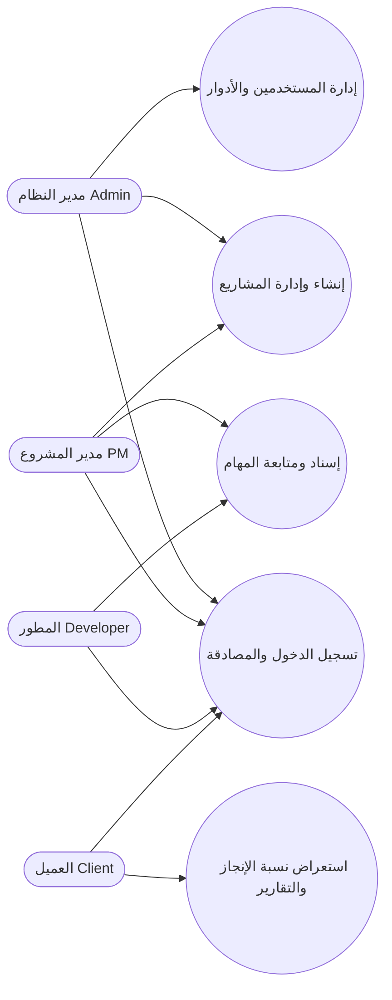

# 📝 مسودة مخرجات التحليل والمخططات — حسين الحيدري
**العضو:** حسين الحيدري  
**المشروع:** نظام إدارة ومتابعة المشاريع (PMMS)  

---

## 📌 1. نطاق النظام (System Scope)
*(انسخ هنا مخرجات البرومت الأول بعد مراجعتها وتنقيحها)*

---

## 📋 2. جدول المتطلبات الوظيفية (Functional Requirements)

| رمز المتطلب | الوحدة | وصف المتطلب الوظيفي | الأولوية |
| :--- | :--- | :--- | :---: |
| `FR-AUTH-01` | المصادقة | تسجيل الدخول وتحديد الصلاحيات عبر التوكن الآمن | High |
| `FR-AUTH-02` | الصلاحيات | توزيع الصلاحيات والأدوار عبر مصفوفة Spatie RBAC | High |
| `FR-PRJ-01` | المشاريع | إنشاء مشروع وتحديد تاريخ البداية والنهاية والميزانية | High |
| `FR-PRJ-02` | المشاريع | تقسيم المشروع إلى مراحل رئيسية (Milestones) | High |
| `FR-TSK-01` | المهام | إسناد المهام لأعضاء الفريق وتحديد الأولويات والحالة | High |
| `FR-TSK-02` | المهام | تحريك المهام عبر لوحة كانبان التفاعلية وتحديث الإنجاز | Medium |

---

## 🔒 3. جدول المتطلبات غير الوظيفية (Non-Functional Requirements)

| رمز المتطلب | التصنيف | المعيار والمواصفة الفنية |
| :--- | :--- | :--- |
| `NFR-SEC-01` | الأمان | تشفير كلمات المرور والتوكنات وتطبيق الحماية من هجمات CSRF و XSS |
| `NFR-PERF-01` | الأداء | دعم الاستجابة اللحظية والتخزين المحلي للعمل دون اتصال (Offline-First) |
| `NFR-USAB-01` | قابلية الاستخدام | واجهة مستخدم ثنائية الوضع (Dark/Light) ودعم كامل للغة العربية (RTL) |

---

## 📊 4. كود مخطط حالات الاستخدام (Use Case Diagram - Mermaid)
*(الصق هنا كود Mermaid الناتج من البرومت الثاني)*

---

## 📑 5. جداول مواصفات حالات الاستخدام التفصيلية (Use Case Specs)
*(يتم وضع الجداول الناتجة من البرومت الثاني هنا قبل تسليمها للأخ عبدالحميد الريشاني)*

