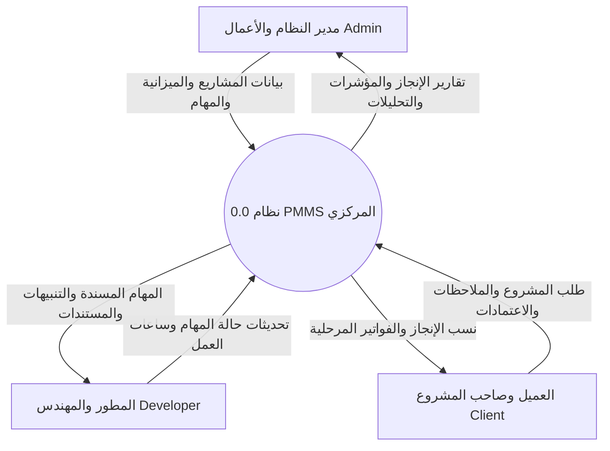

# 🗄️ معجم البيانات ومخططات التدفق — حمزه إبراهيم
**العضو:** حمزه إبراهيم  
**المشروع:** نظام إدارة ومتابعة المشاريع (PMMS)  

---

## 🌐 1. مخطط تدفق البيانات السياقي (Context Diagram - Level 0 DFD)

---

## 🗄️ 2. جدول قاموس البيانات (Data Dictionary) — عينة الجداول الأساسية

### جدول المشاريع (`projects` Table)
| اسم الحقل | النوع البرمجي | الطول | يقبل Null | القيد (Constraint) | الوصف بالعربية |
| :--- | :--- | :---: | :---: | :--- | :--- |
| `id` | BigInt | 20 | لا | Primary Key, Auto Increment | المعرف الفريد للمشروع |
| `title` | Varchar | 191 | لا | NOT NULL | اسم/عنوان المشروع |
| `description` | Text | -- | نعم | NULL | الوصف التفصيلي وأهداف المشروع |
| `client_id` | BigInt | 20 | نعم | Foreign Key -> `users(id)` | معرف العميل المرتبط بالمشروع |
| `manager_id` | BigInt | 20 | لا | Foreign Key -> `users(id)` | معرف مدير ومسؤول المشروع |
| `budget` | Decimal | 12,2 | لا | Default: 0.00 | الميزانية الإجمالية المعتمدة |
| `status` | Enum | -- | لا | Default: 'draft' | حالة المشروع (draft, active, completed, on_hold) |
| `start_date` | Date | -- | نعم | NULL | تاريخ بدء العمل الفعلي |
| `end_date` | Date | -- | نعم | NULL | تاريخ التسليم النهائي المتوقع |
| `created_at` | Timestamp | -- | لا | CURRENT_TIMESTAMP | تاريخ ووقت إنشاء السجل |

### جدول المهام (`tasks` Table)
| اسم الحقل | النوع البرمجي | الطول | يقبل Null | القيد (Constraint) | الوصف بالعربية |
| :--- | :--- | :---: | :---: | :--- | :--- |
| `id` | BigInt | 20 | لا | Primary Key, Auto Increment | المعرف الفريد للمهمة |
| `project_id` | BigInt | 20 | لا | Foreign Key -> `projects(id)` | معرف المشروع التابعة له المهمة |
| `title` | Varchar | 191 | لا | NOT NULL | عنوان المهمة |
| `description` | Text | -- | نعم | NULL | تفاصيل متطلبات المهمة |
| `status` | Enum | -- | لا | Default: 'pending' | حالة المهمة (pending, in_progress, review, done) |
| `priority` | Enum | -- | لا | Default: 'medium' | الأولوية (low, medium, high, urgent) |
| `assigned_to` | BigInt | 20 | نعم | Foreign Key -> `users(id)` | معرف المطور المسندة إليه المهمة |
| `due_date` | Date | -- | نعم | NULL | الموعد النهائي للإنجاز |

---

## 🧩 3. مخطط علاقات الكيانات (ERD)
*(يتم وضع كود الـ ERD الكامل الناتج من أداة الذكاء الاصطناعي هنا لتسليمه للأخوين محمد الرقاص وعبدالحميد الريشاني)*

